# YOU-PRD


| 版本号 | 作者 | 修改时间 | 备注 |
| --- | --- | --- | --- |
| v1.0.0 | 王卓 | 46327 | PRD 初始化 |
| v1.0.1 | 王卓、蔡占豪 | 46328 | 对齐了“浏览瞬间”与“瞬间分享” |

## 产品介绍

YOU 是属于用户自己的记忆平台，用户可在 Yours 浏览自己发布的所有瞬间，在 Related 浏览本人所在同行、圈子内当前有权查看的瞬间。

## 角色术语


| 角色 | 定义 |
| --- | --- |
| 用户 | 使用 YOU 记录、整理和回顾记忆的人，拥有自己的账号和记忆空间。 |
| 瞬间作者 | 发布瞬间的用户，负责编辑、删除该瞬间，以及管理其关联和分享。 |
| 时光所有者 | 拥有并管理某个时光的用户，可以调整时光信息、内容、整理方式、自动更新及分享设置。 |
| 同行创建者 | 发起某次同行的用户，也是该同行的初始管理者。 |
| 同行管理者 | 拥有某个同行管理权限的用户，可以按权限管理同行信息、成员及状态等。 |
| 同行成员 | 加入某个同行的用户，可以浏览同行内容、关联自己发布的瞬间，参与共同记录。 |
| 圈子创建者 | 创建某个圈子的用户，也是该圈子的初始管理者。 |
| 圈子管理者 | 拥有某个圈子管理权限的用户，可以按权限管理圈子信息、成员及分享内容等。 |
| 圈子成员 | 加入某个圈子的用户，可以浏览圈子可见内容、分享自己的内容并参与互动。 |

## 业务术语

### 瞬间

瞬间是用户发布的一条生活记录，即图文帖子，是 YOU 中最基本的内容单位。

一个瞬间以文字、图片或图文组合的形式记录用户的经历，可以包含标题、标签、心情、时间、地点等信息。

用户通过底部的“＋”发布瞬间。发布时，可以选择将瞬间关联到同行、分享到圈子，也可以仅为自己保留。

用户可以通过搜索寻找自己发布的瞬间，以及本人所在同行、圈子中当前有权查看的所有瞬间；搜索范围为两者并集，不受当前浏览 Tab 限制。

一个瞬间由下面元素组成：

- 标题

- 文案（普通文本格式，不加入富文本）

- 组图（零到多张图片）

- 标签

- 心情

- 时间

- 地点

- 参与人员

- 可见范围（分享到的同行与圈子；未分享时仅作者可见）

- 评论

### 时光

时光是由多个相关瞬间组成的集合，类似一本可以持续整理的相册，帮助用户回顾某段经历、某个主题或某个地方的记录。

时光可以由 AI 自动整理形成，也可以由用户设置标签等条件形成，或由用户手动选择瞬间创建。

一个瞬间可以同时属于多个时光。加入时光不会产生新的瞬间，瞬间仍然保留为独立记录。

自动整理的时光可以随着新增瞬间持续更新；手动整理的时光由用户自行维护其中包含的瞬间。

一个时光由下面元素组成：

- 时光名称：用于识别这个时光，可由用户填写或由 AI 建议。

- 时光线：将时光中包含的瞬间按照瞬间时间排列，呈现经历的过程。

- 参与人员：这个时光所记录经历中的参与者，不代表查看权限。

- 整理方式：说明这个时光通过 AI、指定条件还是手动选择进行整理。

- 整理条件：采用按条件整理时，保存用户设置的标签等条件。

### 同行码

同行码是用于加入指定同行的凭证。用户通过扫描或输入同行码加入对应同行。

“瞬间”是基本内容单位，“同行”负责组织一次共同经历，“时光”负责进一步整理相关瞬间，关系就连起来了。

### 同行

同行是围绕一次共同经历建立的记录空间，包含成员关联到其中的多条瞬间。

用户发布瞬间时，可以选择将瞬间关联到某个同行。不同成员发布的瞬间共同组成这次经历的记录。

同行中的瞬间可以在成员的“瞬间”页面中浏览，也可以参与成员的时光整理。关联到同行不会复制瞬间，也不会改变瞬间的作者。

一个同行由下面元素组成：

- 同行名称：这次共同经历的名称，例如“毕业旅行”。

- 同行介绍：对这次经历的简要描述，选填。

- 同行成员：加入该同行的用户，包含创建者。

- 瞬间列表：成员关联到该同行的瞬间，按照瞬间时间排列。

- 同行码：用于邀请其他用户加入该同行的凭证。

### 圈子

圈子是由一组用户组成的持续分享空间，成员可以将自己发布的瞬间分享到圈子，供其他成员浏览和互动。

圈子围绕一群人建立，可以承载不同时间、不同经历中的瞬间。例如家人圈子、好友圈子、社团圈子。

圈子可以一键发起一个同行。

一个圈子由下面元素组成：

- 圈子名称：用于识别圈子，例如“我们一家人”。

- 圈子介绍：对圈子的简要描述，选填。

- 圈子成员：加入该圈子的用户，包含创建者。

- 瞬间列表：成员分享到该圈子的瞬间。

- 圈子码：用于邀请其他用户加入该圈子的凭证。

## 功能设计

### 瞬间模块


| 功能 | 功能范围 |
| --- | --- |
| 发布瞬间 | 输入正文、添加图片，填写或选择其他信息；选择是否关联同行、分享到圈子 |
| AI 辅助填写 | 提供标题、标签、心情等建议，由用户选择是否采纳 |
| 浏览瞬间 | 浏览本人发布及所在同行中的瞬间，区分作者和来源 |
| 查看瞬间详情 | 查看完整正文、图片、时间、地点等，以及关联的同行、时光和分享圈子 |
| 搜索瞬间 | 支持关键词、条件组合及自然语言描述搜索 |
| 编辑瞬间 | 修改本人发布的内容和相关信息 |
| 删除瞬间 | 删除本人发布的瞬间，处理它与时光、同行、圈子的关联 |
| 分享瞬间 | 将已有瞬间分享到圈子 |
| 管理瞬间关联与分享 | 为已有瞬间添加或取消同行关联，增加或取消圈子分享 |
| 评论与评论管理 | 查看、发表评论，删除有权管理的评论 |
| 草稿与发布失败处理 | 暂存未完成内容，发布失败后保留内容并支持重试 |

#### 【M01】发布瞬间

功能说明

用户通过底部“＋”创建生活记录，填写文字、图片及其他信息，选择是否关联同行、分享到圈子。发布成功后形成一条独立瞬间。

使用者

已登录用户；发布成功后成为该瞬间作者。

触发条件

用户点击底部“＋”，选择文字记录或从相册选择多张图片。

用户流程

- 正常流程：进入发布页，填写内容及信息，设置关联和分享范围，检查后发布，进入瞬间详情。

- 异常流程：内容不符合要求时提示修改；图片处理或发布失败时保留内容；关联对象失效时提示重新选择；离开页面时进入草稿处理。


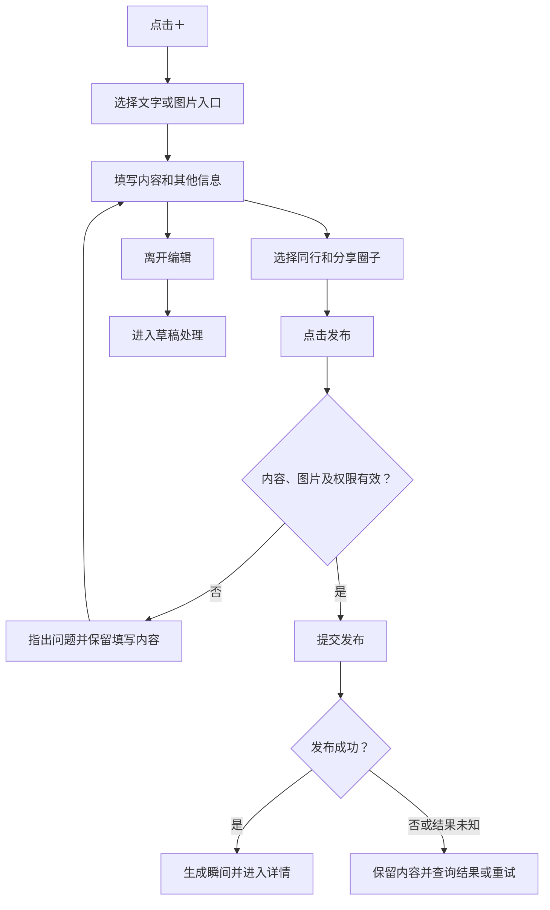

业务规则


| 规则编号 | 规则名称 | 规则描述 | 异常处理 |
| --- | --- | --- | --- |
| M01-BR01 | 发布身份 | 用户须登录后发布，作者由当前账号确定，不可自行指定其他作者。 | 未登录时引导登录，并保留可恢复的编辑内容。 |
| M01-BR02 | 最小内容 | 正文去除空白后有内容，或至少有一张有效图片；标题选填，正文采用普通文本。 | 仅填写标题或其他附加信息时不允许发布，提示添加正文或图片。 |
| M01-BR03 | 图片就绪 | 图片须完成读取、校验和上传；支持追加、移除和排序，发布后按确认顺序展示。 | 标记失败图片，允许重试或移除，不将未成功的图片静默忽略。 |
| M01-BR04 | 信息填写 | 记忆时间默认当前日期，可修改；标题、标签、心情、地点及参与人员可选填。 | 时间无效时提示修正；可选信息为空不阻止发布。 |
| M01-BR05 | 关联与可见性 | 最多关联一个本人所在的同行，可分享到多个本人所在的圈子；提交前展示实际可见范围。 | 对象失效或权限变化时阻止本次提交，提示重新确认，不自动扩大或缩小范围。 |
| M01-BR06 | 单次发布 | 一次发布操作只生成一条瞬间，关联和分享均引用该瞬间；仅在发布结果确定后显示成功。 | 重复提交返回同一结果；结果未知时先查询，失败内容交由 M12 保留和重试。 |

验收规则


| 验收编号 | 验收场景 | 预期结果 |
| --- | --- | --- |
| M01-AC01 | 仅填写有效正文发布 | 发布成功，标题和图片允许为空。 |
| M01-AC02 | 仅选择有效图片发布 | 发布成功，组图顺序与用户确认顺序一致。 |
| M01-AC03 | 正文为空且无图片 | 不发布，提示补充内容，其他填写信息保留。 |
| M01-AC04 | 同时关联同行并分享到两个圈子 | 只生成一个瞬间，建立对应关系，展示完整可见范围。 |
| M01-AC05 | 重复点击发布或提交后断网 | 不产生重复瞬间；保留内容并能够确认原提交结果。 |

#### 【M02】AI 辅助填写

功能说明

根据用户已输入的正文和图片生成标题、标签、心情等建议，由用户逐项决定是否采纳。

使用者

正在发布或编辑本人瞬间的用户。

触发条件

编辑页已有可供分析的正文或图片，用户主动点击 AI 辅助填写。

用户流程

- 正常流程：发起分析，查看建议，选择采纳、修改后采纳或拒绝，返回编辑。

- 异常流程：内容不足时提示补充；分析失败时允许重试；分析期间原内容变化时提示建议可能过期。


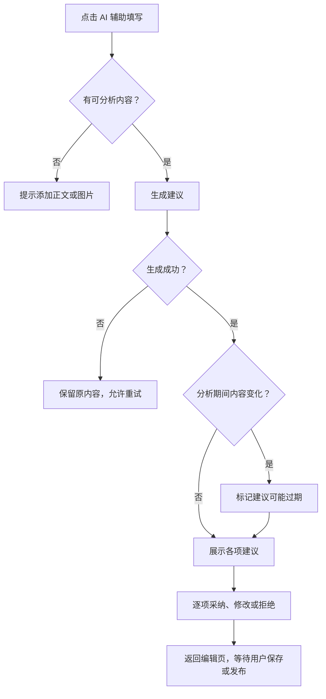

业务规则


| 规则编号 | 规则名称 | 规则描述 | 异常处理 |
| --- | --- | --- | --- |
| M02-BR01 | 用户主动触发 | AI 分析基于当前瞬间的内容，并遵循用户的 AI 使用授权。 | 缺少内容时提示补充；未授权时提供授权说明，不开始分析。 |
| M02-BR02 | 建议确认 | 建议与已填写值区分展示，支持逐项采纳、修改或拒绝。 | 未采纳的建议不得写入正式字段。 |
| M02-BR03 | 覆盖保护 | AI 不自动覆盖用户已经填写或确认的值。 | 采纳与原值冲突的建议时展示替换结果，由用户确认。 |
| M02-BR04 | 建议时效 | 建议对应生成时的内容版本；原内容变化后须标记可能过期。 | 用户可保留使用、拒绝或重新生成，不自动应用过期建议。 |
| M02-BR05 | 发布独立 | AI 辅助不是发布必经步骤；采纳建议不等于发布或保存。 | AI 失败、超时或取消时仍可手动填写并继续发布。 |

验收规则


| 验收编号 | 验收场景 | 预期结果 |
| --- | --- | --- |
| M02-AC01 | 对已有图文发起分析 | 展示可供选择的建议，不直接更改原字段。 |
| M02-AC02 | 只采纳标题建议 | 仅标题发生变化，标签和心情保持原值。 |
| M02-AC03 | 分析期间修改正文 | 返回结果被标记可能过期，由用户决定是否使用。 |
| M02-AC04 | AI 请求失败或拒绝全部建议 | 原内容完整保留，可以继续手动发布。 |

#### 【M03】浏览瞬间

功能说明

瞬间页设置 Yours、Related 两个 Tab。Yours 展示本人发布的所有瞬间；Related 展示本人所在同行和圈子中当前有权查看的所有瞬间，按瞬间 ID 去重并保留全部有效来源。本人发布且已分享的瞬间可同时出现在两类列表。

使用者

已登录用户。

触发条件

用户进入瞬间页面，或从其他页面返回瞬间列表。

用户流程

- 正常流程：选择 Yours 或 Related，加载对应范围的瞬间，浏览卡片及作者、来源，打开详情；Related 详情展示具体同行、圈子入口，点击进入对应空间，返回时保留原 Tab 与条件。

- 异常流程：Yours 无内容时引导发布；Related 无内容时展示加入同行或圈子引导；加载失败可重试；退出空间、取消分享或内容失效后，重新计算来源，已无有效来源且非本人记录则移除。


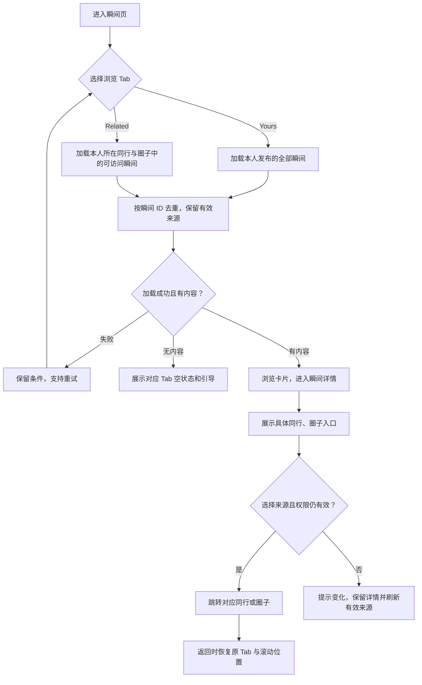

业务规则


| 规则编号 | 规则名称 | 规则描述 | 异常处理 |
| --- | --- | --- | --- |
| M03-BR01 | 列表范围 | Yours 展示本人发布的所有瞬间；Related 展示本人所在同行和圈子中当前有权查看的所有瞬间，按瞬间 ID 去重并保留全部有效来源。本人发布且已分享的瞬间可同时出现在两个 Tab。 | 超出所选 Tab 范围或当前无权查看的内容不返回、不展示。 |
| M03-BR02 | 去重展示 | 同一瞬间在列表中只展示一次，可同时标记“本人发布”“来自某同行”等来源。 | 多来源结果合并，不复制卡片。 |
| M03-BR03 | 作者与摘要 | 卡片区分作者和来源；有图展示图片摘要，无图展示文字摘要，缺少标题时仍可正常展示。 | 信息缺失时采用正文摘要或合理占位，不生成虚假信息。 |
| M03-BR04 | 排序与连续性 | 固定按记忆时间倒序，同一时间按瞬间 ID 倒序；使用游标加载更多，保持顺序和去重。 | 加载失败保留已加载内容，允许继续重试。 |
| M03-BR05 | 动态权限 | 内容删除、同行关联取消或成员权限失效后，不再继续展示对应内容。 | 刷新或再次访问时移除失效内容，不泄露正文及图片。 |

验收规则


| 验收编号 | 验收场景 | 预期结果 |
| --- | --- | --- |
| M03-AC01 | 同时存在本人和同行成员瞬间 | 均能浏览，作者与来源清晰可辨。 |
| M03-AC02 | 本人瞬间同时关联同行 | 列表只展示一次，来源信息完整。 |
| M03-AC03 | 存在纯文字、纯图片瞬间 | 两类卡片均正常展示并可进入详情。 |
| M03-AC04 | 加载更多失败或权限被撤销 | 已加载的有效内容保留，失败可重试，失效内容不再可读。 |

#### 【M04】查看瞬间详情

功能说明

展示瞬间完整内容、作者、元信息、评论及当前有权访问的具体同行、圈子入口。Related 来源的瞬间必须可跳转到相应同行或圈子；目标失效时提示并保留当前详情。编辑、分享仅向作者开放。

使用者

瞬间作者，以及通过同行或圈子获得查看权限的用户。

触发条件

用户从列表、时光、同行、圈子、搜索结果或通知中打开瞬间。

用户流程

- 正常流程：打开详情，校验权限，展示完整内容，浏览组图、关联信息和评论。

- 异常流程：内容不存在、已删除或无权限时展示不可访问状态；局部加载失败时提供重试。


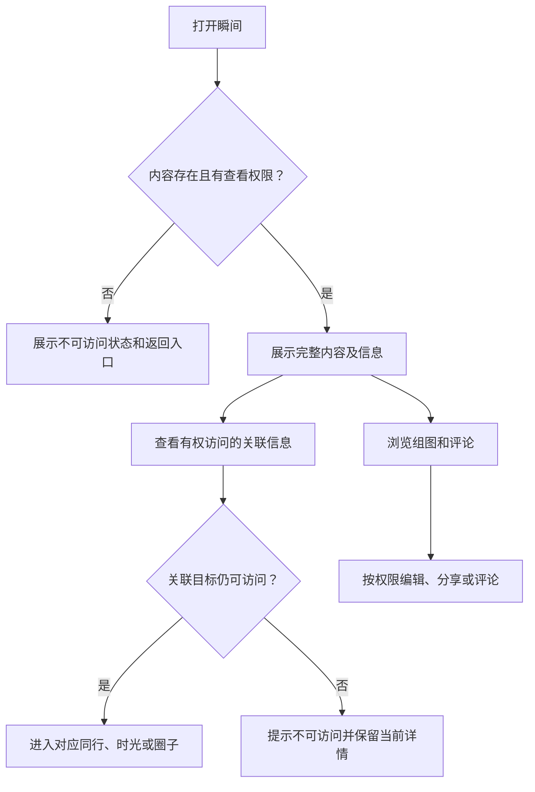

业务规则


| 规则编号 | 规则名称 | 规则描述 | 异常处理 |
| --- | --- | --- | --- |
| M04-BR01 | 访问校验 | 每次打开详情须校验内容状态和当前权限，不能仅依赖入口曾经可见。 | 无权限或已删除时不返回正文、图片、评论等内容。 |
| M04-BR02 | 完整展示 | 展示已填写的标题、普通文本正文、组图、标签、心情、记忆时间、地点和参与人员。 | 未填写的选填项可隐藏；图片失败展示重试状态，不阻断文字阅读。 |
| M04-BR03 | 关联信息隔离 | 作者可查看该瞬间的全部关联；其他用户仅能查看其有权访问的同行、时光和圈子关联。 | 不展示无权限关联的名称、成员或入口。 |
| M04-BR04 | 操作权限 | 作者具有编辑、删除、关联及分享管理入口；其他用户仅获得其被授权的浏览和评论操作。 | 越权操作隐藏入口，直接请求仍须拒绝。 |
| M04-BR05 | 原内容一致 | 不同入口打开同一瞬间，读取相同的最新原内容；入口不创建副本。 | 原内容变更后更新展示；删除后统一不可访问。 |

验收规则


| 验收编号 | 验收场景 | 预期结果 |
| --- | --- | --- |
| M04-AC01 | 作者打开包含全部信息的瞬间 | 完整展示内容、关联及管理入口。 |
| M04-AC02 | 同行成员打开关联瞬间 | 可阅读内容，但不能编辑或删除原瞬间。 |
| M04-AC03 | 用户无权访问某个分享圈子或时光 | 详情不暴露该关联的信息。 |
| M04-AC04 | 从旧通知打开已删除或已失权瞬间 | 展示不可访问状态，不泄露原内容。 |

#### 【M05】搜索瞬间

功能说明

通过关键词、结构化条件或自然语言搜索本人发布的瞬间，以及本人所在同行、圈子中当前有权查看的瞬间。搜索取两者并集，按瞬间 ID 去重，不受当前 Yours / Related 浏览 Tab 限制，结果展示作者和有效来源。

使用者

已登录用户。

触发条件

用户在瞬间搜索入口输入关键词或自然语言描述。

用户流程

- 正常流程：输入搜索内容或条件，在本人瞬间与相关同行、圈子瞬间的并集中检索，展示去重结果、匹配依据及来源，进入原瞬间详情。退出空间或分享撤销后，结果同步重新校验。

- 异常流程：输入为空时不发起搜索；自然语言有歧义时允许确认或调整；失败可重试；无结果可修改条件。


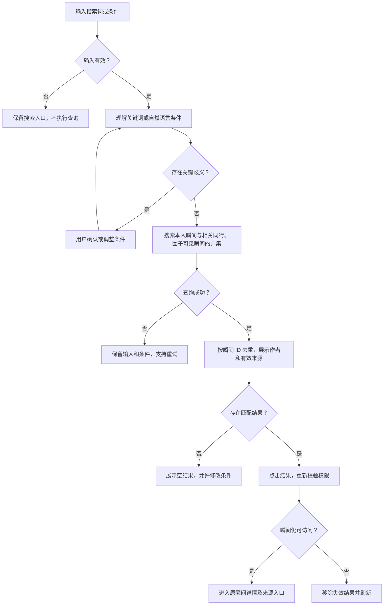

业务规则


| 规则编号 | 规则名称 | 规则描述 | 异常处理 |
| --- | --- | --- | --- |
| M06-BR01 | 搜索范围 | 搜索范围为本人发布的瞬间与本人所在同行、圈子中当前有权查看的瞬间的并集，不受当前浏览 Tab 限制；按瞬间 ID 去重，并明确展示当前范围。 | 无权限内容不得进入匹配结果、摘要或数量统计。 |
| M06-BR02 | 关键词匹配 | 支持检索标题、正文、标签、地点及参与人员；可叠加结构化条件。 | 空白输入不执行；无结果时保留原输入和条件。 |
| M06-BR03 | 自然语言解释 | 将“去年和小满去海边”等描述解释为可理解的时间、人物、主题等条件。 | 关键解释不确定时允许确认或修改，不将猜测作为确定事实。 |
| M06-BR04 | 结果真实性 | 每项结果必须指向真实存在且可访问的瞬间，匹配说明须来自原内容或明确标记为语义推断。 | 不生成虚构瞬间；无法支持的匹配依据不展示。 |
| M06-BR05 | 搜索降级 | 自然语言服务不可用时，可继续使用关键词和人工条件。 | 明确提示自然语言搜索不可用，不将降级结果冒充原搜索结果。 |

验收规则


| 验收编号 | 验收场景 | 预期结果 |
| --- | --- | --- |
| M06-AC01 | 使用正文关键词并叠加时间条件 | 返回同时满足关键词和时间条件的授权瞬间。 |
| M06-AC02 | 输入自然语言描述 | 展示搜索解释及对应结果，可调整解释后重新查询。 |
| M06-AC03 | 数据中存在匹配但无权查看的瞬间 | 不返回该内容、摘要或可推知其存在的统计。 |
| M06-AC04 | 自然语言服务失败 | 输入保留，提示失败，可重试或改用关键词搜索。 |

#### 【M06】编辑瞬间

功能说明

作者修改已发布瞬间的内容及相关信息，保存后各模块引用同一份最新内容。

使用者

瞬间作者。

触发条件

作者在详情中点击编辑。

用户流程

- 正常流程：进入编辑，修改内容和信息，校验后保存，返回详情。

- 异常流程：内容不合规或权限变化时提示修正；发生版本冲突时保留本地修改；保存失败时支持重试；离开时提示草稿处理。


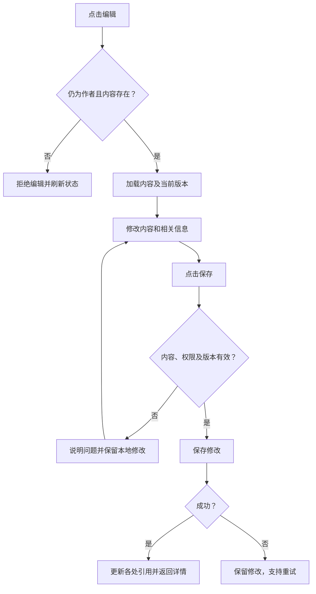

业务规则


| 规则编号 | 规则名称 | 规则描述 | 异常处理 |
| --- | --- | --- | --- |
| M07-BR01 | 作者权限 | 仅作者可编辑原瞬间，同行或圈子管理身份不自动获得编辑权。 | 越权请求拒绝；内容已删除时退出编辑并保留可恢复的本地文字。 |
| M07-BR02 | 内容校验 | 保存遵循发布的最小内容规则；图片可追加、删除和排序。 | 修改后正文及图片均为空时不保存，提示补充。 |
| M07-BR03 | 身份与时间 | 编辑不改变瞬间 ID、作者和原发布时间；允许修改记忆发生时间，记录更新时间。 | 修改不可编辑字段的请求被拒绝。 |
| M07-BR04 | 跨模块一致 | 同行、圈子及手动时光引用更新后的原内容；条件或 AI 自动更新时光按其整理规则重新评估。 | 自动整理未完成时展示处理中状态；不得将所有手动关系一并清除。 |
| M07-BR05 | 冲突与关联变更 | 保存须检查版本；同行和圈子变更遵循 M10，并在提交前确认新增可见范围。 | 版本冲突时不静默覆盖，允许查看最新内容并重新处理本地修改。 |

验收规则


| 验收编号 | 验收场景 | 预期结果 |
| --- | --- | --- |
| M07-AC01 | 作者修改正文并调整组图 | 保存成功，各入口读取最新内容及顺序。 |
| M07-AC02 | 非作者尝试编辑 | 无编辑入口，直接请求也被拒绝。 |
| M07-AC03 | 修改记忆时间或标签 | 列表排序更新，自动整理按规则重新评估，手动时光归属保留。 |
| M07-AC04 | 两个页面先后保存同一瞬间 | 后提交的旧版本收到冲突提示，本地修改不丢失。 |

#### 【M07】删除瞬间

功能说明

作者删除本人瞬间，同时处理原内容、评论及其在时光、同行、圈子中的引用。

使用者

瞬间作者。

触发条件

作者在瞬间管理入口选择删除。

用户流程

- 正常流程：选择删除，阅读影响说明，确认后删除，返回列表。

- 异常流程：取消则不变更；删除失败可重试；内容已删除时返回已删除状态；结果未知时查询状态。


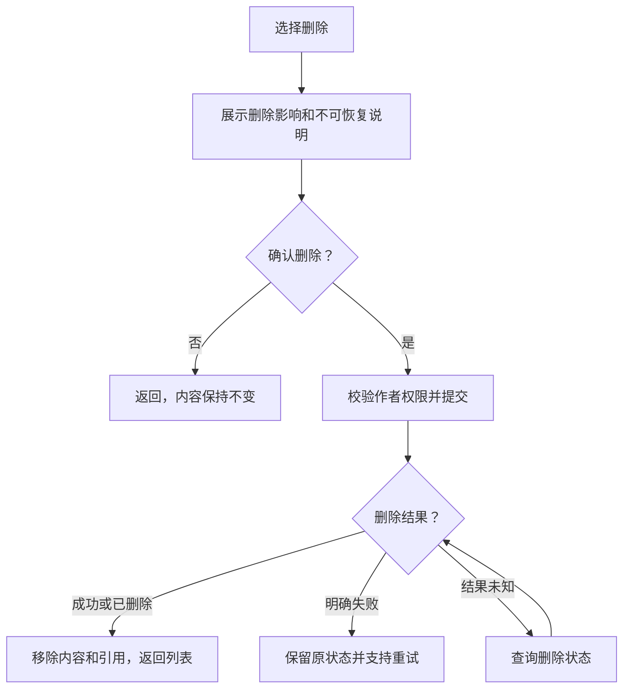

业务规则


| 规则编号 | 规则名称 | 规则描述 | 异常处理 |
| --- | --- | --- | --- |
| M08-BR01 | 删除权限 | 仅作者可删除原瞬间；空间管理者移除分享或关联不等于删除原内容。 | 非作者删除请求被拒绝。 |
| M08-BR02 | 明确确认 | 删除前说明会影响原瞬间、评论及全部关联，且不可恢复。 | 未确认不执行；取消后不改变内容及关系。 |
| M08-BR03 | 全面失效 | 删除后原瞬间、图片访问和评论不可继续使用，时光、同行、圈子引用及数量随之更新。 | 清理异步进行时先阻断访问，再完成资源和索引清理。 |
| M08-BR04 | 派生内容处理 | 搜索摘要、AI 问答引用及动态回顾中的相关内容须失效、移除或重新生成。 | 重新处理完成前不继续提供包含已删除内容的派生结果。 |
| M08-BR05 | 重复与失败 | 重复删除不产生额外影响；仅在删除已确认生效后提示成功。 | 失败可重试，结果未知先查询，不假报成功。 |

验收规则


| 验收编号 | 验收场景 | 预期结果 |
| --- | --- | --- |
| M08-AC01 | 删除确认页选择取消 | 原内容、评论和全部关联保持不变。 |
| M08-AC02 | 删除被多个模块引用的瞬间 | 各处不能再访问原内容，引用和数量得到更新。 |
| M08-AC03 | 删除后通过旧链接或搜索访问 | 不返回正文、图片、评论及旧摘要。 |
| M08-AC04 | 重复提交删除或删除中断网 | 不产生异常副作用，可查询并确定最终结果。 |

#### 【M08】分享瞬间

功能说明

将本人已发布的瞬间分享到同行或圈子，使对应空间有效成员获得查看及互动入口；引用原瞬间，不复制内容或改变作者。

本功能侧重首次或追加分享；完整的关联与分享调整由 M09 承接。

使用者

瞬间作者，同时为目标同行或圈子成员。

触发条件

作者从瞬间详情选择分享至同行或圈子，或在圈子中选择本人已有瞬间。

用户流程

- 正常流程：选择瞬间和目标同行或圈子，确认可见范围，提交分享，查看成功状态。

- 异常流程：无可选同行或圈子时展示引导；目标失效或权限变化时重新选择；失败保留选择并允许重试。


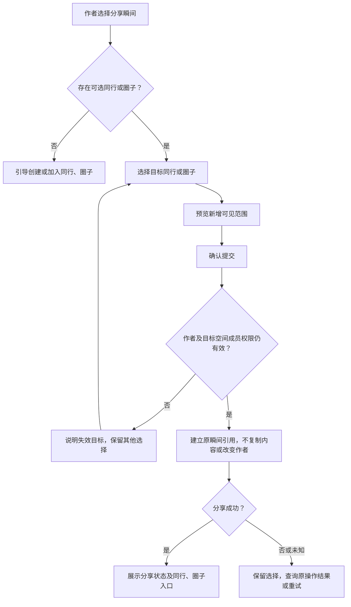

业务规则


| 规则编号 | 规则名称 | 规则描述 | 异常处理 |
| --- | --- | --- | --- |
| M09-BR01 | 分享资格 | 仅作者可以分享本人已发布、未删除的瞬间，目标为本人所在且有效的圈子。 | 不符合资格的内容或圈子不可选，提交时再次校验。 |
| M09-BR02 | 引用分享 | 分享建立圈子与原瞬间的关系，不复制内容，不改变作者。 | 同一瞬间重复分享到同一圈子时返回已有分享状态。 |
| M09-BR03 | 范围确认 | 支持多圈子选择，提交前展示新增可见人群及统一评论的可见口径。 | 未确认不提交；目标变化时要求重新确认。 |
| M09-BR04 | 批次结果 | 同一次多圈子分享作为一个操作提交，全部目标校验通过后生效。 | 任一目标失效时整次不生效，标明问题目标并保留选择。 |
| M09-BR05 | 可追溯状态 | 成功后作者可在详情查看已分享圈子；其他用户仅见其有权访问的关系。 | 刷新失败时不猜测分享状态，提供重新查询。 |

验收规则


| 验收编号 | 验收场景 | 预期结果 |
| --- | --- | --- |
| M09-AC01 | 将一条瞬间分享到两个有效圈子 | 两圈子均可见，原瞬间仍只有一条。 |
| M09-AC02 | 再次分享到已分享圈子 | 不生成重复内容或重复关系。 |
| M09-AC03 | 提交前被移出某个目标圈子 | 整次不生效，说明问题并允许调整选择。 |
| M09-AC04 | 同行成员尝试分享他人瞬间 | 操作被拒绝，不改变原瞬间可见范围。 |

#### 【M09】管理瞬间关联与分享

功能说明

作者为已有瞬间添加、更换或取消同行关联，增加或取消圈子分享，并查看调整后的实际可见范围。

使用者

瞬间作者。

触发条件

作者在详情或编辑页进入关联与分享设置。

用户流程

- 正常流程：查看现有关系，调整同行和圈子，核对增减影响，确认保存。

- 异常流程：关系版本冲突或目标权限失效时保留选择并提示；保存失败时不改变已生效状态。


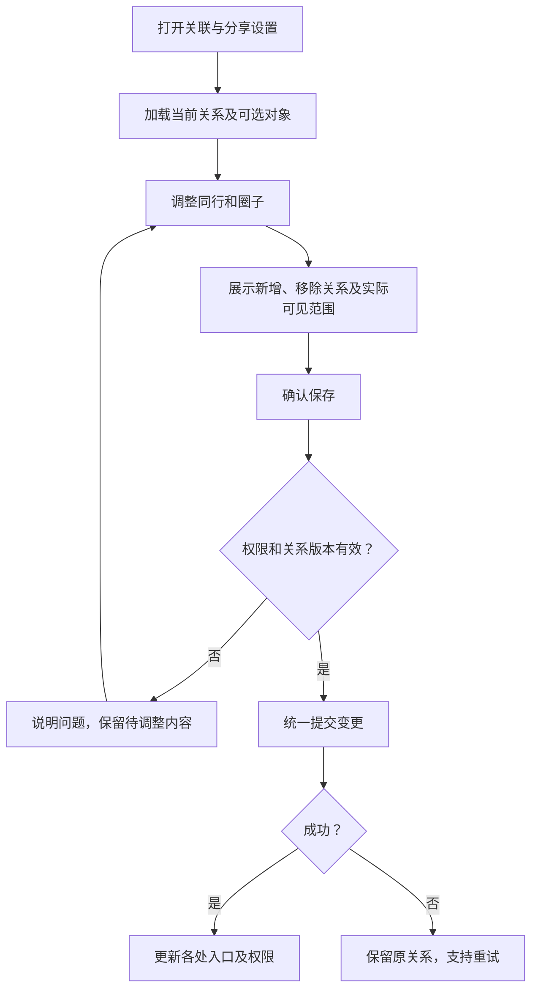

业务规则


| 规则编号 | 规则名称 | 规则描述 | 异常处理 |
| --- | --- | --- | --- |
| M10-BR01 | 作者管理 | 作者可管理本人瞬间的同行关联和圈子分享；空间管理者的移除操作由对应空间模块处理。 | 非作者进入本功能时拒绝操作。 |
| M10-BR02 | 关系数量 | 最多关联一个同行，可分享到多个圈子；更换同行须明确移除原关系并建立新关系。 | 不允许同时保存多个同行，不静默保留旧关联。 |
| M10-BR03 | 有效权限并集 | 查看权限来自作者身份、有效同行关联和有效圈子分享的并集。 | 撤销某一关系后，如用户仍有其他有效来源，继续允许访问，不能误判为完全失权。 |
| M10-BR04 | 关系与原内容分离 | 取消关系不删除原瞬间及评论；失去全部来源的用户无法继续读取，相关时光引用同步失效。 | 不复制或删除原瞬间；动态引用与派生结果按权限重新处理。 |
| M10-BR05 | 整体保存 | 一次调整统一校验并生效，提交前展示可见范围变化。 | 权限失效、版本冲突或提交失败时不部分生效，保留待修改内容。 |

验收规则


| 验收编号 | 验收场景 | 预期结果 |
| --- | --- | --- |
| M10-AC01 | 将同行 A 更换为同行 B | A 中不再关联，B 中建立关联，原瞬间 ID 不变。 |
| M10-AC02 | 取消一个圈子分享，保留另一个 | 被取消圈子不再显示，保留圈子仍可访问。 |
| M10-AC03 | 某用户同时通过同行和圈子可见，只撤销圈子 | 该用户仍可通过同行访问。 |
| M10-AC04 | 取消全部关联和分享 | 仅作者可见，原瞬间及评论保留。 |
| M10-AC05 | 提交期间目标失效或发生版本冲突 | 不部分保存，提示问题且保留用户调整。 |

#### 【M10】评论与评论管理

功能说明

有权查看瞬间的用户查看和发表评论；评论者删除自己的评论，瞬间作者管理该瞬间下的评论。

使用者

瞬间作者、获得瞬间查看权限的同行成员或圈子成员，以及评论作者。

触发条件

用户打开瞬间评论区域，点击发表评论或删除评论。

用户流程

- 正常流程：查看评论，输入内容并发布；有删除权限时确认后删除。

- 异常流程：空白评论不提交；失去查看权限时停止读取和发布；发送失败保留输入；删除失败可重试。


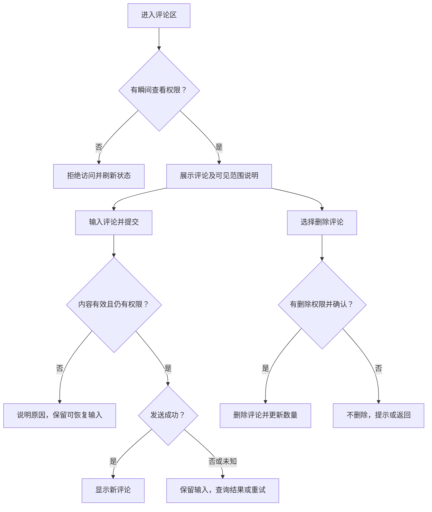

业务规则


| 规则编号 | 规则名称 | 规则描述 | 异常处理 |
| --- | --- | --- | --- |
| M11-BR01 | 访问与发布资格 | 用户须当前有权查看瞬间，才能读取或发表评论；作者可评论自己的私人瞬间。 | 权限撤销或瞬间删除时拒绝读取和提交。 |
| M11-BR02 | 评论归属与范围 | 评论统一归属原瞬间，不按圈子复制；所有当前有权查看该瞬间的用户可见。发布前展示说明。 | 不展示“仅本圈子可见”等与实际范围不符的提示。 |
| M11-BR03 | 内容及身份 | 评论采用普通文本，去除空白后不能为空；记录真实作者、发布时间和唯一标识。 | 空白内容不提交；身份信息由账号确定，不接受伪造。 |
| M11-BR04 | 删除权限 | 评论者可删除自己的评论，瞬间作者可删除该瞬间下的任何评论；空间管理员不自动获得评论删除权。 | 越权删除被拒绝；已删除评论重复操作返回已删除状态。 |
| M11-BR05 | 顺序与重试 | 评论按发布时间正序展示；同一次发送重试不得产生重复评论。 | 失败保留输入，结果未知先查询；删除后正文不再展示，数量同步更新。 |

验收规则


| 验收编号 | 验收场景 | 预期结果 |
| --- | --- | --- |
| M11-AC01 | 有查看权限的成员发表评论 | 成功展示作者、时间和正文，各入口读取同一评论。 |
| M11-AC02 | 用户提交空白评论 | 不产生评论，提示填写内容。 |
| M11-AC03 | 评论者、瞬间作者和无权用户分别删除评论 | 前两者按规则成功，无权用户被拒绝。 |
| M11-AC04 | 用户在发送前失去瞬间访问权 | 发送被拒绝，评论和瞬间内容不再可读。 |
| M11-AC05 | 发送后断网并重试 | 可确定原发送结果，不生成重复评论。 |

#### 【M11】草稿与发布失败处理

功能说明

暂存未完成的新增或编辑内容，支持恢复继续；发布或保存失败时保留内容，帮助用户确认结果并重试。

使用者

正在创建或编辑本人瞬间的用户。

触发条件

用户开始填写内容、离开编辑、主动保存草稿，或发布和保存出现失败、超时、断网等情况。

用户流程

- 正常流程：编辑中自动暂存或主动保存，退出后从草稿入口恢复，继续编辑并发布。

- 异常流程：暂存失败明确提示；恢复时关联对象失效或原瞬间已变化时重新确认；发布结果未知时先查询再决定是否重试。


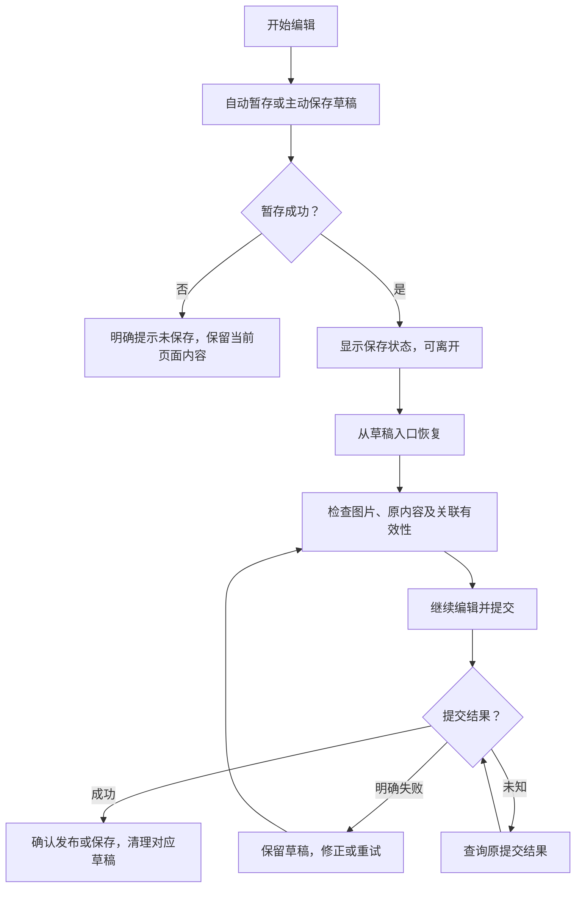

业务规则


| 规则编号 | 规则名称 | 规则描述 | 异常处理 |
| --- | --- | --- | --- |
| M12-BR01 | 草稿归属与内容 | 草稿归当前账号，保存文字、图片及顺序、元信息、关联和分享选择；编辑草稿还须记录原瞬间及版本。 | 不向其他账号展示；无法保存的资源明确标记，不伪装为完整草稿。 |
| M12-BR02 | 保存与离开 | 支持自动暂存、主动保存及草稿列表中的继续编辑和删除；离开时可保存、放弃或继续编辑。 | 尚未完成保存时不能提示已保存；保存失败须明确说明风险并保留当前内容。 |
| M12-BR03 | 草稿不生效 | 草稿不进入瞬间、时光、同行、圈子，不授予其他用户查看权；未保存编辑不覆盖已发布版本。 | 意外恢复或重复暂存也不得自动发布。 |
| M12-BR04 | 恢复校验 | 恢复时检查图片可用性、同行和圈子资格，以及原瞬间是否存在、版本是否变化。 | 标记失效项，允许修复或移除；不静默改变分享范围或覆盖新版本。 |
| M12-BR05 | 结果未知与重试 | 区分明确失败和结果未知；未知时查询原操作，确认未成功后再重试，沿用原操作标识。 | 未查询清楚前不创建第二条瞬间；重试无效内容前要求修正。 |
| M12-BR06 | 草稿清理 | 仅在服务端确认发布或保存成功后清理对应草稿；用户主动删除草稿须确认。 | 发布失败保留草稿；成功后的重复恢复不再次发布，提示查看已发布内容。 |

验收规则


| 验收编号 | 验收场景 | 预期结果 |
| --- | --- | --- |
| M12-AC01 | 填写图文及分享选择，保存草稿后重新进入 | 恢复内容、图片顺序和选择，失效项有明确标记。 |
| M12-AC02 | 编辑已发布瞬间后暂存退出 | 已发布内容不变，恢复后可继续修改。 |
| M12-AC03 | 草稿存储失败或图片无法恢复 | 显示真实失败状态，不提示已完整保存，可继续处理。 |
| M12-AC04 | 发布请求已成功但客户端未收到响应 | 查询后进入原瞬间，不重复发布，并清理对应草稿。 |
| M12-AC05 | 发布明确失败后重新进入 | 草稿完整保留，可修正或重试。 |
| M12-AC06 | 恢复时圈子资格失效或原瞬间版本变化 | 提示重新确认或解决冲突，不自动改变权限、不覆盖最新内容。 |


### 时光模块


| 功能 | 功能范围 |
| --- | --- |
| AI 自动整理时光 | 根据瞬间内容、时间、地点等关联，发现并形成时光 |
| 按条件创建时光 | 用户设置标签、时间范围、地点等条件，收集符合条件的瞬间 |
| 按描述创建时光 | 用户描述需求，例如“整理我学习吉他的过程”，由 AI 查找相关瞬间 |
| 手动创建时光 | 用户选择若干瞬间，自行组成时光 |
| 浏览时光 | 浏览已有时光，查看名称、封面、包含的瞬间数量等 |
| 查看时光详情 | 通过时光线回顾其中的瞬间，查看参与人员等信息 |
| 编辑时光信息 | 修改名称、介绍、封面等 |
| 调整时光内容 | 手动添加、移出瞬间，纠正整理结果 |
| 管理自动更新 | 修改整理条件，控制是否继续自动补充瞬间 |
| 删除时光 | 删除集合，保留其中独立存在的瞬间 |
| 分享时光 | 将时光分享到圈子 |
| AI 生成时光回顾 | 根据其中的瞬间生成概述或回顾文字，支持用户修改 |

#### 【T01】AI 自动整理时光

功能说明

系统根据用户可用于整理的瞬间，识别共同经历、主题、时间或地点关联，形成时光，并提供名称、封面和整理说明。

使用者

已开启 AI 自动整理的用户。

触发条件

用户开启自动整理后，首次执行整理；或新增、编辑瞬间及访问范围变化后，系统触发整理任务。

用户流程

- 正常流程：系统检查设置和内容范围，识别关联，形成或更新时光，用户查看结果并按需纠正。

- 异常流程：授权不足时不执行；关联依据不足时不创建；任务失败支持重试；处理期间内容失效时重新校验。


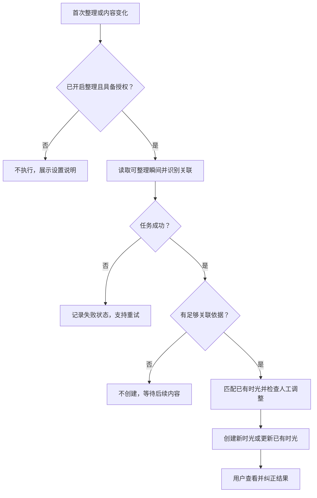

业务规则


| 规则编号 | 规则名称 | 规则描述 | 异常处理 |
| --- | --- | --- | --- |
| T01-BR01 | 授权与范围 | 仅在用户开启并授权后执行，只读取当前允许整理的瞬间。 | 未开启或授权撤销时停止任务；不得继续读取或提交新的整理结果。 |
| T01-BR02 | 整理依据 | 依据内容、时间、地点等真实信息组织时光，提供可理解的整理说明；不将推测写成事实。 | 关联依据不足时不创建，不为凑数量强行分组。 |
| T01-BR03 | 重复控制 | 同一用户下主题和内容高度重合的结果优先更新已有自动时光；一个瞬间仍可属于多个不同主题的时光。 | 疑似重复但无法确定时不直接合并，保留原集合并提供建议。 |
| T01-BR04 | 人工调整优先 | 已确认的名称、封面、手动添加和排除记录不得被自动任务直接覆盖。 | 自动结果与人工调整冲突时保留人工结果，必要时提示用户确认。 |
| T01-BR05 | 结果一致 | 任务提交前再次检查内容权限和时光状态，同一任务重试不重复创建集合。 | 内容失效时排除后重新计算；时光已删除时终止，不因旧任务恢复。 |

验收规则


| 验收编号 | 验收场景 | 预期结果 |
| --- | --- | --- |
| T01-AC01 | 开启自动整理且存在明确关联的瞬间 | 形成时光，展示整理方式、依据和来源瞬间。 |
| T01-AC02 | 内容之间缺少可靠关联 | 不生成无依据的时光，不虚构共同经历。 |
| T01-AC03 | 同一任务重试或新增相同主题内容 | 不重复创建相同集合，按规则更新已有时光。 |
| T01-AC04 | 用户已排除某瞬间，或任务期间撤销授权 | 排除记录得到保留；撤销授权后不提交新整理结果。 |

#### 【T02】按描述创建时光

功能说明

用户通过自然语言描述整理目标，由 AI 查找相关瞬间，用户确认理解结果、内容范围及更新方式后创建时光。

使用者

已登录且已授权相关 AI 能力的用户。

触发条件

用户选择按描述创建，并输入整理需求。

用户流程

- 正常流程：输入描述，AI 解释需求并查找内容，用户调整结果，确认后创建。

- 异常流程：描述不清时请求补充；无结果时允许改写描述；AI 失败支持重试；生成结果不会自动视为用户确认。


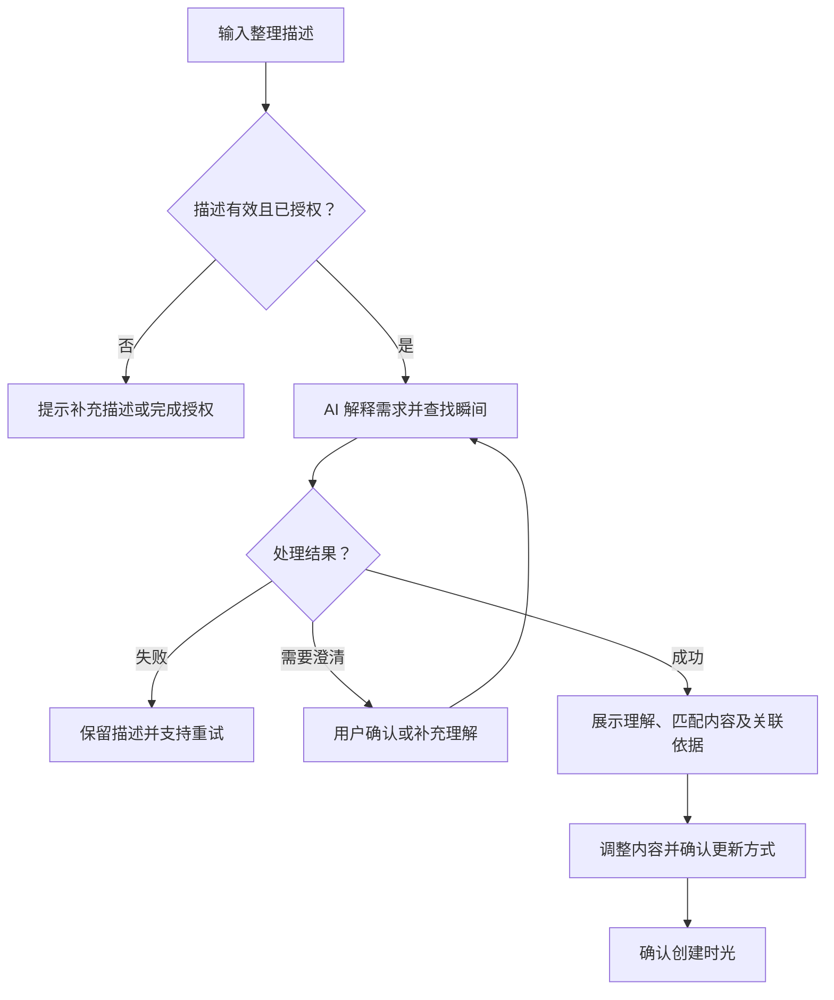

业务规则


| 规则编号 | 规则名称 | 规则描述 | 异常处理 |
| --- | --- | --- | --- |
| T03-BR01 | 描述理解 | 展示 AI 对主题、时间、人物等要求的解释，关键歧义由用户确认。 | 不确定的条件不作为事实直接执行，允许修改解释或补充描述。 |
| T03-BR02 | 来源真实 | 匹配结果必须对应真实、可整理的瞬间，并提供关联依据。 | 不返回虚构或失权内容；无匹配时说明未找到。 |
| T03-BR03 | 用户确认 | 用户可移除误匹配内容、补充遗漏内容，确认后才创建。 | 离开或拒绝结果不创建正式时光。 |
| T03-BR04 | 更新方式 | 用户确认是否持续更新；启用时保存经确认的整理描述及解释。 | 无法形成可持续执行的规则时不擅自开启，说明仅保存当前结果。 |
| T03-BR05 | 任务状态 | 展示处理中、成功或失败状态；重复确认和任务重试不得重复创建。 | 失败保留描述及已完成调整；结果未知时先查询原操作。 |

验收规则


| 验收编号 | 验收场景 | 预期结果 |
| --- | --- | --- |
| T03-AC01 | 输入“整理我学习吉他的过程” | 展示需求解释、匹配瞬间及依据，等待确认。 |
| T03-AC02 | 描述中的人物或时间有歧义 | 允许澄清后重新匹配，不直接采用未经确认的解释。 |
| T03-AC03 | 用户移除误匹配内容后创建 | 时光保存用户确认后的内容和更新方式。 |
| T03-AC04 | AI 失败或重复点击确认 | 描述和调整不丢失，不生成重复时光。 |

#### 【T03】手动创建时光

功能说明

用户主动选择若干瞬间，填写时光名称等信息，创建由自己维护的集合。

使用者

已登录用户，创建后成为时光所有者。

触发条件

用户选择手动创建时光，或从瞬间选择界面进入创建流程。

用户流程

- 正常流程：浏览并选择瞬间，核对选中内容，填写信息，确认创建。

- 异常流程：未选择内容时提示补充；选中内容失效时提示重新确认；创建失败保留选择。


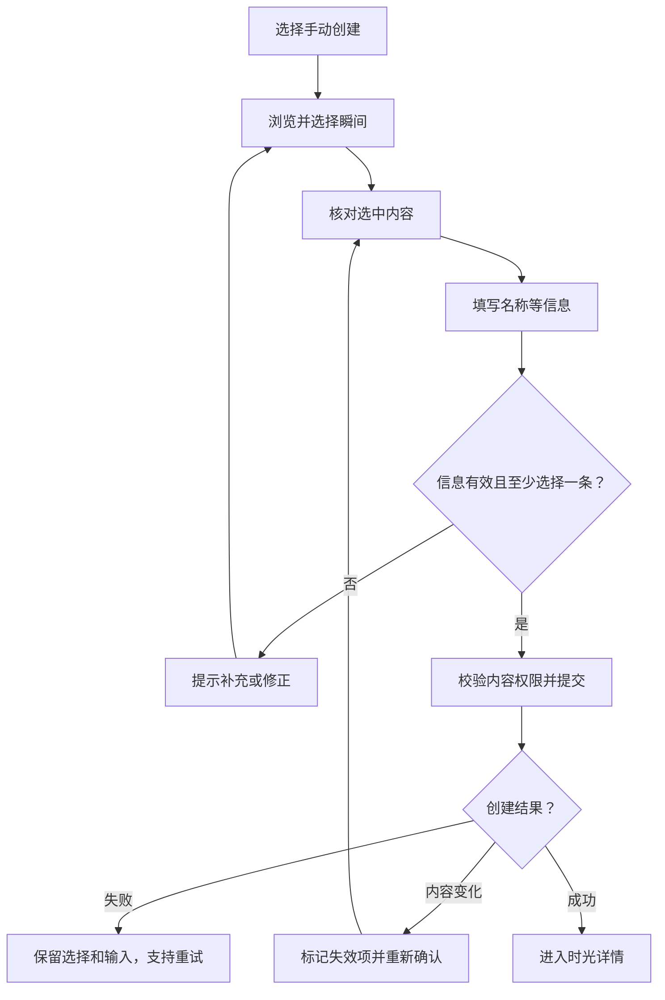

业务规则


| 规则编号 | 规则名称 | 规则描述 | 异常处理 |
| --- | --- | --- | --- |
| T04-BR01 | 选择范围 | 可选择本人瞬间及通过同行获得整理权限的瞬间。 | 无权限内容不展示为可选项，提交时再次校验。 |
| T04-BR02 | 创建内容 | 手动创建至少选择一条瞬间，名称须为有效非空文本。 | 缺少内容或名称时不创建，定位到待补充项。 |
| T04-BR03 | 引用与去重 | 同一瞬间在一个时光中只保留一个引用，可同时属于其他时光。 | 重复选择合并，不复制原瞬间。 |
| T04-BR04 | 手动维护 | 整理方式标记为手动，后续新增瞬间不会自动进入。 | 用户希望持续更新时引导明确设置自动整理规则，不隐式切换。 |
| T04-BR05 | 提交一致 | 提交前校验全部选中内容和创建状态。 | 失效项明确标记并由用户重新确认；失败保留选择和输入。 |

验收规则


| 验收编号 | 验收场景 | 预期结果 |
| --- | --- | --- |
| T04-AC01 | 选择若干有效瞬间并填写名称 | 成功创建手动时光，不产生瞬间副本。 |
| T04-AC02 | 同一瞬间重复选择 | 集合只包含一次该瞬间。 |
| T04-AC03 | 创建后发布相似主题的新瞬间 | 新瞬间不会自动加入该手动时光。 |
| T04-AC04 | 提交时选中内容已失效 | 标记失效项，保留其他选择，等待重新确认。 |

#### 【T04】浏览时光

功能说明

浏览本人已有时光，查看名称、封面、瞬间数量及整理方式，并进入详情。

使用者

已登录用户。

触发条件

用户进入时光页面或从详情返回。

用户流程

- 正常流程：加载时光列表，浏览集合摘要，继续加载或打开详情。

- 异常流程：无时光时展示创建引导；加载失败可重试；已删除集合从列表移除。


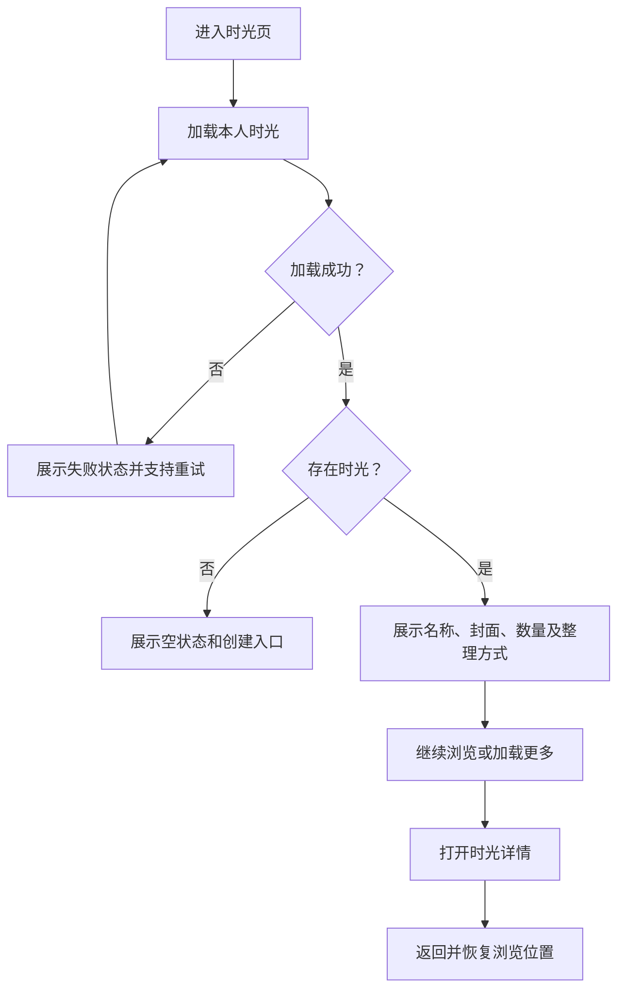

业务规则


| 规则编号 | 规则名称 | 规则描述 | 异常处理 |
| --- | --- | --- | --- |
| T05-BR01 | 列表范围 | 时光主页展示本人拥有的时光；他人分享到圈子的时光从圈子进入。 | 不将无权限集合混入列表或统计。 |
| T05-BR02 | 摘要准确 | 名称、封面、瞬间数量和整理方式反映当前有效状态，数量按独立瞬间计算。 | 内容变化后更新摘要；不可用封面替换为有效封面或占位。 |
| T05-BR03 | 默认顺序 | 建议按时光创建时间倒序展示，同一创建时间采用稳定顺序。 | 翻页或刷新时去重，避免随机跳动。 |
| T05-BR04 | 空与失败区分 | 无内容、加载失败、任务处理中分别展示。 | 不将加载失败显示为“没有时光”，不因失败删除已加载集合。 |
| T05-BR05 | 返回连续性 | 从详情返回保留合理的浏览位置，删除和内容更新后同步刷新对应卡片。 | 集合已删除时移除卡片，并调整当前位置。 |

验收规则


| 验收编号 | 验收场景 | 预期结果 |
| --- | --- | --- |
| T05-AC01 | 存在不同整理方式的时光 | 卡片正确展示各自信息及整理方式。 |
| T05-AC02 | 某时光内瞬间失效或被移出 | 数量和封面按有效内容更新。 |
| T05-AC03 | 首次加载失败或用户没有时光 | 分别展示失败重试状态和空状态。 |
| T05-AC04 | 打开详情后返回 | 恢复浏览位置，已删除或更新的卡片得到同步。 |

#### 【T05】查看时光详情

功能说明

通过时光线浏览集合中的瞬间，查看时光信息、参与人员、整理方式、整理条件及回顾文字。

使用者

时光所有者，以及通过圈子分享获得时光入口的用户。

触发条件

用户从时光列表或圈子分享打开时光。

用户流程

- 正常流程：检查集合访问权限，加载当前用户可查看的内容，展示时光线，打开原瞬间。

- 异常流程：集合删除或失权时展示不可访问状态；部分瞬间无权查看时过滤；局部加载失败支持重试。


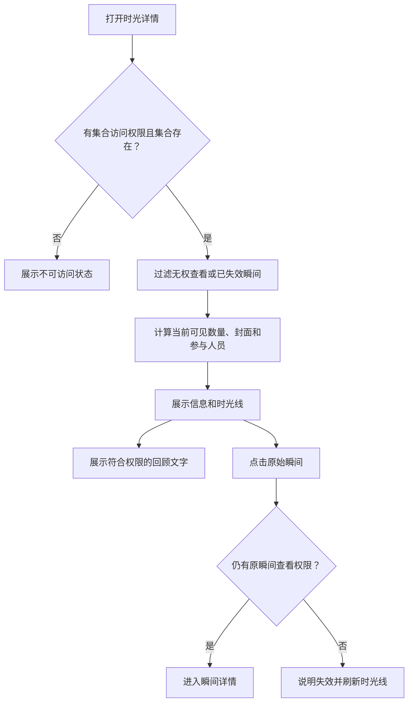

业务规则


| 规则编号 | 规则名称 | 规则描述 | 异常处理 |
| --- | --- | --- | --- |
| T06-BR01 | 双层权限 | 能打开时光不代表能查看全部瞬间；集合和瞬间分别校验。 | 集合失权则阻断访问；个别瞬间失权则过滤，不展示其摘要。 |
| T06-BR02 | 时间线口径 | 按记忆发生时间正序展示，同一时间按发布时间正序，形成稳定的经历顺序。 | 时间缺失的历史异常数据单独标记，不伪造时间。 |
| T06-BR03 | 信息披露 | 所有者可查看整理条件；其他用户仅查看分享信息及其可见内容，不暴露包含私人信息的条件。 | 无权限字段不返回，不通过隐藏样式代替权限控制。 |
| T06-BR04 | 参与人员含义 | 参与人员表示经历中的参与者，自动汇总时仅使用当前可见瞬间中的有效信息，不授予访问权。 | 信息不完整时保持为空或注明来源有限，不推断不存在的人物。 |
| T06-BR05 | 原内容与回顾 | 瞬间引用保持最新；回顾仅在当前用户有权查看全部引用来源时展示。 | 原内容失效时刷新时光线；回顾权限不足时隐藏正文并说明受限。 |

验收规则


| 验收编号 | 验收场景 | 预期结果 |
| --- | --- | --- |
| T06-AC01 | 集合包含不同日期的瞬间 | 按记忆时间形成稳定正序时光线，可进入原记录。 |
| T06-AC02 | 圈子成员只能查看部分瞬间 | 仅展示有权内容，对应数量、封面和参与人员不泄露其他内容。 |
| T06-AC03 | 用户无权查看回顾中的某个来源 | 不展示该回顾正文。 |
| T06-AC04 | 时光或其中瞬间在打开前被删除 | 时光删除则不可访问；单条瞬间删除则过滤并更新展示。 |

#### 【T06】编辑时光信息

功能说明

所有者修改时光名称、介绍和封面等展示信息，不直接改变其中包含的瞬间。

使用者

时光所有者。

触发条件

所有者在详情中点击编辑信息。

用户流程

- 正常流程：进入编辑，修改信息及封面，检查后保存。

- 异常流程：信息无效或封面处理失败时提示；版本冲突时保留修改；保存失败可重试；离开时确认是否放弃。


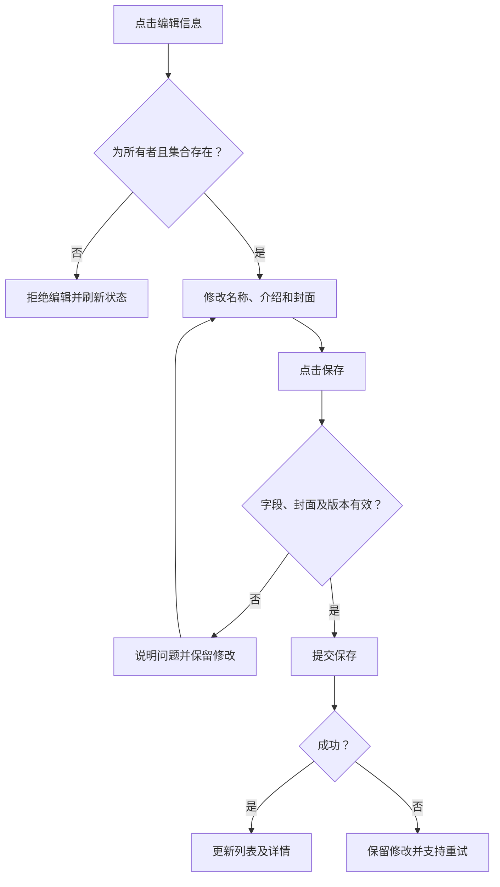

业务规则


| 规则编号 | 规则名称 | 规则描述 | 异常处理 |
| --- | --- | --- | --- |
| T07-BR01 | 编辑权限 | 仅所有者可修改时光信息，圈子成员或圈子管理者不因分享而获得编辑权。 | 越权请求拒绝，集合删除后停止编辑。 |
| T07-BR02 | 名称与介绍 | 名称须为有效非空文本，介绍选填；不强制不同集合名称唯一。 | 名称为空时不保存并提示；介绍为空可正常保存。 |
| T07-BR03 | 封面处理 | 可从时光内图片选择或上传封面；从瞬间选取的封面须保留来源关联。 | 读取或上传失败时不替换原封面；来源失权时更换或隐藏。 |
| T07-BR04 | 修改边界 | 编辑信息不改变瞬间归属、整理条件和分享范围；人工确认信息不被后续 AI 自动覆盖。 | 请求夹带其他变更时拒绝或转入对应设置流程明确确认。 |
| T07-BR05 | 版本保护 | 保存时检查当前版本，避免覆盖其他页面已保存的修改。 | 版本冲突时保留本地输入，展示最新信息供重新处理。 |

验收规则


| 验收编号 | 验收场景 | 预期结果 |
| --- | --- | --- |
| T07-AC01 | 所有者修改名称、介绍和有效封面 | 列表、详情及分享入口展示新信息。 |
| T07-AC02 | 名称为空或封面上传失败 | 不提交无效修改，原信息保留。 |
| T07-AC03 | 信息修改后再次执行 AI 整理 | 人工确认的名称和封面不被自动覆盖。 |
| T07-AC04 | 非所有者操作或两个页面产生冲突 | 越权被拒绝；冲突不静默覆盖且本地输入保留。 |

#### 【T07】调整时光内容

功能说明

所有者手动添加或移出瞬间，纠正自动整理结果；操作只改变集合引用，不修改或删除原瞬间。

使用者

时光所有者。

触发条件

所有者在详情中选择添加瞬间、移出瞬间或调整内容。

用户流程

- 正常流程：查看当前内容，选择添加或移出项，检查变化后保存。

- 异常流程：待添加内容失权时提示；版本冲突时重新确认；保存失败保留调整；移出全部内容时明确提示。


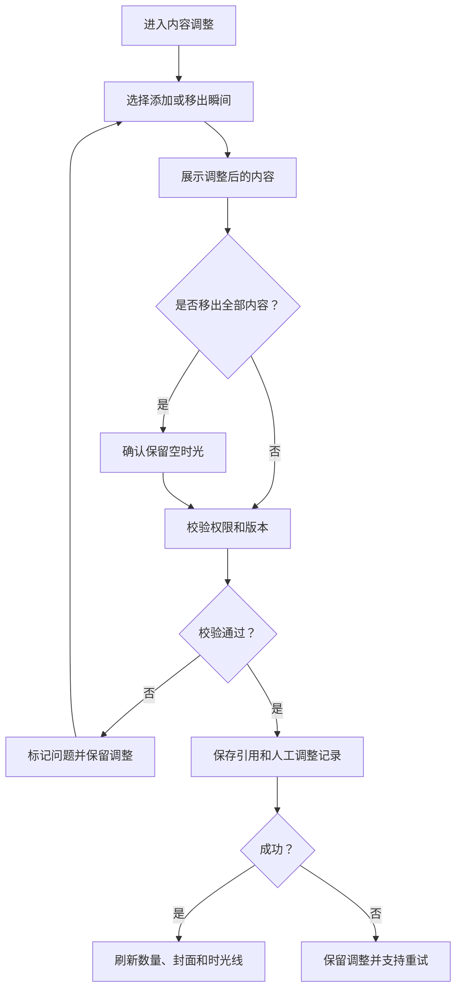

业务规则


| 规则编号 | 规则名称 | 规则描述 | 异常处理 |
| --- | --- | --- | --- |
| T08-BR01 | 调整权限 | 仅所有者调整内容；新增瞬间须属于当前可整理范围。 | 越权操作拒绝，失效内容不可添加。 |
| T08-BR02 | 引用操作 | 添加和移出仅改变当前时光引用，同一瞬间不重复加入，不影响其他时光。 | 重复添加返回已存在状态，不生成副本。 |
| T08-BR03 | 人工覆盖 | 自动时光中，手动移出的瞬间记为排除，手动添加的瞬间记为保留；允许用户撤销这些人工覆盖。 | 后续自动任务不得擅自重新加入排除项或移除保留项。 |
| T08-BR04 | 空集合 | 允许移出全部瞬间并保留时光，须明确确认。 | 未确认不清空；清空后采用占位封面，数量为零。 |
| T08-BR05 | 派生更新 | 保存后更新数量、封面、参与人员和时光线；已有回顾标记为需要检查或更新。 | 回顾不自动覆盖用户编辑稿；失效来源不得继续向无权用户展示。 |

验收规则


| 验收编号 | 验收场景 | 预期结果 |
| --- | --- | --- |
| T08-AC01 | 添加和移出若干有效瞬间 | 当前时光引用更新，原瞬间及其他时光不受影响。 |
| T08-AC02 | 从自动时光排除某条瞬间后再次更新 | 被排除瞬间不会自动回到集合。 |
| T08-AC03 | 手动加入不符合自动条件的瞬间 | 在权限有效期间保留，自动任务不擅自移除。 |
| T08-AC04 | 移出全部内容并确认 | 集合保留为空，数量和封面更新，回顾标记需要检查。 |

#### 【T08】管理自动更新

功能说明

所有者修改整理条件或经确认的整理描述，控制时光是否继续自动维护内容。

使用者

时光所有者。

触发条件

所有者在详情中进入自动更新或整理设置。

用户流程

- 正常流程：查看现有方式和条件，修改设置，预览影响，保存后执行更新。

- 异常流程：条件无效时修正；描述无法执行时重新确认；任务失败保留已保存设置及上次有效结果。


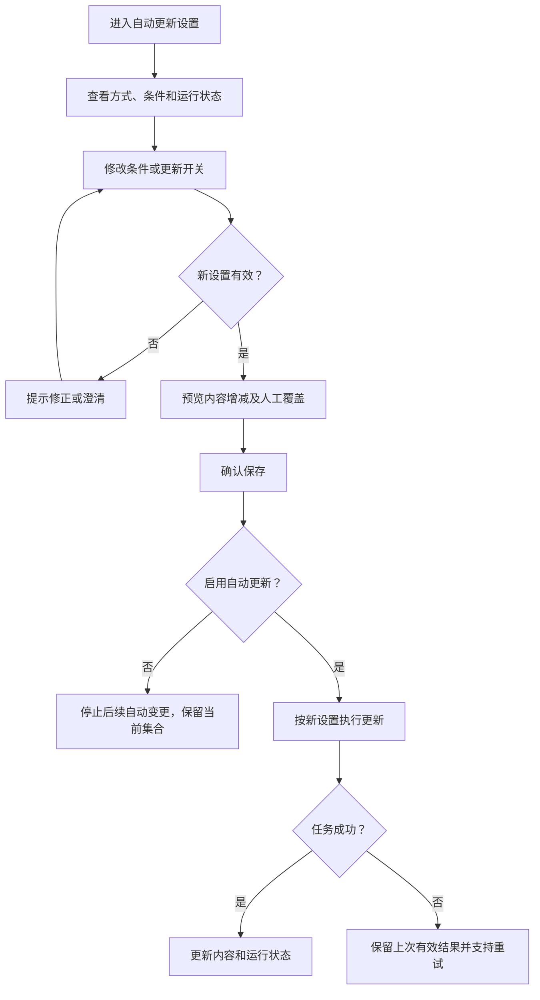

业务规则


| 规则编号 | 规则名称 | 规则描述 | 异常处理 |
| --- | --- | --- | --- |
| T09-BR01 | 适用方式 | AI、条件及可持续执行的描述整理可开启更新；手动时光须先明确配置整理方式。 | 不为手动集合自动推断条件并开启更新。 |
| T09-BR02 | 更新语义 | 开启后，新增或修改的瞬间按规则重新匹配；自动加入项不再匹配时移出，人工保留和排除继续优先。 | 任务失败保留上次有效结果，不提交半套内容。 |
| T09-BR03 | 关闭语义 | 关闭后冻结当前成员关系，不再因新增内容或条件匹配变化自动增减。 | 删除、失权等有效性处理仍继续，不能因关闭更新保留越权访问。 |
| T09-BR04 | 条件变更确认 | 修改条件或描述后预览可能的增减；重置人工覆盖须另行明确确认。 | 无效条件不保存，不因改条件清空人工纠正。 |
| T09-BR05 | 任务版本 | 任务须使用当前设置版本；旧版本任务不得覆盖新设置结果。 | 检测设置变化或关闭时终止旧任务提交，记录真实状态。 |

验收规则


| 验收编号 | 验收场景 | 预期结果 |
| --- | --- | --- |
| T09-AC01 | 开启更新后新增符合条件的瞬间 | 自动加入，人工排除项除外。 |
| T09-AC02 | 自动加入项修改后不再符合条件 | 自动移出；人工保留项继续保留。 |
| T09-AC03 | 关闭更新后新增内容或原内容失权 | 新内容不自动加入，失权内容仍不可访问。 |
| T09-AC04 | 更新运行时修改条件或关闭开关 | 旧任务不覆盖新设置，状态和结果一致。 |

#### 【T09】删除时光

功能说明

所有者删除时光集合及其整理设置、回顾和分享关系，保留其中独立存在的瞬间。

使用者

时光所有者。

触发条件

所有者在时光管理入口选择删除。

用户流程

- 正常流程：查看影响说明，确认删除，返回列表。

- 异常流程：取消则不修改；删除失败可重试；结果未知先查询；正在执行的整理任务终止提交。


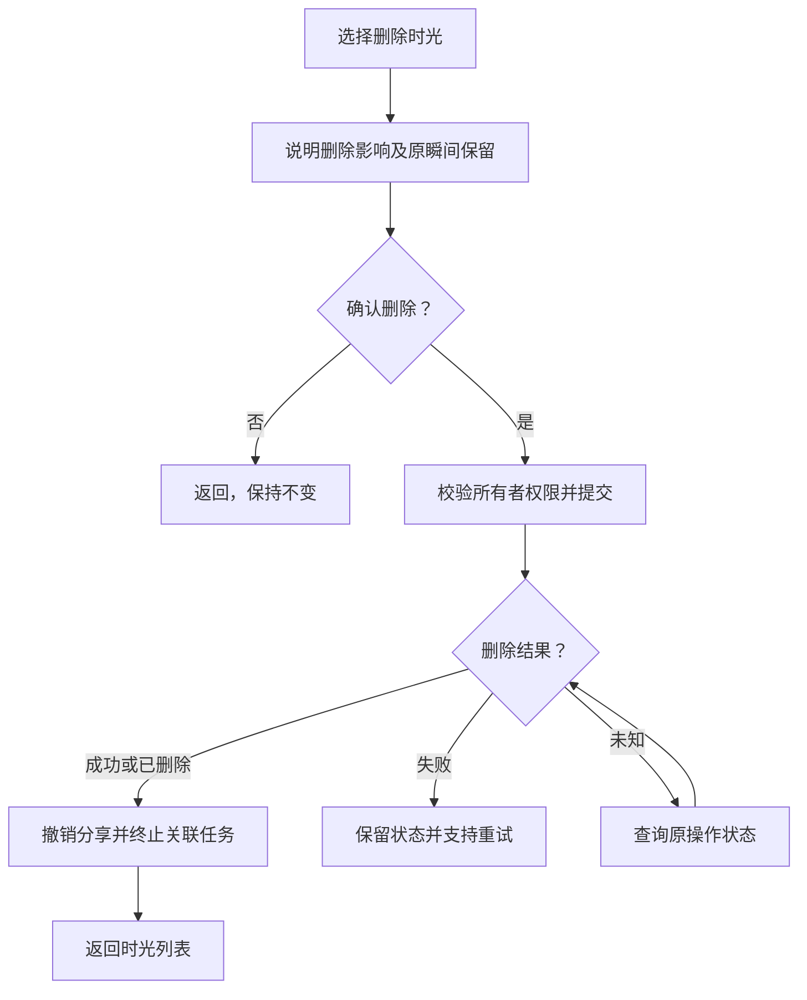

业务规则


| 规则编号 | 规则名称 | 规则描述 | 异常处理 |
| --- | --- | --- | --- |
| T10-BR01 | 删除资格 | 仅所有者可删除，须明确确认；建议采用不可恢复删除。 | 未确认或非所有者请求不执行。 |
| T10-BR02 | 集合边界 | 删除时光及其条件、人工调整、回顾、封面引用和分享关系，不删除原瞬间及原评论。 | 不向瞬间执行级联删除，不影响其他集合引用。 |
| T10-BR03 | 入口失效 | 删除后列表、圈子分享、搜索和旧链接不能继续提供该集合内容。 | 旧入口显示不可访问，不返回缓存正文。 |
| T10-BR04 | 任务终止 | 未完成整理和回顾任务不得继续写入已删除集合；自动任务不应立即重建同一结果。 | 终止旧任务提交，并保留必要的去重记录；用户主动重新创建不受限制。 |
| T10-BR05 | 幂等结果 | 重复删除不产生额外影响，成功状态以已确认结果为准。 | 结果未知先查询；失败不从界面永久移除有效集合。 |

验收规则


| 验收编号 | 验收场景 | 预期结果 |
| --- | --- | --- |
| T10-AC01 | 删除含多条瞬间的时光 | 集合消失，原瞬间和其他时光完整保留。 |
| T10-AC02 | 删除后从圈子或旧链接进入 | 无法再读取该时光内容。 |
| T10-AC03 | 整理任务运行中删除集合 | 任务不恢复集合、不写入已删除对象。 |
| T10-AC04 | 重复删除或提交后断网 | 不产生额外影响，可确定最终删除结果。 |

#### 【T10】分享时光

功能说明

所有者将已有时光分享到圈子，前提为时光涉及的用户集合 U 是目标圈子当前有效成员集合 C 的子集，即 U ⊆ C，集合相等也允许。可调整或撤销已有分享；各目标圈子独立校验。

使用者

时光所有者，同时为目标圈子成员。

触发条件

所有者在时光详情选择分享，或在圈子中选择本人已有时光。

用户流程

- 正常流程：汇总时光涉及用户集合，选择满足 U ⊆ C 的圈子，预览分享信息与原瞬间权限说明，提交时再次校验成员与时光版本，成功后建立分享入口。

- 异常流程：存在涉及用户不在目标圈子时禁止分享并说明原因；目标失效、成员变化或时光内容变化时重新校验；不得仅过滤不符合条件的参与者后绕过集合限制；提交失败保留选择并允许重试。


```mermaid
flowchart TD
 A["选择分享时光"] --> B["获取涉及用户集合 U 和目标圈子成员集合 C"]
 B --> C{"信息完整且 U 为 C 的子集？"}
 C -->|否| D["禁用目标并说明缺少成员或信息"]
 D --> E["调整圈子选择或时光内容"]
 E --> B
 C -->|是，含集合相等| F["预览分享信息与原瞬间权限说明"]
 F --> G["用户确认提交"]
 G --> H{"成员、内容版本及子集条件仍有效？"}
 H -->|否| I["保留选择，提示变化并重新校验"]
 I --> B
 H -->|是| J["建立圈子分享入口"]
 J --> K{"提交成功？"}
 K -->|否或未知| L["保留选择，查询结果或重试"]
 K -->|是| M["显示分享成功"]
 M --> N["后续时光或成员变化时重新校验"]
 N --> O{"仍满足子集条件？"}
 O -->|是| P["维持分享，按原瞬间权限展示"]
 O -->|否| Q["停止展示该分享，修正后重新分享"]
```

业务规则


| 规则编号 | 规则名称 | 规则描述 | 异常处理 |
| --- | --- | --- | --- |
| T11-BR01 | 分享资格 | 仅所有者可将未删除时光分享到本人所在的有效圈子。 | 越权、失效或已退出的圈子不可提交。 |
| T11-BR02 | 引用分享 | 分享引用原时光，不复制集合；内容和信息变化后各分享入口读取最新结果。 | 重复分享到同一圈子不生成重复入口。 |
| T11-BR03 | 原权限保留 | 分享时光不授予原瞬间权限；成员只看到自己可访问的瞬间，其他信息也按可见内容计算。 | 无可见瞬间时展示受限或空状态，不泄露隐藏数量、图片或参与人员。 |
| T11-BR04 | 分享信息确认 | 名称、介绍及用户上传封面属于分享信息，提交前明确预览；来源图片和回顾须继续检查权限。 | 无权查看来源时换用安全占位或隐藏回顾，不直接复用所有者视图。 |
| T11-BR05 | 撤销与退出 | 所有者可撤销分享；退出或被移出目标圈子、圈子解散时，该分享关系失效。 | 不删除原时光；用户仍有其他有效分享入口时按其他来源访问。 |
| T11-BR06 | 多目标提交 | 同次多圈子调整统一校验，全部通过后生效。 | 任一目标失效时整次不生效，保留选择并标明原因。 |

验收规则


| 验收编号 | 验收场景 | 预期结果 |
| --- | --- | --- |
| T11-AC01 | 将同一时光分享到两个圈子 | 建立两个入口，原时光仍只有一个。 |
| T11-AC02 | 不同成员对原瞬间的权限不同 | 各自看到的内容、数量和封面符合权限，无隐藏信息泄露。 |
| T11-AC03 | 回顾引用了某成员无权查看的瞬间 | 该成员不能读取该回顾正文。 |
| T11-AC04 | 撤销分享、退出圈子或圈子解散 | 对应分享入口失效，原时光及原瞬间保留。 |
| T11-AC05 | 多圈子提交中有一个目标失效 | 不部分生效，提示问题且保留选择。 |

#### 【T11】AI 生成时光回顾

功能说明

根据时光中的有效瞬间生成概述或回顾文字，提供原始依据，支持所有者修改、保存和重新生成。

使用者

已授权相关 AI 能力的时光所有者。

触发条件

所有者在时光详情点击生成回顾，或对已有回顾选择重新生成。

用户流程

- 正常流程：确认生成，读取有效来源，生成草稿，用户检查和修改后保存。

- 异常流程：无有效内容时不生成；任务失败允许重试；生成期间内容变化时标记过期；重新生成不直接覆盖已编辑文字。


```mermaid
flowchart TD
    A["点击生成或重新生成回顾"] --> B{"已授权且有有效内容？"}
    B -->|"否"| C["说明原因，不开始生成"]
    B -->|"是"| D["记录来源版本并生成草稿"]
    D --> E{"生成成功？"}
    E -->|"否"| F["保留原回顾，支持重试"]
    E -->|"是"| G{"来源是否发生变化？"}
    G -->|"是"| H["标记草稿可能过期"]
    G -->|"否"| I["展示草稿及原始依据"]
    H --> I
    I --> J["用户检查、修改或放弃"]
    J --> K{"确认保存？"}
    K -->|"是"| L["保存回顾及来源记录"]
    K -->|"否"| M["保留原有已保存回顾"]
```

业务规则


| 规则编号 | 规则名称 | 规则描述 | 异常处理 |
| --- | --- | --- | --- |
| T12-BR01 | 生成范围 | 仅使用该时光内所有者当前可访问的有效瞬间；无有效内容时不生成。 | 过滤删除或失权内容，内容不足时说明限制，不补写虚构经历。 |
| T12-BR02 | 事实依据 | 对时间、地点、人物和事件的描述须可追溯到原瞬间；推断明确标识，不编造引语。 | 无依据内容不进入正式结果，无法确定时采用保守表述。 |
| T12-BR03 | 草稿确认 | AI 输出先作为草稿，用户可修改、保存或放弃；保存前不替换已有正式回顾。 | 放弃或生成失败时保留原回顾。 |
| T12-BR04 | 重新生成保护 | 重新生成形成新候选稿，已编辑内容须经明确确认后才能替换。 | 不自动覆盖人工文字；并发保存发生冲突时保留两侧可恢复内容。 |
| T12-BR05 | 来源版本 | 保存所用瞬间和版本；来源内容增减或变化后标记回顾需要检查，不自动重写。 | 来源删除或失权时停止对受限用户展示相关回顾，提示所有者处理。 |
| T12-BR06 | 分享权限 | 所有者编辑后仍保留来源约束；接收者须有权查看全部引用来源才能读取回顾。 | 任一来源无权查看时隐藏回顾正文，不通过摘要、通知或搜索继续泄露。 |

验收规则


| 验收编号 | 验收场景 | 预期结果 |
| --- | --- | --- |
| T12-AC01 | 对有有效内容的时光生成回顾 | 返回草稿并提供原始依据，等待用户确认。 |
| T12-AC02 | 时光为空或来源缺少事实信息 | 不虚构经历，说明无法生成或内容不足。 |
| T12-AC03 | 修改回顾后重新生成 | 新结果作为候选稿，不自动覆盖已编辑文字。 |
| T12-AC04 | 生成期间或保存后来源发生变化 | 标记需要检查，保留人工文字并按权限限制展示。 |
| T12-AC05 | 接收者无权查看任一引用来源 | 无法通过详情、摘要或搜索读取该回顾正文。 |

### 同行模块


| 功能 | 功能范围 |
| --- | --- |
| 新建同行 | 设置名称、介绍等，创建一次共同经历的记录空间 |
| 加入同行 | 通过同行码加入 |
| 邀请成员 | 展示、分享同行码 |
| 浏览同行 | 查看自己创建或加入的同行 |
| 查看同行详情 | 查看介绍、成员、状态及其中的瞬间 |
| 关联瞬间到同行 | 发布时选择同行，或将已有瞬间关联到同行 |
| 取消瞬间关联 | 将有权操作的瞬间从同行中移出，保留原瞬间 |
| 编辑同行信息 | 修改名称、介绍等 |
| 成员管理 | 查看成员，以及按权限执行移除成员、转交管理等操作 |
| 退出同行 | 成员离开同行 |
| 结束同行 | 标记这次共同经历已经结束 |
| AI 生成同行回顾 | 整理这次经历的过程，生成可编辑的回顾 |
| 解散同行 | 关闭整个同行，按规则处理成员访问及内容关联 |
| AI 问答与查找 | 根据同行中的内容回答问题，并关联原始瞬间 |
| AI 推荐关联瞬间 | 从用户有权使用的瞬间中，找出可能属于该同行的内容，供用户确认 |

#### 【J01】新建同行

功能说明

用户设置同行名称、介绍等信息，创建一次共同经历的记录空间，成为初始管理者，并获得同行码。

使用者

已登录用户。

触发条件

用户在同行模块选择新建同行，或从圈子选择发起同行。

用户流程

- 正常流程：进入创建页面，填写信息，确认创建，系统建立同行及创建者成员关系，进入详情。

- 异常流程：信息无效时提示修正；创建失败时保留填写内容；提交结果未知时查询原操作。


```mermaid
flowchart TD
    A["选择新建同行"] --> B["填写名称和介绍"]
    B --> C{"信息有效？"}
    C -->|"否"| D["提示修正并保留内容"]
    D --> B
    C -->|"是"| E["确认创建"]
    E --> F{"创建结果？"}
    F -->|"成功"| G["建立同行、成员关系和同行码"]
    G --> H["进入同行详情"]
    F -->|"失败"| I["保留内容并支持重试"]
    F -->|"未知"| J["查询原操作结果"]
    J --> F
```

业务规则


| 规则编号 | 规则名称 | 规则描述 | 异常处理 |
| --- | --- | --- | --- |
| J01-BR01 | 创建资格 | 用户须登录后创建，创建者由当前账号确定。 | 未登录时引导登录，并保留可恢复的填写内容。 |
| J01-BR02 | 信息要求 | 名称去除空白后不能为空，介绍选填；不同同行允许重名，以独立标识区分。 | 名称无效时禁止提交，指出待修正字段。 |
| J01-BR03 | 初始身份 | 创建成功时，创建者同时成为成员和初始管理者，同行状态为进行中。 | 任一必要关系建立失败时整次创建不生效，避免产生无管理者空间。 |
| J01-BR04 | 圈子发起 | 从圈子发起时可预填相关信息，但不自动将全部圈子成员加入同行。 | 用户仍须确认创建；成员通过邀请加入，不隐式建立成员关系。 |
| J01-BR05 | 创建幂等 | 同一次创建只生成一个同行，同行码对应唯一同行。 | 重复提交返回原结果；结果未知先查询，不立即再次创建。 |

验收规则


| 验收编号 | 验收场景 | 预期结果 |
| --- | --- | --- |
| J01-AC01 | 输入有效名称，介绍为空 | 创建成功，用户成为成员和管理者。 |
| J01-AC02 | 名称仅为空白 | 不创建，提示填写有效名称。 |
| J01-AC03 | 从圈子发起同行 | 创建成功，未自动加入其他圈子成员。 |
| J01-AC04 | 重复提交或创建后断网 | 只生成一个同行，可查询最终结果。 |

#### 【J02】加入同行

功能说明

用户通过扫描或输入同行码，确认同行信息后加入，获得该同行成员权限。

使用者

已登录且尚未加入目标同行的用户。

触发条件

用户扫描同行码、输入同行码，或打开包含同行码的邀请入口。

用户流程

- 正常流程：识别同行码，查看加入预览，确认加入，进入同行详情。

- 异常流程：同行码无效、邀请已关闭或同行解散时提示；已是成员时直接提供进入入口；加入失败可重试。


```mermaid
flowchart TD
    A["扫描或输入同行码"] --> B["校验同行码和目标状态"]
    B --> C{"可加入？"}
    C -->|"否"| D["说明无效、失效或邀请关闭"]
    C -->|"是"| E{"已是成员？"}
    E -->|"是"| F["提供进入同行入口"]
    E -->|"否"| G["展示加入预览及权限说明"]
    G --> H["用户确认加入"]
    H --> I{"加入成功？"}
    I -->|"是"| J["建立成员关系并进入详情"]
    I -->|"否"| K["保留目标信息并支持重试"]
```

业务规则


| 规则编号 | 规则名称 | 规则描述 | 异常处理 |
| --- | --- | --- | --- |
| J02-BR01 | 凭证有效性 | 同行码须有效、邀请开启，且目标未解散。 | 无效时拒绝加入，不暴露同行正文、图片及成员详情。 |
| J02-BR02 | 加入确认 | 加入前仅展示名称、介绍、管理者公开资料及状态等必要信息，并说明加入后的访问范围。 | 未确认不得建立成员关系或读取同行内容。 |
| J02-BR03 | 成员唯一 | 一个用户在同一同行中只保留一条有效成员关系。 | 已是成员时提示并提供进入入口，不重复计数。 |
| J02-BR04 | 历史内容访问 | 加入成功后，可查看当前仍关联的历史及后续瞬间；已取消关联内容不因此恢复。 | 提交时状态变化则重新校验，不使用旧预览直接授权。 |
| J02-BR05 | 移除后加入 | 被管理者移除的用户不得仅凭原同行码立即重新加入；管理者须明确解除限制。 | 提示当前无法加入，不自动恢复旧关系及旧内容关联。 |

验收规则


| 验收编号 | 验收场景 | 预期结果 |
| --- | --- | --- |
| J02-AC01 | 使用有效同行码并确认加入 | 建立成员关系，可查看当前关联内容。 |
| J02-AC02 | 使用失效码或加入已解散同行 | 拒绝加入，不泄露同行内容。 |
| J02-AC03 | 已是成员时再次提交 | 不重复加入，提供进入入口。 |
| J02-AC04 | 被移除用户使用旧码加入 | 未解除限制前不能重新加入。 |

#### 【J03】邀请成员

功能说明

成员展示、复制或分享同行码，邀请其他用户加入；管理者可以管理邀请凭证的有效性。

使用者

同行成员；同行管理者另具有更新同行码、开启或关闭邀请的权限。

触发条件

成员在同行详情或成员页面选择邀请成员。

用户流程

- 正常流程：打开邀请面板，查看同行码，复制或分享，受邀用户按加入流程操作。

- 异常流程：邀请码失效时刷新；复制或分享失败时提供替代方式；成员失权时停止展示有效凭证。


```mermaid
flowchart TD
    A["打开邀请成员"] --> B{"仍为有效成员？"}
    B -->|"否"| C["拒绝获取同行码"]
    B -->|"是"| D{"邀请是否开启？"}
    D -->|"否"| E["展示关闭状态"]
    D -->|"是"| F["展示同行码和加入说明"]
    F --> G["复制、分享或展示"]
    G --> H{"操作成功？"}
    H -->|"是"| I["提示邀请凭证已提供"]
    H -->|"否"| J["提供手动复制等替代方式"]
    E --> K["管理者可调整邀请设置"]
```

业务规则


| 规则编号 | 规则名称 | 规则描述 | 异常处理 |
| --- | --- | --- | --- |
| J03-BR01 | 获取资格 | 有效成员可获取同行码，非成员不能通过接口直接获取。 | 权限失效时拒绝返回，清除当前页面中的有效凭证展示。 |
| J03-BR02 | 邀请管理 | 管理者可更新同行码、开启或关闭邀请；更新后旧码失效。 | 普通成员不能修改设置；并发修改时读取最新状态。 |
| J03-BR03 | 凭证与身份 | 提供同行码不等于对方已加入，成员数量只在加入成功后增加。 | 分享失败或对方未确认时不建立成员关系。 |
| J03-BR04 | 分享信息 | 邀请内容仅包含加入所需信息，不附带瞬间正文、图片或完整成员列表。 | 敏感内容不进入邀请预览及外部分享摘要。 |
| J03-BR05 | 状态联动 | 结束同行不自动关闭邀请；解散同行立即使全部同行码失效。 | 已打开的旧邀请面板再次操作时校验最新状态。 |

验收规则


| 验收编号 | 验收场景 | 预期结果 |
| --- | --- | --- |
| J03-AC01 | 普通成员打开邀请面板 | 可查看、复制或分享有效同行码。 |
| J03-AC02 | 管理者更新同行码 | 新码可用，旧码无法加入。 |
| J03-AC03 | 用户分享同行码但对方未加入 | 成员数量不变。 |
| J03-AC04 | 邀请关闭、成员失权或同行解散 | 不再提供可用邀请凭证。 |

#### 【J04】浏览同行

功能说明

查看本人创建或加入的同行，识别名称、状态、成员数量及瞬间数量，进入对应详情。

使用者

已登录用户。

触发条件

用户进入同行页面，或从同行详情返回。

用户流程

- 正常流程：加载本人同行列表，浏览摘要，打开详情，返回后恢复位置。

- 异常流程：无同行时展示创建和加入入口；加载失败可重试；退出、移除或解散后更新列表。


```mermaid
flowchart TD
    A["进入同行页"] --> B["加载有效成员关系对应的同行"]
    B --> C{"加载成功？"}
    C -->|"否"| D["展示失败状态并支持重试"]
    C -->|"是"| E{"存在同行？"}
    E -->|"否"| F["展示新建和加入入口"]
    E -->|"是"| G["展示同行摘要"]
    G --> H["打开详情"]
    H --> I["返回列表并恢复位置"]
    I --> J["同步退出、移除及解散状态"]
```

业务规则


| 规则编号 | 规则名称 | 规则描述 | 异常处理 |
| --- | --- | --- | --- |
| J04-BR01 | 列表范围 | 仅展示当前具有有效成员关系的同行，创建者转交管理后仍按当前成员关系判断。 | 已退出、被移除或已解散的同行不再展示。 |
| J04-BR02 | 摘要准确 | 名称、介绍摘要、状态、成员数量和瞬间数量以当前有效数据为准。 | 数据变化时刷新对应卡片，不显示失效统计。 |
| J04-BR03 | 稳定顺序 | 建议按本人加入时间倒序排列，同时间采用稳定次序；加载更多不得重复。 | 请求失败保留已加载内容，支持继续重试。 |
| J04-BR04 | 状态区分 | 无同行、加载失败和权限失效分别处理。 | 不将请求失败显示为“没有同行”。 |
| J04-BR05 | 返回连续性 | 从详情返回保留合理浏览位置，并更新发生变化的同行。 | 原卡片已失效时移除，不继续显示其内容摘要。 |

验收规则


| 验收编号 | 验收场景 | 预期结果 |
| --- | --- | --- |
| J04-AC01 | 用户创建或加入多个同行 | 列表正确展示，状态与数量准确。 |
| J04-AC02 | 用户没有任何同行 | 展示创建和加入引导。 |
| J04-AC03 | 列表加载失败 | 展示失败状态，已加载内容保留。 |
| J04-AC04 | 用户被移除或同行被解散 | 对应同行从列表移除，旧摘要不再展示。 |

#### 【J05】查看同行详情

功能说明

查看同行名称、介绍、成员、状态及关联瞬间，按照经历顺序回顾共同记录，并进入原瞬间。

使用者

当前有效同行成员。

触发条件

用户从同行列表、加入结果、通知或其他有效入口打开同行。

用户流程

- 正常流程：校验成员身份，展示同行信息、成员和瞬间，点击内容进入原记录。

- 异常流程：已失权或解散时阻断；部分内容删除或取消关联时过滤；局部加载失败支持重试。


```mermaid
flowchart TD
    A["打开同行详情"] --> B{"同行存在且为有效成员？"}
    B -->|"否"| C["展示不可访问状态"]
    B -->|"是"| D["加载介绍、成员和状态"]
    D --> E["加载有效关联瞬间"]
    E --> F{"内容加载成功？"}
    F -->|"否"| G["保留已加载信息，支持重试"]
    F -->|"是"| H["按记忆时间展示瞬间"]
    H --> I["点击原瞬间"]
    I --> J{"关联及访问权限仍有效？"}
    J -->|"是"| K["进入瞬间详情"]
    J -->|"否"| L["说明变化并刷新列表"]
```

业务规则


| 规则编号 | 规则名称 | 规则描述 | 异常处理 |
| --- | --- | --- | --- |
| J05-BR01 | 成员访问 | 完整详情仅对有效成员开放，邀请预览不属于完整详情。 | 非成员、已退出或被移除用户不能读取内容。 |
| J05-BR02 | 内容来源 | 展示当前有效关联的瞬间，明确作者；关联不复制内容、不改变作者。 | 原瞬间删除或关联失效时移除对应项并更新数量。 |
| J05-BR03 | 经历顺序 | 瞬间按记忆发生时间正序排列，同时间按发布时间正序排列。 | 异常缺失时间单独标记，不虚构经历顺序。 |
| J05-BR04 | 成员与参与者 | 成员列表表示当前访问关系，瞬间参与人员表示经历参与者，两者分别展示。 | 参与人员姓名不能作为进入同行或读取内容的凭证。 |
| J05-BR05 | 操作入口 | 普通成员可关联本人瞬间；管理者另有成员、信息及生命周期管理入口。 | 隐藏越权入口，直接请求仍须校验权限。 |

验收规则


| 验收编号 | 验收场景 | 预期结果 |
| --- | --- | --- |
| J05-AC01 | 成员打开包含多人记录的同行 | 展示完整同行信息，作者清晰，瞬间顺序正确。 |
| J05-AC02 | 原瞬间被编辑或取消关联 | 编辑内容更新，取消关联项不再展示。 |
| J05-AC03 | 非成员被填写为参与人员 | 不能因此访问同行详情。 |
| J05-AC04 | 用户通过旧通知进入已失权同行 | 不返回成员及瞬间内容。 |

#### 【J06】关联瞬间到同行

功能说明

成员在发布时选择同行，或将本人已有瞬间关联到同行，使其他成员共同浏览这条记录。

使用者

同行成员，同时为待关联瞬间的作者。

触发条件

发布瞬间时选择同行，或从瞬间、同行页面选择关联已有瞬间。

用户流程

- 正常流程：选择本人瞬间和同行，确认可见范围，提交后更新同行内容。

- 异常流程：瞬间已属于其他同行时确认更换；成员资格失效时拒绝；提交失败保留选择。


```mermaid
flowchart TD
    A["选择发布关联或已有瞬间关联"] --> B["选择瞬间和同行"]
    B --> C{"瞬间已关联其他同行？"}
    C -->|"是"| D["确认移除原关联并更换"]
    C -->|"否"| E["说明同行成员可见范围"]
    D --> E
    E --> F["校验作者、成员资格及内容状态"]
    F --> G{"校验通过？"}
    G -->|"否"| H["说明原因，保留选择"]
    G -->|"是"| I["提交关联"]
    I --> J{"成功？"}
    J -->|"是"| K["更新同行及瞬间来源信息"]
    J -->|"否"| L["保留原关系并支持重试"]
```

业务规则


| 规则编号 | 规则名称 | 规则描述 | 异常处理 |
| --- | --- | --- | --- |
| J06-BR01 | 关联资格 | 用户须为同行有效成员且为瞬间作者；管理身份不能代替他人授权。 | 不允许关联他人瞬间，提交时身份失效则拒绝。 |
| J06-BR02 | 单同行关系 | 一个瞬间最多关联一个同行；更换时统一移除原关系并建立新关系。 | 未确认更换不修改，失败不出现双重关联或关系丢失。 |
| J06-BR03 | 可见范围确认 | 关联后当前及后续加入的同行成员可查看，提交前说明权限变化及 AI 使用口径。 | 未确认不提交，不将关联后的内容标记为仅自己可见。 |
| J06-BR04 | 原内容独立 | 关联引用原瞬间，作者、原发布时间及其他圈子分享不变。 | 重复关联同一同行返回已有状态，不复制瞬间。 |
| J06-BR05 | 发布一致性 | 新发布时，内容和关联须按确认范围统一生效；已结束同行仍允许补记。 | 关联校验失败不静默改为私人发布，保留草稿待重新确认。 |

验收规则


| 验收编号 | 验收场景 | 预期结果 |
| --- | --- | --- |
| J06-AC01 | 成员关联自己的有效瞬间 | 同行成员可查看，原瞬间仍只有一条。 |
| J06-AC02 | 尝试关联他人瞬间 | 操作被拒绝，管理者也不能越权关联。 |
| J06-AC03 | 将瞬间由同行 A 更换到 B | 确认后原子更换，A 不再关联，B 显示内容。 |
| J06-AC04 | 发布时成员资格失效 | 不静默改变发布范围，内容保留待处理。 |

#### 【J07】取消瞬间关联

功能说明

瞬间作者或同行管理者将瞬间从当前同行移出，保留原瞬间及其其他关系。

使用者

瞬间作者、同行管理者。

触发条件

作者在瞬间关联设置中取消同行，或管理者在同行内容管理中选择移出瞬间。

用户流程

- 正常流程：选择移出，查看影响，确认后取消关系并更新同行。

- 异常流程：无权操作时拒绝；关系已取消时返回最新状态；失败保留原关系并允许重试。


```mermaid
flowchart TD
    A["选择取消关联或移出瞬间"] --> B["展示影响说明"]
    B --> C{"用户确认？"}
    C -->|"否"| D["保留原关系"]
    C -->|"是"| E["校验作者或管理者权限"]
    E --> F{"有权操作？"}
    F -->|"否"| G["拒绝操作并刷新状态"]
    F -->|"是"| H["取消当前同行关系"]
    H --> I{"成功或关系已不存在？"}
    I -->|"是"| J["更新内容、权限和派生结果"]
    I -->|"否"| K["保留原状态并支持重试"]
```

业务规则


| 规则编号 | 规则名称 | 规则描述 | 异常处理 |
| --- | --- | --- | --- |
| J07-BR01 | 操作资格 | 作者可取消本人瞬间关联；管理者可移出当前同行内任意关联瞬间。 | 普通成员不能移出他人内容，接口拒绝越权请求。 |
| J07-BR02 | 操作边界 | 仅取消当前同行关系，不删除原瞬间、评论或其他时光和圈子关系。 | 不执行原内容级联删除。 |
| J07-BR03 | 权限重算 | 仅通过该同行获得查看权的用户失去访问；仍有其他有效来源的用户保留相应权限。 | 不将取消同行关联误处理为全部用户失权。 |
| J07-BR04 | 派生处理 | 更新同行数量、时间线、AI 回顾、问答索引及成员时光中的有效引用。 | 旧派生内容先限制访问，再异步清理或重新生成。 |
| J07-BR05 | 操作反馈 | 管理者移出他人内容时通知作者，记录操作者和原因；重复操作不产生额外影响。 | 内容已不在同行时返回最新状态，不错误提示原瞬间被删除。 |

验收规则


| 验收编号 | 验收场景 | 预期结果 |
| --- | --- | --- |
| J07-AC01 | 作者取消本人瞬间关联 | 同行不再展示，原瞬间及其他关系保留。 |
| J07-AC02 | 管理者移出成员瞬间 | 关系取消，作者收到通知，原内容未被编辑或删除。 |
| J07-AC03 | 普通成员尝试移出他人瞬间 | 操作被拒绝。 |
| J07-AC04 | 用户仍通过圈子拥有查看权 | 不能再通过同行读取，但保留圈子来源的权限。 |

#### 【J08】编辑同行信息

功能说明

管理者修改同行名称、介绍等基础信息，各入口同步展示最新结果。

使用者

同行管理者。

触发条件

管理者在同行详情或管理页面选择编辑信息。

用户流程

- 正常流程：加载信息，修改名称和介绍，校验后保存。

- 异常流程：无效信息提示修正；管理权变化或版本冲突时不覆盖；保存失败保留输入。


```mermaid
flowchart TD
    A["选择编辑信息"] --> B{"仍为管理者且同行有效？"}
    B -->|"否"| C["拒绝编辑并刷新身份"]
    B -->|"是"| D["修改名称和介绍"]
    D --> E["点击保存"]
    E --> F{"字段及版本有效？"}
    F -->|"否"| G["提示问题并保留修改"]
    G --> D
    F -->|"是"| H["提交保存"]
    H --> I{"成功？"}
    I -->|"是"| J["更新各入口信息"]
    I -->|"否"| K["保留修改并支持重试"]
```

业务规则


| 规则编号 | 规则名称 | 规则描述 | 异常处理 |
| --- | --- | --- | --- |
| J08-BR01 | 管理权限 | 仅当前管理者可编辑基础信息，创建者转交后不保留该权限。 | 提交时重新校验，失权请求拒绝。 |
| J08-BR02 | 字段有效 | 名称不能为空，介绍选填；允许与其他同行重名。 | 无效字段不保存，定位并提示修正。 |
| J08-BR03 | 变更边界 | 编辑信息不改变成员、内容关联、同行码和结束状态。 | 夹带其他变更时拒绝，转入对应流程处理。 |
| J08-BR04 | 同步展示 | 保存后列表、详情、邀请预览及相关分享入口读取最新信息。 | 刷新失败提供重试，不继续将旧值标记为最新。 |
| J08-BR05 | 冲突保护 | 保存校验信息版本，避免覆盖另一页面已保存的修改。 | 冲突时保留本地修改，允许核对最新信息后重提。 |

验收规则


| 验收编号 | 验收场景 | 预期结果 |
| --- | --- | --- |
| J08-AC01 | 管理者修改有效名称及介绍 | 保存成功，各入口更新。 |
| J08-AC02 | 名称仅为空白 | 不保存，原信息保留。 |
| J08-AC03 | 编辑过程中管理权已转交 | 保存被拒绝，不覆盖当前信息。 |
| J08-AC04 | 两个页面产生版本冲突 | 不静默覆盖，本地输入保留。 |

#### 【J09】成员管理

功能说明

查看当前成员及身份，由管理者执行移除成员、转交管理、解除加入限制等操作。

使用者

同行成员可以查看；管理操作由当前管理者执行。

触发条件

用户打开成员列表，或管理者选择某个成员进行管理。

用户流程

- 正常流程：查看成员，选择操作，阅读影响并确认，系统执行后刷新身份及列表。

- 异常流程：权限变化、目标退出或并发操作时重新校验；移除或转交失败时保持原有效状态。


```mermaid
flowchart TD
    A["打开成员列表"] --> B["查看成员及身份"]
    B --> C{"执行管理操作？"}
    C -->|"否"| D["继续浏览"]
    C -->|"是"| E{"当前用户为管理者？"}
    E -->|"否"| F["拒绝操作"]
    E -->|"是"| G["选择移除、转交或解除限制"]
    G --> H["展示影响并确认"]
    H --> I["校验目标及管理关系版本"]
    I --> J{"操作成功？"}
    J -->|"是"| K["刷新关系、内容和通知"]
    J -->|"否"| L["保持原状态并说明原因"]
```

业务规则


| 规则编号 | 规则名称 | 规则描述 | 异常处理 |
| --- | --- | --- | --- |
| J09-BR01 | 查看与管理 | 有效成员可查看成员公开资料和身份；仅当前管理者可执行管理操作。 | 非成员不能读取完整列表，普通成员管理请求被拒绝。 |
| J09-BR02 | 移除边界 | 管理者可移除其他成员，不能通过移除功能移除自己；移除须确认。 | 自身离开转入退出流程，取消确认不变更关系。 |
| J09-BR03 | 移除影响 | 被移除者失去成员权限，其瞬间取消同行关联，并产生重新加入限制。 | 原瞬间、评论及独立分享保留；派生内容按权限清理。 |
| J09-BR04 | 管理权转交 | 目标须为另一名有效成员；转交前确认，成功后目标成为唯一管理者，原管理者成为普通成员。 | 目标失效或版本冲突时整次不生效，避免无管理者或双管理者。 |
| J09-BR05 | 限制解除 | 当前管理者可明确解除被移除用户的加入限制，但不自动恢复其成员关系及内容关联。 | 解除后仍须用户重新确认加入。 |
| J09-BR06 | 留痕通知 | 移除和转交记录操作者、对象、时间，并向相关用户通知结果。 | 通知失败不回滚已完成操作，支持补发或重新查询。 |

验收规则


| 验收编号 | 验收场景 | 预期结果 |
| --- | --- | --- |
| J09-AC01 | 普通成员查看列表并尝试移除他人 | 可查看公开成员信息，移除被拒绝。 |
| J09-AC02 | 管理者移除成员 | 成员失权，其瞬间取消关联，原瞬间保留。 |
| J09-AC03 | 成功转交管理权 | 目标成为唯一管理者，原管理者降为普通成员。 |
| J09-AC04 | 转交时目标已退出或存在并发转交 | 转交不生效，原有效管理关系保留。 |
| J09-AC05 | 解除某用户加入限制 | 不自动加入，该用户可重新通过加入流程确认。 |

#### 【J10】退出同行

功能说明

成员主动离开同行，终止成员关系，并处理本人关联内容和同行访问权限。

使用者

同行成员；管理者须先转交管理权，或选择解散同行。

触发条件

用户在同行详情或设置页面选择退出。

用户流程

- 正常流程：查看退出影响，确认后离开，取消本人瞬间关联，返回列表。

- 异常流程：管理者未转交时引导处理；退出失败可重试；状态未知时查询结果。


```mermaid
flowchart TD
    A["选择退出同行"] --> B{"当前为管理者？"}
    B -->|"是"| C["引导先转交管理或选择解散"]
    B -->|"否"| D["展示权限及内容影响"]
    D --> E{"确认退出？"}
    E -->|"否"| F["保留成员关系"]
    E -->|"是"| G["提交退出"]
    G --> H{"退出结果？"}
    H -->|"成功或已退出"| I["取消本人关联并返回列表"]
    H -->|"失败"| J["保留原状态并支持重试"]
    H -->|"未知"| K["查询原操作结果"]
    K --> H
```

业务规则


| 规则编号 | 规则名称 | 规则描述 | 异常处理 |
| --- | --- | --- | --- |
| J10-BR01 | 主动退出 | 有效普通成员可主动退出，须确认退出影响。 | 未确认不执行；已退出时返回最新状态。 |
| J10-BR02 | 管理者约束 | 当前管理者不能直接退出，须先转交；仅剩本人时可解散同行。 | 阻止退出并提供对应入口，不自动随机指定管理者。 |
| J10-BR03 | 内容处理 | 退出后本人瞬间自动取消同行关联，原瞬间及其他圈子分享保留。 | 不删除原瞬间；相关引用、回顾及索引同步失效或重算。 |
| J10-BR04 | 访问终止 | 退出后不能再读取同行详情及仅通过同行可见的他人瞬间。 | 清理受限缓存和入口；其他有效权限来源仍单独保留。 |
| J10-BR05 | 再次加入 | 主动退出不默认加入限制名单；可持有效码重新加入，但不自动恢复本人旧关联。 | 需重新确认加入及后续关联，不恢复失效旧码。 |

验收规则


| 验收编号 | 验收场景 | 预期结果 |
| --- | --- | --- |
| J10-AC01 | 普通成员确认退出 | 成员关系结束，同行从本人列表移除。 |
| J10-AC02 | 管理者未转交直接退出 | 操作被阻止，提供转交或解散入口。 |
| J10-AC03 | 退出者在同行中有本人瞬间 | 自动取消关联，原瞬间及其他分享保留。 |
| J10-AC04 | 退出后重新加入 | 可按有效邀请加入，不自动恢复本人旧关联。 |

#### 【J11】结束同行

功能说明

管理者标记这次共同经历已经结束，记录结束操作时间，并在列表和详情中展示状态。

使用者

同行管理者。

触发条件

管理者在同行管理中选择结束同行。

用户流程

- 正常流程：选择结束，阅读状态说明，确认后更新为已结束。

- 异常流程：权限失效时拒绝；重复结束返回现有状态；失败保留进行中状态并允许重试。


```mermaid
flowchart TD
    A["选择结束同行"] --> B["说明结束后的行为"]
    B --> C{"确认结束？"}
    C -->|"否"| D["保持原状态"]
    C -->|"是"| E["校验管理权限及同行状态"]
    E --> F{"可执行？"}
    F -->|"否"| G["说明权限或状态变化"]
    F -->|"是"| H["标记已结束并记录操作时间"]
    H --> I{"成功？"}
    I -->|"是"| J["更新列表、详情及成员通知"]
    I -->|"否"| K["保留原状态并支持重试"]
```

业务规则


| 规则编号 | 规则名称 | 规则描述 | 异常处理 |
| --- | --- | --- | --- |
| J11-BR01 | 操作资格 | 仅管理者可结束未解散同行，须明确确认。 | 普通成员或失权请求拒绝。 |
| J11-BR02 | 状态含义 | 结束表示共同经历结束，不删除、解散或锁定空间。 | 界面不得将已结束误标为无法访问。 |
| J11-BR03 | 后续操作 | 已结束仍允许邀请、加入、补记、关联、取消关联、评论及管理。 | 各操作继续按原权限判断，不因结束状态一概拒绝。 |
| J11-BR04 | 时间口径 | 记录结束操作时间，不将其自动视为所有瞬间的发生时间或经历精确终点。 | 回顾中缺少真实经历终点时不据此编造。 |
| J11-BR05 | 状态幂等 | 重复结束不重写首次结束时间，不重复发送相同状态通知。 | 同行已解散时拒绝操作，返回不可访问状态。 |

验收规则


| 验收编号 | 验收场景 | 预期结果 |
| --- | --- | --- |
| J11-AC01 | 管理者确认结束 | 状态更新为已结束，记录操作时间。 |
| J11-AC02 | 结束后成员补记并关联瞬间 | 按权限正常完成，状态仍为已结束。 |
| J11-AC03 | 普通成员调用结束操作 | 被拒绝，状态不变。 |
| J11-AC04 | 重复结束或结束后请求失败重试 | 不重复通知，不覆盖首次结束时间。 |

#### 【J12】AI 生成同行回顾

功能说明

根据同行中当前有效的瞬间整理经历过程，生成有来源依据的回顾草稿，支持管理者修改和保存。

使用者

同行管理者负责生成和编辑；有效成员可查看符合权限的已保存回顾。

触发条件

管理者在同行详情点击生成或重新生成回顾。

用户流程

- 正常流程：检查内容及授权，生成草稿，管理者核对来源、修改后保存，成员查看。

- 异常流程：内容不足或授权缺失时说明；生成失败保留原回顾；来源变化时标记需要检查。


```mermaid
flowchart TD
    A["点击生成回顾"] --> B{"管理权限、授权和内容有效？"}
    B -->|"否"| C["说明原因，不执行生成"]
    B -->|"是"| D["读取有效来源并生成草稿"]
    D --> E{"生成成功？"}
    E -->|"否"| F["保留原回顾并支持重试"]
    E -->|"是"| G["展示草稿及原始来源"]
    G --> H{"来源或管理权限变化？"}
    H -->|"是"| I["标记变化并重新校验"]
    H -->|"否"| J["管理者修改并确认保存"]
    I --> J
    J --> K["成员按当前权限查看"]
```

业务规则


| 规则编号 | 规则名称 | 规则描述 | 异常处理 |
| --- | --- | --- | --- |
| J12-BR01 | 生成权限 | 仅当前管理者可生成、编辑和保存，普通成员可查看正式结果。 | 生成中转交管理后，旧管理者不得继续保存。 |
| J12-BR02 | 来源范围 | 仅使用当前关联、可访问且允许 AI 处理的瞬间；保存来源及版本。 | 无有效来源时不生成；未使用的内容不被描述为已完整覆盖。 |
| J12-BR03 | 事实与引用 | 人物、地点、时间、事件须有来源支持，原始瞬间可跳转；推断明确标识。 | 无依据的事实不进入正式回顾，不虚构引语和经历。 |
| J12-BR04 | 人工确认 | 输出先为草稿，保存后才向成员展示；重新生成不覆盖已有人工编辑稿。 | 放弃或失败时保留原稿，覆盖须再次明确确认。 |
| J12-BR05 | 动态失效 | 来源编辑时标记需要检查；删除、取消关联或授权撤销时，受影响回顾在重新处理前停止展示。 | 不以“旧回顾”为由继续暴露已失效来源内容。 |
| J12-BR06 | 编辑责任 | 管理者编辑回顾不改变原瞬间作者和内容，不得借编辑自动扩大来源访问范围。 | 保存时重新校验来源；权限不满足则拒绝发布该版本。 |

验收规则


| 验收编号 | 验收场景 | 预期结果 |
| --- | --- | --- |
| J12-AC01 | 管理者对有效内容生成回顾 | 返回草稿及来源，确认保存后成员可见。 |
| J12-AC02 | 普通成员或已转交管理的用户保存 | 操作被拒绝。 |
| J12-AC03 | 已编辑回顾后重新生成 | 新稿作为候选，不自动覆盖原稿。 |
| J12-AC04 | 回顾来源被取消关联或删除 | 受影响回顾停止展示，重新处理后恢复有效版本。 |

#### 【J13】解散同行

功能说明

管理者关闭整个同行，终止成员访问，取消全部瞬间关联及邀请凭证，保留独立瞬间。

使用者

同行管理者。

触发条件

管理者在同行管理中选择解散。

用户流程

- 正常流程：阅读解散影响，明确确认，系统关闭同行并处理关系，返回列表。

- 异常流程：取消不变更；权限失效时拒绝；失败可重试；结果未知先查询。


```mermaid
flowchart TD
    A["选择解散同行"] --> B["展示成员、内容和访问影响"]
    B --> C{"明确确认解散？"}
    C -->|"否"| D["保留同行"]
    C -->|"是"| E["校验管理权限并提交"]
    E --> F{"解散结果？"}
    F -->|"成功或已解散"| G["立即阻断访问及加入"]
    G --> H["取消关联、停止任务并通知成员"]
    H --> I["返回同行列表"]
    F -->|"失败"| J["保留原状态并支持重试"]
    F -->|"未知"| K["查询原操作"]
    K --> F
```

业务规则


| 规则编号 | 规则名称 | 规则描述 | 异常处理 |
| --- | --- | --- | --- |
| J13-BR01 | 解散权限 | 仅当前管理者可解散，进行中或已结束同行均可；建议解散后不可恢复。 | 须明确确认，非管理者或未确认不执行。 |
| J13-BR02 | 访问终止 | 解散生效后全部成员关系失效，同行码失效，旧链接及分享入口不可读取内容。 | 先阻断访问，再执行异步清理，避免清理期间继续泄露。 |
| J13-BR03 | 原内容保留 | 全部瞬间取消该同行关联，原瞬间、评论、其他圈子分享和独立时光保留。 | 依赖该同行获得的访问权终止，其他有效来源单独计算。 |
| J13-BR04 | 派生清理 | 同行回顾、问答索引、任务结果及相关缓存失效；未完成任务不得继续提交。 | 旧任务检测解散状态后终止，不重建同行或关系。 |
| J13-BR05 | 通知与幂等 | 通知原成员解散结果，重复请求不重复处理。 | 通知失败不恢复同行；结果未知先查询再反馈。 |

验收规则


| 验收编号 | 验收场景 | 预期结果 |
| --- | --- | --- |
| J13-AC01 | 管理者确认解散多人同行 | 全部成员失去访问，列表入口移除。 |
| J13-AC02 | 同行包含多人瞬间及外部分享 | 同行关联取消，原瞬间及其他有效分享保留。 |
| J13-AC03 | 使用旧同行码或链接访问 | 无法加入或读取内容。 |
| J13-AC04 | 解散时 AI 任务正在执行 | 任务不能提交结果，派生内容不再可读。 |

#### 【J14】AI 问答与查找

功能说明

成员通过关键词或自然语言查找同行内容，询问共同经历，系统提供有来源依据的回答及原始瞬间入口。

使用者

当前有效同行成员。

触发条件

成员在同行中打开查找或 AI 问答入口并输入问题。

用户流程

- 正常流程：输入问题，系统理解并检索同行内容，返回匹配结果或有引用的回答，用户查看原记录。

- 异常流程：问题有歧义时澄清；无依据时说明未找到；服务失败支持重试；权限变化时停止返回受限内容。


```mermaid
flowchart TD
    A["输入关键词或问题"] --> B{"仍为有效成员且输入有效？"}
    B -->|"否"| C["提示登录、失权或补充输入"]
    B -->|"是"| D["理解问题并检索同行内容"]
    D --> E{"存在关键歧义？"}
    E -->|"是"| F["用户确认或补充"]
    F --> D
    E -->|"否"| G{"检索有足够依据？"}
    G -->|"否"| H["说明未找到或无法确认"]
    G -->|"是"| I["生成结果及来源"]
    I --> J["重新检查权限和来源有效性"]
    J --> K["展示回答或匹配瞬间"]
    K --> L["打开原始记录"]
```

业务规则


| 规则编号 | 规则名称 | 规则描述 | 异常处理 |
| --- | --- | --- | --- |
| J14-BR01 | 空间限定 | 仅检索当前同行内有效、可访问且符合 AI 使用授权的内容，不自动跨到成员私人记录或其他同行。 | 问题超出范围时说明限制，不调用其他成员私有内容补答。 |
| J14-BR02 | 输入理解 | 关键词直接检索；自然语言中的关键人物、时间和事件歧义须允许澄清。 | 不把不确定解释当成用户已确认条件。 |
| J14-BR03 | 回答依据 | 涉及事实的回答提供原始瞬间来源；信息不足或来源矛盾时明确说明。 | 不编造答案、记录或引用，不用模型常识冒充同行事实。 |
| J14-BR04 | 实时权限 | 检索、生成、返回及打开来源时分别检查有效状态。 | 成员失权或来源失效时取消受影响输出，不展示旧摘要。 |
| J14-BR05 | 结果范围 | 结果包括匹配瞬间及必要说明，不自动编辑内容、关联瞬间或执行管理操作。 | 指令涉及修改时仅说明对应操作入口，不擅自执行。 |
| J14-BR06 | 失败与记录 | 服务失败保留问题并支持重试；保存的问答同样受当前权限约束。 | 不能通过历史回答、缓存或通知继续读取失权内容。 |

验收规则


| 验收编号 | 验收场景 | 预期结果 |
| --- | --- | --- |
| J14-AC01 | 查询“我们第二天去了哪里”且有明确记录 | 返回有来源的回答，可打开原瞬间。 |
| J14-AC02 | 问题无依据或记录互相矛盾 | 说明无法确认或列出差异，不编造结论。 |
| J14-AC03 | 问题涉及成员未关联的私人瞬间 | 不检索、不泄露该内容。 |
| J14-AC04 | 回答生成期间用户被移除 | 不返回受限回答，历史相关结果同样不可读。 |
| J14-AC05 | 用户要求 AI 直接移除某成员 | 不执行管理变更，提示按对应管理流程操作。 |

#### 【J15】AI 推荐关联瞬间

功能说明

根据同行名称、介绍、已有内容及时间地点线索，从当前用户有权使用的瞬间中识别可能属于该经历的记录，由用户确认是否关联。

使用者

当前有效同行成员。

触发条件

成员主动点击推荐关联瞬间，或在开启相关推荐偏好后查看系统建议。

用户流程

- 正常流程：系统分析同行线索和当前用户候选内容，展示推荐理由，用户逐项选择并确认关联。

- 异常流程：依据不足时不强行推荐；他人瞬间不提供越权关联；目标失效时重新校验；任务失败可重试。


```mermaid
flowchart TD
    A["触发推荐关联瞬间"] --> B{"成员身份及 AI 授权有效？"}
    B -->|"否"| C["说明原因，不执行推荐"]
    B -->|"是"| D["分析同行线索和授权候选内容"]
    D --> E{"有可靠候选？"}
    E -->|"否"| F["说明暂无推荐"]
    E -->|"是"| G["展示候选、作者和推荐理由"]
    G --> H["用户采纳、修改选择或拒绝"]
    H --> I{"所选内容均可由本人关联？"}
    I -->|"否"| J["标记不可操作项并重新选择"]
    I -->|"是"| K["确认可见范围及关系更换"]
    K --> L["按关联规则提交并反馈结果"]
```

业务规则


| 规则编号 | 规则名称 | 规则描述 | 异常处理 |
| --- | --- | --- | --- |
| J15-BR01 | 私有推荐范围 | 推荐以当前用户身份执行，仅向该用户展示其可访问且允许 AI 处理的候选。 | 管理者不能借推荐功能扫描其他成员未分享的私人内容。 |
| J15-BR02 | 可操作候选 | 可直接采纳的候选必须为本人发布、未删除的瞬间；他人可读内容不能因此获得关联权。 | 不提供越权关联按钮，不能由管理者代为确认他人内容。 |
| J15-BR03 | 推荐依据 | 展示时间、地点、内容等关联理由，明确为建议；已关联当前同行的内容不重复推荐。 | 依据不足时不推荐，不将推测关系写为既定事实。 |
| J15-BR04 | 主动确认 | 推荐不自动修改关联；用户可逐项采纳或拒绝，提交前说明成员可见范围。 | 未确认不生效；拒绝项记录在当前同行的推荐偏好中，避免反复打扰。 |
| J15-BR05 | 其他同行关系 | 已关联其他同行的候选须明确提示，采纳时按更换流程处理。 | 未确认更换则保留原关系，不产生双重关联。 |
| J15-BR06 | 提交与复核 | 采纳时重新校验作者、成员身份、内容版本和同行状态；批量操作须反馈每项实际结果。 | 失效项不关联，明确成功及失败项；重试已成功项不重复建立关系。 |

验收规则


| 验收编号 | 验收场景 | 预期结果 |
| --- | --- | --- |
| J15-AC01 | 当前用户有与同行明显相关的本人瞬间 | 展示候选及依据，确认后建立关联。 |
| J15-AC02 | 管理者尝试推荐其他成员未分享内容 | 不读取、不展示相关私人内容。 |
| J15-AC03 | 用户拒绝候选或未确认退出 | 不改变关联，拒绝项不被无条件反复推荐。 |
| J15-AC04 | 候选已关联其他同行 | 明确提示更换影响，确认后按单同行规则处理。 |
| J15-AC05 | 批量采纳时部分内容失效 | 失效项不关联，逐项反馈结果，成功项重试不重复。 |

### 圈子模块


| 功能 | 功能范围 |
| --- | --- |
| 新建圈子 | 设置名称、介绍等 |
| 加入圈子 | 通过圈子码加入 |
| 邀请成员 | 展示、分享圈子码 |
| 浏览圈子 | 查看自己创建或加入的圈子 |
| 查看圈子内容 | 浏览圈子里分享的瞬间、时光、同行 |
| 分享到圈子 | 选择已有瞬间、时光或同行进行分享 |
| 取消圈子分享 | 撤回有权管理的分享 |
| 查看分享详情 | 从圈子进入具体瞬间、时光或同行 |
| 编辑圈子信息 | 修改名称、介绍等 |
| 成员管理 | 查看成员，以及按权限执行移除成员、转交管理等操作 |
| 退出圈子 | 成员离开圈子 |
| 解散圈子 | 关闭整个圈子，按规则处理原有分享 |
| 发起同行 | 从当前圈子一键创建一次共同经历的同行，并邀请圈子成员参与 |
| AI 圈子内容整理 | 按主题整理已经分享到圈子的瞬间、时光、同行，提供浏览入口 |
| AI 圈子阶段回顾 | 整理某段时间的分享，帮助成员回顾和补看 |
| AI 圈子搜索与问答 | 在圈子可见内容中查找信息，回答时提供来源 |
| AI 发现内容关联 | 找出不同分享之间的联系，帮助成员继续探索 |

注：AI功能是蹭的，需求暂不明确

#### 【C01】新建圈子

功能说明

用户填写名称、介绍等信息，创建一个供成员持续分享内容的空间，并成为初始管理者。

使用者

已登录用户。

触发条件

用户在圈子模块选择新建圈子。

用户流程

- 正常流程：进入创建页，填写信息，确认创建，建立圈子、初始成员关系和圈子码，进入圈子页面。

- 异常流程：信息无效时提示修正；创建失败保留输入；结果未知时查询原操作。


```mermaid
flowchart TD
    A["选择新建圈子"] --> B["填写名称和介绍"]
    B --> C{"信息有效？"}
    C -->|"否"| D["提示修正并保留输入"]
    D --> B
    C -->|"是"| E["确认创建"]
    E --> F{"创建结果？"}
    F -->|"成功"| G["建立圈子、管理关系和圈子码"]
    G --> H["进入圈子页面"]
    F -->|"失败"| I["保留输入并支持重试"]
    F -->|"未知"| J["查询原操作结果"]
    J --> F
```

业务规则


| 规则编号 | 规则名称 | 规则描述 | 异常处理 |
| --- | --- | --- | --- |
| C01-BR01 | 创建资格 | 用户须登录后创建，创建者由当前账号确定。 | 未登录时引导登录，保留可恢复的输入。 |
| C01-BR02 | 信息有效性 | 名称去除空白后不能为空，介绍选填；允许不同圈子重名，通过独立标识区分。 | 无效名称不允许提交，定位到待修正字段。 |
| C01-BR03 | 初始关系 | 创建者同时成为成员和初始管理者，初始内容列表为空。 | 圈子、成员或管理关系建立失败时整次操作不生效。 |
| C01-BR04 | 凭证生成 | 成功创建后提供指向该圈子的有效圈子码。 | 凭证暂时获取失败时允许重新获取，不重复创建圈子。 |
| C01-BR05 | 创建幂等 | 同一次创建操作只生成一个圈子。 | 重复提交返回原结果，未知状态先查询。 |

验收规则


| 验收编号 | 验收场景 | 预期结果 |
| --- | --- | --- |
| C01-AC01 | 输入有效名称，介绍为空 | 创建成功，用户成为成员和管理者。 |
| C01-AC02 | 名称为空或仅为空白 | 不创建，提示填写有效名称。 |
| C01-AC03 | 创建成功后获取圈子码失败 | 可重新获取，原圈子不重复创建。 |
| C01-AC04 | 重复提交或提交后断网 | 只生成一个圈子，可确定最终结果。 |

#### 【C02】加入圈子

功能说明

用户通过扫描或输入圈子码，查看加入预览并确认，成为圈子成员。

使用者

已登录且尚未加入目标圈子的用户。

触发条件

用户扫描、输入圈子码，或打开包含加入凭证的邀请入口。

用户流程

- 正常流程：识别圈子码，查看基本信息及加入说明，确认加入，进入圈子。

- 异常流程：凭证失效、邀请关闭或圈子解散时拒绝；已加入时提供进入入口；被限制加入时说明状态。


```mermaid
flowchart TD
    A["扫描或输入圈子码"] --> B["校验凭证及圈子状态"]
    B --> C{"可加入？"}
    C -->|"否"| D["说明失效、关闭或限制状态"]
    C -->|"是"| E{"已是成员？"}
    E -->|"是"| F["提供进入圈子入口"]
    E -->|"否"| G["展示圈子预览和加入说明"]
    G --> H["确认加入"]
    H --> I{"加入成功？"}
    I -->|"是"| J["建立成员关系并进入圈子"]
    I -->|"否"| K["保留目标信息并支持重试"]
```

业务规则


| 规则编号 | 规则名称 | 规则描述 | 异常处理 |
| --- | --- | --- | --- |
| C02-BR01 | 凭证有效 | 圈子码须有效，邀请开启且圈子未解散。 | 无效时拒绝加入，不返回圈内内容及完整成员列表。 |
| C02-BR02 | 主动确认 | 加入前仅展示名称、介绍、管理者公开资料等必要信息，用户须确认加入。 | 未确认不建立关系，不授予内容查看权。 |
| C02-BR03 | 唯一成员关系 | 同一用户在同一圈子只保留一条有效成员关系。 | 已加入时直接提供进入入口，不重复计数。 |
| C02-BR04 | 历史分享 | 加入成功后可浏览当前有效的历史及后续分享，集合内部内容仍单独校验权限。 | 不恢复已撤回分享，不因加入自动成为同行成员。 |
| C02-BR05 | 被移除限制 | 被管理者移除的用户须解除限制后才能重新加入。 | 使用旧码不自动恢复成员关系或历史分享。 |

验收规则


| 验收编号 | 验收场景 | 预期结果 |
| --- | --- | --- |
| C02-AC01 | 使用有效圈子码确认加入 | 成功建立成员关系，可浏览有效分享。 |
| C02-AC02 | 使用失效码或加入已解散圈子 | 加入被拒绝，圈内内容不泄露。 |
| C02-AC03 | 已是成员再次加入 | 不重复建立关系和增加成员数量。 |
| C02-AC04 | 被移除用户尝试使用旧码加入 | 未解除限制前无法加入。 |

#### 【C03】邀请成员

功能说明

成员展示、复制或分享圈子码，邀请其他用户加入；管理者管理邀请状态及凭证有效性。

使用者

有效圈子成员；当前管理者另具有邀请设置权限。

触发条件

用户在圈子页面或成员页面选择邀请成员。

用户流程

- 正常流程：获取圈子码，展示、复制或分享，受邀用户自行确认加入。

- 异常流程：邀请关闭或成员失权时停止提供凭证；复制、分享失败时提供替代方式。


```mermaid
flowchart TD
    A["打开邀请成员"] --> B{"仍为有效成员？"}
    B -->|"否"| C["拒绝获取凭证"]
    B -->|"是"| D{"邀请开启？"}
    D -->|"否"| E["展示关闭状态"]
    D -->|"是"| F["展示圈子码及说明"]
    F --> G["展示、复制或分享"]
    G --> H{"操作成功？"}
    H -->|"是"| I["提示凭证已提供"]
    H -->|"否"| J["提供替代复制方式"]
    E --> K["管理者可调整邀请设置"]
```

业务规则


| 规则编号 | 规则名称 | 规则描述 | 异常处理 |
| --- | --- | --- | --- |
| C03-BR01 | 获取权限 | 仅有效成员可获取当前圈子码。 | 成员关系失效时拒绝返回并清除有效凭证展示。 |
| C03-BR02 | 邀请设置 | 管理者可开启、关闭邀请及更新圈子码；更新后旧码失效。 | 普通成员修改请求被拒绝，提交时校验最新管理身份。 |
| C03-BR03 | 分享边界 | 邀请信息只包含加入所需资料，不包含圈内帖子、图片及完整成员名单。 | 敏感内容不进入外部分享摘要或预览。 |
| C03-BR04 | 加入独立 | 分享凭证不等于对方加入，须经过 C02 确认。 | 未加入时不增加成员数量或发送加入成功通知。 |
| C03-BR05 | 状态联动 | 关闭邀请或解散后凭证不可继续使用。 | 旧面板操作及受邀者提交时重新校验，不依赖旧截图状态。 |

验收规则


| 验收编号 | 验收场景 | 预期结果 |
| --- | --- | --- |
| C03-AC01 | 有效成员打开邀请面板 | 可展示、复制或分享圈子码。 |
| C03-AC02 | 管理者更新圈子码 | 新码可用，旧码失效。 |
| C03-AC03 | 分享凭证但对方未加入 | 不建立成员关系，人数不变。 |
| C03-AC04 | 成员失权或邀请关闭后再次操作 | 不再返回可用邀请凭证。 |

#### 【C04】浏览圈子

功能说明

查看本人创建或加入的圈子，识别基本信息并切换进入对应空间。

使用者

已登录用户。

触发条件

用户进入圈子模块或打开圈子切换入口。

用户流程

- 正常流程：加载本人圈子，浏览列表，选择圈子进入内容页面。

- 异常流程：无圈子时提供创建和加入入口；加载失败可重试；已失效圈子及时移除。


```mermaid
flowchart TD
    A["进入圈子模块"] --> B["加载本人有效圈子"]
    B --> C{"加载成功？"}
    C -->|"否"| D["展示失败状态并支持重试"]
    C -->|"是"| E{"存在圈子？"}
    E -->|"否"| F["展示创建和加入入口"]
    E -->|"是"| G["展示圈子列表"]
    G --> H["选择圈子"]
    H --> I{"成员关系仍有效？"}
    I -->|"是"| J["进入圈子内容"]
    I -->|"否"| K["移除失效入口并刷新"]
```

业务规则


| 规则编号 | 规则名称 | 规则描述 | 异常处理 |
| --- | --- | --- | --- |
| C04-BR01 | 列表范围 | 仅展示当前具有有效成员关系的圈子。 | 已退出、被移除或解散的圈子不再展示。 |
| C04-BR02 | 基本信息 | 展示名称、圈子标识及必要摘要；摘要须符合当前权限。 | 不使用已撤回内容或失权图片作为摘要。 |
| C04-BR03 | 稳定顺序 | 建议按本人加入时间倒序展示，同时间采用稳定顺序。 | 加载更多时去重，失败保留已加载结果。 |
| C04-BR04 | 切换校验 | 切换时再次检查圈子状态及成员关系，不将上一圈子的内容留在新圈子页面。 | 失效时返回可访问圈子或列表，清理旧内容。 |
| C04-BR05 | 状态区分 | 区分没有圈子、加载失败和权限失效。 | 不将网络失败显示为用户没有加入圈子。 |

验收规则


| 验收编号 | 验收场景 | 预期结果 |
| --- | --- | --- |
| C04-AC01 | 用户创建或加入多个圈子 | 列表完整，进入对象正确。 |
| C04-AC02 | 用户尚未加入圈子 | 展示创建和加入入口。 |
| C04-AC03 | 切换圈子时目标成员关系失效 | 不展示目标内容，并清除错误页面状态。 |
| C04-AC04 | 加载失败或某圈子解散 | 正确区分失败状态，失效圈子从列表移除。 |

#### 【C05】查看圈子内容

功能说明

浏览圈子中分享的瞬间、时光和同行，查看分享者、分享时间及当前有权查看的内容摘要。

使用者

有效圈子成员。

触发条件

用户进入某个圈子的内容页面。

用户流程

- 正常流程：校验身份，加载有效分享，按类型展示卡片，继续浏览或打开详情。

- 异常流程：分享撤回、来源删除或局部失权时更新卡片；加载失败保留有效内容并重试。


```mermaid
flowchart TD
    A["进入圈子内容"] --> B{"圈子及成员关系有效？"}
    B -->|"否"| C["阻断访问并返回"]
    B -->|"是"| D["获取有效分享"]
    D --> E["按内容类型和当前权限生成卡片"]
    E --> F{"加载成功？"}
    F -->|"否"| G["保留已加载内容并支持重试"]
    F -->|"是"| H["展示分享者、时间和摘要"]
    H --> I["继续浏览或查看详情"]
    I --> J["同步撤回及权限变化"]
```

业务规则


| 规则编号 | 规则名称 | 规则描述 | 异常处理 |
| --- | --- | --- | --- |
| C05-BR01 | 有效分享范围 | 仅展示当前圈子内未撤回、来源有效的分享。 | 已撤回或来源删除时移除卡片，不保留内容摘要。 |
| C05-BR02 | 类型识别 | 卡片明确区分瞬间、时光、同行，展示分享者及分享时间。 | 信息缺失时显示合理占位，不混淆作者、所有者和分享者。 |
| C05-BR03 | 权限化摘要 | 瞬间按圈子授权展示；时光只展示当前用户可见内容；非同行成员仅见同行介绍和加入入口。 | 不展示隐藏瞬间数量、私有封面、同行记录等受限信息。 |
| C05-BR04 | 默认排序 | 按分享到当前圈子的时间倒序，同时间采用稳定顺序。 | 原内容编辑不自动提升分享排序，分页不重复。 |
| C05-BR05 | 重复控制 | 同一原对象在同一圈子仅有一条有效分享；时光内含某瞬间不等于该瞬间被单独分享。 | 重复提交不产生重复卡片，不错误合并不同类型对象。 |
| C05-BR06 | 空与失败 | 无分享、加载失败和内容受限分别展示。 | 不将服务失败当成空圈子，不因部分失败清空全部有效内容。 |

验收规则


| 验收编号 | 验收场景 | 预期结果 |
| --- | --- | --- |
| C05-AC01 | 圈子含三种类型分享 | 类型、分享者、时间和入口均正确。 |
| C05-AC02 | 成员无权查看时光中的部分瞬间 | 摘要不泄露隐藏内容及数量。 |
| C05-AC03 | 非同行成员看到同行分享 | 仅看到介绍和加入入口，不能读取同行记录。 |
| C05-AC04 | 分享撤回或原对象删除 | 卡片及其摘要失效，数量相应更新。 |

#### 【C06】分享到圈子

功能说明

用户选择已有瞬间、时光或同行，确认分享信息及权限影响后建立圈子分享入口。其中瞬间支持分享到同行与圈子；时光分享到圈子必须满足涉及用户集合为目标圈子成员集合的子集，校验与时光详情分享入口一致。

使用者

有效圈子成员，并具有对应原对象的分享权限。

触发条件

从圈子选择分享已有内容，或从原对象详情选择分享到圈子。

用户流程

- 正常流程：选择对象和目标圈子；对象为时光时汇总涉及用户并校验 U ⊆ C，预览分享信息，提交前重新校验，成功后更新圈子内容。

- 异常流程：对象不可分享时提示；目标圈子失效时重新选择；失败保留选择；结果未知先查询。


```mermaid
flowchart TD
 A["选择原对象与目标圈子"] --> B{"成员身份及原对象分享权限有效？"}
 B -->|否| C["说明原因并阻断"]
 B -->|是| D{"原对象为时光？"}
 D -->|是| E["获取时光涉及用户 U 与圈子成员 C"]
 E --> F{"信息完整且 U 为 C 的子集？"}
 F -->|否| G["禁止分享并说明缺少成员或信息"]
 F -->|是，含集合相等| H["预览分享信息和权限影响"]
 D -->|否| H
 H --> I["用户确认提交"]
 I --> J{"权限、版本和时光子集条件仍有效？"}
 J -->|否| K["保留选择，提示变化并重新校验"]
 K --> A
 J -->|是| L["建立圈子分享入口"]
 L --> M{"提交成功？"}
 M -->|是| N["更新圈子内容"]
 M -->|否或未知| O["保留选择，查询结果或重试"]
```

业务规则

C06-BR：从圈子入口分享时光，同样执行 T10 的 U ⊆ C 规则；其他入口、自动整理和后续更新均不能绕过。


| 规则编号 | 规则名称 | 规则描述 | 异常处理 |
| --- | --- | --- | --- |
| C06-BR01 | 类型权限 | 瞬间作者、时光所有者、当前同行管理者可分享对应对象，且须为目标圈子成员。 | 可查看但无分享权的对象不可提交。 |
| C06-BR02 | 分享语义 | 瞬间授予圈子查看权；时光不扩大内部瞬间权限；同行提供介绍及加入入口。 | 提交前明确差异，不以圈子成员身份自动加入同行。 |
| C06-BR03 | 原对象引用 | 分享引用原对象，不复制内容、不改变作者或所有者。 | 重复分享到同一圈子返回已有分享状态。 |
| C06-BR04 | 预览确认 | 预览拟公开的名称、介绍、图片等信息；同行码须仍允许邀请。 | 不允许分享被关闭邀请的同行加入凭证；权限变化时重新确认。 |
| C06-BR05 | 多目标一致 | 同次分享到多个圈子，全部校验通过后统一生效。 | 任一目标失效则整次不生效，保留选择并指出问题。 |
| C06-BR06 | 授权不转移 | 分享成功后，圈子管理者只能管理圈内入口，不能据此编辑、删除原对象。 | 越权修改原内容的请求被拒绝。 |

验收规则

C06-AC：同一时光从详情或圈子入口分享至同一圈子，校验结果一致。


| 验收编号 | 验收场景 | 预期结果 |
| --- | --- | --- |
| C06-AC01 | 作者分享本人瞬间 | 圈子成员获得查看权，原瞬间不复制。 |
| C06-AC02 | 分享时光或同行 | 不额外授予内部瞬间权限或同行成员身份。 |
| C06-AC03 | 普通成员尝试分享他人对象 | 无对应分享权时被拒绝。 |
| C06-AC04 | 重复提交或某个目标圈子失效 | 不重复创建；多目标校验失败时不部分生效。 |

#### 【C07】取消圈子分享

功能说明

有权用户撤回原对象在当前圈子的分享，使对应入口及圈子授权失效，保留原对象。

使用者

原分享者、当前原对象管理权持有人，以及当前圈子管理者，按各自权限操作。

触发条件

用户在分享卡片、原对象分享设置或圈子管理中选择撤回。

用户流程

- 正常流程：选择撤回，查看影响，确认后移除当前圈子分享并刷新相关权限。

- 异常流程：无权操作时拒绝；已撤回时返回最新状态；失败保留原状态并重试。


```mermaid
flowchart TD
    A["选择取消分享"] --> B["展示当前圈子内的撤回影响"]
    B --> C{"确认撤回？"}
    C -->|"否"| D["保持分享"]
    C -->|"是"| E["校验操作资格"]
    E --> F{"有权操作？"}
    F -->|"否"| G["拒绝并刷新状态"]
    F -->|"是"| H["撤销当前圈子分享及授权"]
    H --> I{"成功或已撤回？"}
    I -->|"是"| J["移除卡片并处理派生内容"]
    I -->|"否"| K["保留原状态并支持重试"]
```

业务规则


| 规则编号 | 规则名称 | 规则描述 | 异常处理 |
| --- | --- | --- | --- |
| C07-BR01 | 撤回资格 | 原分享者、原对象当前管理权持有人可撤回该对象分享；圈子管理者可移除圈内分享。 | 普通成员不能撤回他人分享，提交时重新校验。 |
| C07-BR02 | 关系边界 | 仅取消当前圈子的分享关系，不删除原对象及其他圈子分享。 | 不执行原内容或跨圈子关系级联删除。 |
| C07-BR03 | 权限重算 | 瞬间撤回后，圈子来源授权终止；其他同行、圈子或作者身份仍可提供权限。 | 不将单一来源撤回误判为所有来源失效。 |
| C07-BR04 | 同行身份独立 | 撤回同行分享只关闭圈内入口，不移除已经加入同行的成员。 | 不自动退出或解散同行。 |
| C07-BR05 | 派生清理 | 当前圈子的摘要、AI 分组、回顾及问答引用不再使用该分享。 | 先阻断受限结果，再异步清理，旧通知不返回原内容。 |
| C07-BR06 | 管理反馈 | 圈子管理者移除他人分享时记录操作，并通知分享者。 | 通知失败不恢复分享，允许重新查询结果。 |

验收规则


| 验收编号 | 验收场景 | 预期结果 |
| --- | --- | --- |
| C07-AC01 | 原分享者撤回 | 当前圈子入口消失，原对象及其他分享保留。 |
| C07-AC02 | 圈子管理者移除他人分享 | 入口被移除，分享者收到结果通知。 |
| C07-AC03 | 撤回同行分享 | 已加入同行的成员仍保留同行身份。 |
| C07-AC04 | 用户仍有另一条有效访问来源 | 不再通过当前圈子访问，其他来源权限保留。 |

#### 【C08】查看分享详情

功能说明

成员从圈子卡片进入原始瞬间、时光或同行入口，按对象类型和当前权限查看详情。

使用者

有效圈子成员。

触发条件

用户点击圈子中的分享卡片、通知或对应详情入口。

用户流程

- 正常流程：校验圈子关系和分享状态，读取对象类型，进入对应详情或同行加入预览。

- 异常流程：分享撤回或原对象删除时提示；部分权限不足时展示受限视图；加入同行仍须确认。


```mermaid
flowchart TD
    A["点击分享卡片"] --> B{"成员、分享及原对象有效？"}
    B -->|"否"| C["说明不可访问并返回"]
    B -->|"是"| D{"对象类型？"}
    D -->|"瞬间"| E["进入瞬间详情"]
    D -->|"时光"| F["进入权限化时光详情"]
    D -->|"同行"| G{"已是同行成员？"}
    G -->|"是"| H["进入同行详情"]
    G -->|"否"| I["展示同行介绍及加入入口"]
    I --> J["用户另行确认加入"]
```

业务规则


| 规则编号 | 规则名称 | 规则描述 | 异常处理 |
| --- | --- | --- | --- |
| C08-BR01 | 入口校验 | 从圈子进入时校验当前成员关系、分享状态及原对象状态。 | 任一失效时不返回圈子授权内容，提示入口失效。 |
| C08-BR02 | 详情分流 | 根据对象类型进入对应详情，保留当前圈子来源信息。 | 类型或对象不匹配时拒绝加载，不跳转到错误对象。 |
| C08-BR03 | 细粒度权限 | 时光内部瞬间、封面和回顾单独校验；同行内容须为同行成员才能查看。 | 不因外层分享有效而返回受限内部内容。 |
| C08-BR04 | 操作权限 | 浏览分享不自动获得编辑、删除、转分享或空间管理权限。 | 越权入口隐藏，直接请求也须拒绝。 |
| C08-BR05 | 返回与变化 | 返回圈子保留浏览位置，并更新已撤回或失效卡片。 | 详情期间失权时停止加载受限内容并刷新页面状态。 |

验收规则


| 验收编号 | 验收场景 | 预期结果 |
| --- | --- | --- |
| C08-AC01 | 打开三种类型分享 | 进入正确详情或同行加入预览。 |
| C08-AC02 | 分享已撤回但旧通知仍存在 | 提示入口失效，不读取原摘要。 |
| C08-AC03 | 非同行成员点击同行分享 | 不直接读取同行瞬间，须另行确认加入。 |
| C08-AC04 | 查看详情后返回 | 恢复浏览位置，失效卡片得到更新。 |

#### 【C09】编辑圈子信息

功能说明

管理者修改圈子名称、介绍等基础信息，并同步至列表、详情和邀请预览。

使用者

当前圈子管理者。

触发条件

管理者在圈子设置中选择编辑信息。

用户流程

- 正常流程：加载原信息，修改后校验并保存。

- 异常流程：字段无效时提示；管理权变化或版本冲突时不覆盖；失败保留输入。


```mermaid
flowchart TD
    A["选择编辑圈子信息"] --> B{"仍为管理者且圈子有效？"}
    B -->|"否"| C["拒绝编辑并刷新状态"]
    B -->|"是"| D["修改名称和介绍"]
    D --> E["点击保存"]
    E --> F{"字段及版本有效？"}
    F -->|"否"| G["说明问题并保留修改"]
    G --> D
    F -->|"是"| H["提交保存"]
    H --> I{"成功？"}
    I -->|"是"| J["同步各入口信息"]
    I -->|"否"| K["保留输入并支持重试"]
```

业务规则


| 规则编号 | 规则名称 | 规则描述 | 异常处理 |
| --- | --- | --- | --- |
| C09-BR01 | 编辑权限 | 仅当前管理者可修改，创建者转交后不保留编辑权。 | 失权或非管理者请求被拒绝。 |
| C09-BR02 | 字段校验 | 名称不能为空，介绍选填，允许不同圈子重名。 | 无效字段不保存，原信息保持不变。 |
| C09-BR03 | 修改边界 | 编辑信息不改变成员、分享关系、邀请设置及圈子码。 | 其他变更须进入对应功能明确操作。 |
| C09-BR04 | 版本保护 | 保存时检查当前信息版本，避免覆盖其他页面的新修改。 | 冲突时保留本地输入，允许核对后重新提交。 |
| C09-BR05 | 同步结果 | 成功后各入口使用最新信息。 | 刷新失败提供重试，不将旧值标记为已更新。 |

验收规则


| 验收编号 | 验收场景 | 预期结果 |
| --- | --- | --- |
| C09-AC01 | 管理者修改有效信息 | 列表、详情及邀请预览更新。 |
| C09-AC02 | 名称仅为空白 | 不保存，定位提示修正。 |
| C09-AC03 | 编辑期间管理权转交 | 原管理者保存被拒绝。 |
| C09-AC04 | 两个页面并发修改 | 不静默覆盖，本地输入保留。 |

#### 【C10】成员管理

功能说明

查看圈子成员及身份，由管理者执行移除成员、转交管理及解除加入限制等操作。

使用者

成员可查看成员公开资料；管理操作由当前管理者执行。

触发条件

用户打开成员列表，或管理者选择成员管理操作。

用户流程

- 正常流程：查看列表，选择操作，确认影响，提交后刷新成员及权限。

- 异常流程：身份变化、目标退出或版本冲突时拒绝旧操作；失败保持原有效关系。


```mermaid
flowchart TD
    A["打开成员列表"] --> B["查看成员及身份"]
    B --> C{"执行管理操作？"}
    C -->|"否"| D["继续浏览"]
    C -->|"是"| E{"当前用户为管理者？"}
    E -->|"否"| F["拒绝操作"]
    E -->|"是"| G["选择移除、转交或解除限制"]
    G --> H["阅读影响并确认"]
    H --> I["校验目标及关系版本"]
    I --> J{"操作成功？"}
    J -->|"是"| K["刷新关系、分享及通知"]
    J -->|"否"| L["保持原状态并说明原因"]
```

业务规则


| 规则编号 | 规则名称 | 规则描述 | 异常处理 |
| --- | --- | --- | --- |
| C10-BR01 | 查看与管理 | 有效成员可查看公开成员资料；仅管理者执行成员管理。 | 非成员不能读取完整列表，越权管理请求拒绝。 |
| C10-BR02 | 移除成员 | 可移除其他成员，不通过本功能移除自己；移除须确认。 | 自身离开转入退出流程，取消确认不变更。 |
| C10-BR03 | 移除影响 | 被移除者失去圈子权限，其在当前圈子的分享撤销，并限制再次加入。 | 原对象和其他分享保留；独立同行成员关系不受影响。 |
| C10-BR04 | 转交管理 | 目标须为另一名有效成员；成功后目标成为唯一管理者，原管理者成为普通成员。 | 目标失效或并发冲突时整次不生效，避免无管理者或双管理者。 |
| C10-BR05 | 解除限制 | 管理者可解除被移除用户的加入限制。 | 不自动恢复成员身份及旧分享，仍须重新确认加入。 |
| C10-BR06 | 记录通知 | 移除和转交记录操作信息，通知相关用户。 | 通知失败不回滚已完成的成员变更，可重新查询结果。 |

验收规则


| 验收编号 | 验收场景 | 预期结果 |
| --- | --- | --- |
| C10-AC01 | 普通成员查看列表并尝试管理 | 可查看公开资料，管理操作被拒绝。 |
| C10-AC02 | 管理者移除成员 | 成员失权，其圈内分享撤销，原对象保留。 |
| C10-AC03 | 成功转交管理 | 新管理者唯一生效，原管理者变为普通成员。 |
| C10-AC04 | 转交目标已退出或发生并发冲突 | 不生效，原有效关系保留。 |
| C10-AC05 | 解除加入限制 | 用户可重新申请加入，旧分享不自动恢复。 |

#### 【C11】退出圈子

功能说明

成员主动离开圈子，终止成员关系并撤销本人在该圈子的分享，保留独立原对象。

使用者

圈子成员；当前管理者须先转交管理或选择解散。

触发条件

用户在圈子设置中选择退出。

用户流程

- 正常流程：查看退出影响，确认退出，撤销本人圈内分享，返回圈子列表。

- 异常流程：管理者未转交时阻止退出；失败可重试；未知结果先查询。


```mermaid
flowchart TD
    A["选择退出圈子"] --> B{"当前为管理者？"}
    B -->|"是"| C["引导转交管理或解散"]
    B -->|"否"| D["说明访问及分享影响"]
    D --> E{"确认退出？"}
    E -->|"否"| F["保留成员关系"]
    E -->|"是"| G["提交退出"]
    G --> H{"退出结果？"}
    H -->|"成功或已退出"| I["撤销本人分享并返回列表"]
    H -->|"失败"| J["保留原状态并支持重试"]
    H -->|"未知"| K["查询原操作结果"]
    K --> H
```

业务规则


| 规则编号 | 规则名称 | 规则描述 | 异常处理 |
| --- | --- | --- | --- |
| C11-BR01 | 主动退出 | 有效普通成员可确认退出。 | 未确认不执行；已退出时返回最新状态。 |
| C11-BR02 | 管理者约束 | 管理者须先转交才能退出；仅剩本人时可解散圈子。 | 不自动随机指定新管理者，不留下无管理者圈子。 |
| C11-BR03 | 分享处理 | 本人在当前圈子的瞬间、时光和同行分享撤销，原对象及其他圈子分享保留。 | 不删除原对象，不影响独立同行成员关系。 |
| C11-BR04 | 权限终止 | 无法再读取圈内内容及仅通过该圈子可见的瞬间，历史 AI 结果同样受限。 | 清理受限缓存，其他有效来源单独保留。 |
| C11-BR05 | 再次加入 | 主动退出不默认限制再次加入，可通过有效码重新确认。 | 不自动恢复旧分享、旧权限或失效凭证。 |

验收规则


| 验收编号 | 验收场景 | 预期结果 |
| --- | --- | --- |
| C11-AC01 | 普通成员确认退出 | 圈子从列表移除，圈子来源权限终止。 |
| C11-AC02 | 管理者直接退出 | 被阻止，提供转交或解散入口。 |
| C11-AC03 | 退出者曾分享三类对象 | 当前圈子分享撤销，原对象和独立同行关系保留。 |
| C11-AC04 | 退出后重新加入 | 重新获得有效成员权限，但旧分享不自动恢复。 |

#### 【C12】解散圈子

功能说明

管理者关闭整个圈子，终止成员访问、邀请及全部圈内分享关系，保留原始内容和独立空间。

使用者

当前圈子管理者。

触发条件

管理者在圈子设置中选择解散。

用户流程

- 正常流程：阅读解散影响，明确确认，系统阻断圈子访问并处理关系，通知成员。

- 异常流程：取消不变更；失权时拒绝；失败可重试；未知结果先查询。


```mermaid
flowchart TD
    A["选择解散圈子"] --> B["展示访问、分享及 AI 内容影响"]
    B --> C{"明确确认解散？"}
    C -->|"否"| D["保留圈子"]
    C -->|"是"| E["校验管理权限并提交"]
    E --> F{"解散结果？"}
    F -->|"成功或已解散"| G["阻断访问和加入"]
    G --> H["撤销分享、停止任务并通知成员"]
    H --> I["返回圈子列表"]
    F -->|"失败"| J["保留原状态并支持重试"]
    F -->|"未知"| K["查询原操作结果"]
    K --> F
```

业务规则


| 规则编号 | 规则名称 | 规则描述 | 异常处理 |
| --- | --- | --- | --- |
| C12-BR01 | 解散资格 | 仅当前管理者可解散，须明确确认；建议解散后不可恢复。 | 未确认或非管理者请求不执行。 |
| C12-BR02 | 全面失效 | 成员关系、圈子码、圈内分享及访问入口全部失效。 | 先阻断访问，再完成异步清理，旧入口不得继续读取。 |
| C12-BR03 | 原对象保留 | 原瞬间、时光、同行及其他有效分享保留，圈子发起的同行独立存在。 | 不级联删除原内容，不解散独立同行。 |
| C12-BR04 | AI 结果处理 | 圈子整理、回顾、问答和关联结果不再通过该圈子使用，未完成任务停止提交。 | 缓存和历史结果同步限制访问，不由旧任务恢复圈子。 |
| C12-BR05 | 幂等与通知 | 重复解散不重复清理，通知原成员结果。 | 通知失败不恢复圈子；结果未知先查询再反馈。 |

验收规则


| 验收编号 | 验收场景 | 预期结果 |
| --- | --- | --- |
| C12-AC01 | 管理者确认解散 | 全部成员失去圈子访问，邀请失效。 |
| C12-AC02 | 圈子含三类分享及其发起的同行 | 分享关系撤销，原对象及独立同行保留。 |
| C12-AC03 | 从旧链接或历史 AI 回答进入 | 不读取圈子授权内容。 |
| C12-AC04 | 解散时存在运行中的 AI 任务 | 任务不能提交或恢复已解散空间。 |

#### 【C13】发起同行

功能说明

从当前圈子创建一次共同经历的同行，并选择圈子成员发送站内邀请，由受邀者确认参与。

使用者

有效圈子成员。

触发条件

用户在圈子中选择发起同行。

用户流程

- 正常流程：填写同行信息，选择受邀成员，确认创建，建立独立同行并发送邀请。

- 异常流程：创建失败保留输入；邀请部分失败时逐项反馈；受邀者不再属于圈子时重新校验；不自动拉入成员。


```mermaid
flowchart TD
    A["在圈子选择发起同行"] --> B["填写同行名称和介绍"]
    B --> C["选择受邀圈子成员"]
    C --> D["确认创建及邀请"]
    D --> E{"圈子身份及信息有效？"}
    E -->|"否"| F["说明问题并保留输入"]
    E -->|"是"| G["创建独立同行"]
    G --> H{"创建成功？"}
    H -->|"否"| I["保留输入并支持重试"]
    H -->|"是"| J["发送成员邀请并反馈结果"]
    J --> K["受邀者确认后加入同行"]
```

业务规则


| 规则编号 | 规则名称 | 规则描述 | 异常处理 |
| --- | --- | --- | --- |
| C13-BR01 | 发起资格 | 有效圈子成员可发起，创建结果遵循 J01。 | 提交时圈子身份失效则停止通过该圈子发起，不静默改变流程。 |
| C13-BR02 | 主动参与 | 可选择当前圈子成员邀请，不自动将全部圈子成员加入同行。 | 未接受邀请不建立同行成员关系。 |
| C13-BR03 | 独立空间 | 发起者成为同行初始管理者；圈子管理者不自动获得同行管理权。 | 两个空间的成员和管理关系分别维护。 |
| C13-BR04 | 内容不自动搬运 | 不自动将圈子既有分享关联到新同行，也不自动将新同行分享到圈子内容流。 | 关联和分享须另行明确确认。 |
| C13-BR05 | 创建与邀请分离 | 同行创建成功后，邀请失败不删除已创建同行；逐项展示发送结果。 | 重试只补发失败项，不重复创建同行或重复发送成功邀请。 |
| C13-BR06 | 邀请接受 | 站内定向邀请由指定用户接受，接受时校验同行状态及邀请有效性。 | 过期、撤销、同行解散或对象不符时拒绝，不使用旧预览授权。 |

验收规则


| 验收编号 | 验收场景 | 预期结果 |
| --- | --- | --- |
| C13-AC01 | 普通成员发起同行并选择部分成员 | 创建独立同行，仅选中成员收到邀请。 |
| C13-AC02 | 圈子管理者未被指定为同行管理者 | 不自动获得同行管理权。 |
| C13-AC03 | 受邀成员未接受邀请 | 不加入同行，不能读取同行内容。 |
| C13-AC04 | 同行已创建但部分邀请失败 | 同行保留，可补发失败邀请，不重复创建。 |
| C13-AC05 | 圈子随后解散 | 已创建同行及其有效成员关系保留。 |

#### 【C14】AI 圈子内容整理

功能说明

按主题组织圈子中已分享且当前用户有权查看的瞬间、时光和同行，形成辅助浏览入口。

使用者

已授权相关 AI 能力的有效圈子成员。

触发条件

用户主动进入 AI 整理入口，或在开启自动整理偏好后查看整理结果。

用户流程

- 正常流程：检查权限和授权，读取可处理内容，识别主题，生成分组，用户从分组打开原分享。

- 异常流程：依据不足时不强行分组；任务失败可重试；来源变化时更新或撤销受影响结果。


```mermaid
flowchart TD
    A["进入 AI 内容整理"] --> B{"身份及授权有效？"}
    B -->|"否"| C["说明原因，不执行"]
    B -->|"是"| D["读取圈内当前可处理内容"]
    D --> E["识别主题并组织分享"]
    E --> F{"任务成功且有可靠分组？"}
    F -->|"否"| G["展示失败或暂无整理结果"]
    F -->|"是"| H["校验来源及当前权限"]
    H --> I["展示主题及浏览入口"]
    I --> J["打开对应原分享"]
```

业务规则


| 规则编号 | 规则名称 | 规则描述 | 异常处理 |
| --- | --- | --- | --- |
| C14-BR01 | 圈子范围 | 只处理当前圈子已分享、当前用户可见且允许 AI 处理的内容。 | 不读取成员未分享内容或其他圈子数据。 |
| C14-BR02 | 个人可见结果 | 分组按请求者权限生成，默认仅向请求者展示；不同成员结果可以不同。 | 不将一个用户的私有整理结果直接复用为全圈结果。 |
| C14-BR03 | 分类依据 | 主题名称和说明须由可见内容支持，一条分享可属于多个主题。 | 依据不足不强行归类，不泄露受限对象名称。 |
| C14-BR04 | 不改变原关系 | 整理只增加辅助浏览结构，不移动、复制或撤回分享，也不自动创建时光。 | 涉及业务对象变更须另行确认，不随 AI 分类执行。 |
| C14-BR05 | 对象与来源去重 | 结果保留原分享引用；同一主题下同一分享只展示一次，嵌套瞬间不重复统计为独立分享。 | 来源重叠时说明归属，避免数量虚增。 |
| C14-BR06 | 动态更新 | 分享撤回、删除或失权时，受影响分组和摘要同步更新。 | 更新前隐藏受限部分，不继续展示旧主题摘要。 |

验收规则


| 验收编号 | 验收场景 | 预期结果 |
| --- | --- | --- |
| C14-AC01 | 圈子有多个明确主题的有效分享 | 形成主题入口，可回到原分享。 |
| C14-AC02 | 不同用户拥有不同内部内容权限 | 各自结果符合权限，不交叉泄露。 |
| C14-AC03 | 一条瞬间同时存在于时光和独立分享中 | 不将同一事实重复统计为多次经历。 |
| C14-AC04 | 来源撤回或用户退出圈子 | 相关分组及摘要失效，不通过缓存继续读取。 |

#### 【C15】AI 圈子阶段回顾

功能说明

根据指定时间段内的圈子分享生成阶段概述，帮助成员回顾和补看，并提供原分享入口。

使用者

已授权相关 AI 能力的有效圈子成员。

触发条件

用户选择阶段回顾并设置时间范围，或打开系统提供的阶段回顾入口。

用户流程

- 正常流程：设置时间范围，确认可见来源，生成回顾，阅读并打开原分享。

- 异常流程：时间无效时修正；无内容时说明；失败可重试；来源变化时重新处理。


```mermaid
flowchart TD
    A["打开阶段回顾"] --> B["设置时间范围"]
    B --> C{"范围、身份及授权有效？"}
    C -->|"否"| D["说明问题并允许修正"]
    D --> B
    C -->|"是"| E["读取期间内可处理分享"]
    E --> F{"存在有效内容？"}
    F -->|"否"| G["展示期间内暂无可回顾内容"]
    F -->|"是"| H["生成概述及来源入口"]
    H --> I{"生成成功且来源仍有效？"}
    I -->|"否"| J["保留条件并重试或重新计算"]
    I -->|"是"| K["展示个人阶段回顾"]
```

业务规则


| 规则编号 | 规则名称 | 规则描述 | 异常处理 |
| --- | --- | --- | --- |
| C15-BR01 | 时间口径 | 默认按分享到当前圈子的时间选择阶段，采用用户时区并包含起止日期。 | 起点晚于终点时不执行；不混用记忆发生时间导致遗漏。 |
| C15-BR02 | 来源范围 | 只使用期间内有效分享及当前用户有权访问、允许 AI 处理的内容。 | 无可用内容时不生成虚构回顾，说明范围有限。 |
| C15-BR03 | 事实与去重 | 按真实内容概述，保留来源；同一经历在多种分享中出现时避免重复计为多个事件。 | 无法确认是否同一事件时不强行合并，明确不确定性。 |
| C15-BR04 | 结果可见性 | 回顾默认仅向请求者展示，不自动成为全圈共享回顾。 | 不跨用户复用受限正文、封面和摘要。 |
| C15-BR05 | 补看入口 | 提供可跳转的原分享，不将“尚未点击”直接断言为用户从未看过。 | 无可靠阅读状态时使用“相关分享”等中性说明。 |
| C15-BR06 | 来源变化 | 回顾记录来源及版本；撤回、删除或失权后限制受影响结果，并重新生成。 | 重新处理完成前不继续展示可能泄露内容的旧回顾。 |

验收规则


| 验收编号 | 验收场景 | 预期结果 |
| --- | --- | --- |
| C15-AC01 | 选择有有效分享的日期范围 | 生成有来源的回顾，时间口径明确。 |
| C15-AC02 | 本周分享了一条去年发生的瞬间 | 按分享时间纳入本周回顾，正文保留真实发生时间。 |
| C15-AC03 | 无分享或全部来源不可处理 | 不虚构内容，展示暂无可回顾内容。 |
| C15-AC04 | 来源撤回或请求者失权 | 旧回顾不继续泄露内容，可重新计算有效结果。 |

#### 【C16】AI 圈子搜索与问答

功能说明

在当前圈子可见内容中检索信息、回答问题，并提供可验证的原始来源。

使用者

有效圈子成员；自然语言问答须满足相关 AI 授权。

触发条件

用户在圈子搜索或问答入口输入关键词、条件或问题。

用户流程

- 正常流程：输入查询，理解条件，检索授权内容，返回匹配结果或有引用的回答。

- 异常流程：空输入不查询；关键歧义允许澄清；无依据时说明；服务失败可重试或改用关键词。


```mermaid
flowchart TD
    A["输入关键词或问题"] --> B{"输入及成员身份有效？"}
    B -->|"否"| C["提示补充或说明失权"]
    B -->|"是"| D["理解条件并检索授权内容"]
    D --> E{"存在关键歧义？"}
    E -->|"是"| F["用户确认或补充"]
    F --> D
    E -->|"否"| G{"有足够依据？"}
    G -->|"否"| H["展示无结果或无法确认"]
    G -->|"是"| I["生成结果及来源"]
    I --> J["再次校验权限"]
    J --> K["展示结果并支持打开原分享"]
```

业务规则


| 规则编号 | 规则名称 | 规则描述 | 异常处理 |
| --- | --- | --- | --- |
| C16-BR01 | 空间限定 | 只检索当前圈子有效分享和请求者可访问的内部内容。 | 不跨圈子、不扫描私人记录、不读取非成员可见的同行正文。 |
| C16-BR02 | 查询解释 | 支持关键词、条件组合及自然语言；时间条件须明确指分享时间或发生时间。 | 有关键歧义时允许确认，不静默选择不同口径。 |
| C16-BR03 | 有据回答 | 事实性回答须提供来源；信息不足或来源矛盾时明确说明。 | 不编造原记录，不将模型常识冒充圈子事实。 |
| C16-BR04 | 权限贯穿 | 检索、生成、返回、历史记录查看和打开来源均校验当前权限。 | 失权后取消受影响输出，不从旧答案泄露内容。 |
| C16-BR05 | 只读边界 | 搜索问答不自动分享、撤回、创建同行或修改成员。 | 操作型请求提供对应入口，执行须进入相应确认流程。 |
| C16-BR06 | 服务降级 | AI 不可用时可提供关键词搜索，但明确说明能力变化。 | 保留原输入，不把降级结果冒充完整语义回答。 |

验收规则


| 验收编号 | 验收场景 | 预期结果 |
| --- | --- | --- |
| C16-AC01 | 查询圈内有明确记录的问题 | 返回有来源的回答，可打开原分享。 |
| C16-AC02 | 问题时间含义不清或来源矛盾 | 提供澄清或不确定说明，不编造结论。 |
| C16-AC03 | 命中隐藏时光内容或同行内部记录 | 无权限内容不进入结果、摘要和统计。 |
| C16-AC04 | 回答生成中用户被移除 | 不返回受限答案，历史相关结果同步受限。 |
| C16-AC05 | AI 服务失败 | 输入保留，可重试或明确改用关键词搜索。 |

#### 【C17】AI 发现内容关联

功能说明

识别圈子内不同分享之间的主题、时间、地点或经历联系，提供探索路径，帮助用户继续浏览相关内容。

使用者

已授权相关 AI 能力的有效圈子成员。

触发条件

用户查看某条分享时打开相关内容入口，或进入圈子关联探索页面。

用户流程

- 正常流程：选择起点分享，系统分析可见内容，展示关联对象和理由，用户继续探索。

- 异常流程：无可靠关联时不推荐；来源失效时移除；任务失败可重试；权限不同不复用他人结果。


```mermaid
flowchart TD
    A["打开关联探索"] --> B{"起点分享及身份有效？"}
    B -->|"否"| C["说明不可访问"]
    B -->|"是"| D["分析圈内可处理内容"]
    D --> E{"存在可靠关联？"}
    E -->|"否"| F["展示暂无相关内容"]
    E -->|"是"| G["展示关联对象及理由"]
    G --> H["用户选择继续探索"]
    H --> I{"目标仍可访问？"}
    I -->|"否"| J["移除失效关联并刷新"]
    I -->|"是"| K["打开目标分享或展开关联"]
```

业务规则


| 规则编号 | 规则名称 | 规则描述 | 异常处理 |
| --- | --- | --- | --- |
| C17-BR01 | 关联范围 | 仅在当前圈子有效分享及请求者可处理内容之间建立探索关系。 | 不通过关联提示暴露私人记录、其他圈子或受限内部对象的存在。 |
| C17-BR02 | 关联说明 | 展示共同标签、地点、时间或主题等依据，推断明确标识。 | 依据不足不推荐，不断言未经证实的同行、亲属或共同参与关系。 |
| C17-BR03 | 关系不落业务 | AI 关联仅用于浏览，不自动合并分享、创建时光或将瞬间关联到同行。 | 需要改变业务关系时进入对应功能并由用户确认。 |
| C17-BR04 | 来源与去重 | 每条推荐指向有效原分享；同一对象不重复推荐，不把起点本身当作新关联。 | 嵌套重复来源合并说明，不虚增相关内容数量。 |
| C17-BR05 | 用户反馈 | 用户可忽略或标记关联不准确，反馈仅影响推荐，不撤回原分享。 | 不因拒绝建议删除原内容或改变其他成员视图。 |
| C17-BR06 | 实时有效 | 推荐展示及打开时重新校验权限，结果默认仅向请求者展示。 | 来源撤回、删除或失权后移除关联及相关理由，不继续展示旧缓存。 |

验收规则


| 验收编号 | 验收场景 | 预期结果 |
| --- | --- | --- |
| C17-AC01 | 两条有效分享具有明确共同地点或主题 | 展示关联及依据，可打开原分享。 |
| C17-AC02 | 内容只有弱相似，无法支持共同经历 | 不断言共同参与或同一次经历。 |
| C17-AC03 | 用户忽略或否定关联 | 推荐按反馈调整，原分享和业务关系不变。 |
| C17-AC04 | 推荐目标撤回或用户失权 | 目标及关联理由不再可读。 |
| C17-AC05 | 同一对象通过多条路径匹配 | 合并推荐，不重复计数或反复展示。 |

### 通用功能


| 功能类别 | 建议包含 |
| --- | --- |
| 账号 | 用户注册、登录、退出登录、找回账号或密码 |
| 个人资料 | 昵称、头像等资料管理 |
| 消息通知 | 评论通知、同行与圈子邀请、重要状态变化 |
| 隐私与权限设置 | 内容可见范围，以及照片、定位等权限管理 |
| 数据管理 | 数据导出、账号注销等 |
| 帮助与反馈 | 使用说明、问题反馈 |
| 统一语义搜索 | 用自然语言寻找瞬间、时光、同行，支持限定搜索范围 |
| 基于记录的问答 | 用户提出问题，AI 根据可访问的记录回答，并提供原始内容入口 |
| AI 整理指令 | 用户描述需求，再由系统帮助执行整理，例如“把这次旅行的瞬间组成一个时光” |
| AI 建议管理 | 查看、采纳、修改或拒绝 AI 建议，明确哪些内容尚未确认 |
| AI 任务状态与重试 | 展示整理进度、失败原因，支持重新生成 |
| AI 使用设置 | 管理自动整理、建议通知等偏好 |

#### 【G01】账号

功能说明

提供注册、登录、退出登录，以及找回账号或密码的能力，建立用户身份，维护登录状态和账号归属。

使用者

未登录访问者、已注册用户、需要恢复账号访问的用户。

触发条件

用户主动进入账号页面，或执行需要登录的操作；用户选择退出登录、找回账号或密码。

用户流程

- 正常流程：用户选择注册、登录或找回，完成身份验证后进入对应结果；已登录用户确认退出后结束会话。

- 异常流程：凭证错误、验证失效或请求过于频繁时提示处理；登录过期时重新认证；网络失败保留必要输入，不保留明文密码。


```mermaid
flowchart TD
    A["进入账号功能"] --> B{"选择操作"}
    B -->|"注册"| C["填写注册信息并验证身份"]
    B -->|"登录"| D["输入登录凭证"]
    B -->|"找回账号或密码"| E["验证账号归属"]
    B -->|"退出登录"| F["处理未保存内容并确认退出"]

    C --> G{"验证通过？"}
    D --> G
    E --> H{"归属验证通过？"}

    G -->|"是"| I["创建账号或建立登录会话"]
    G -->|"否"| J["提示修正、重试或稍后操作"]
    H -->|"是"| K["恢复账号入口或重设密码"]
    H -->|"否"| J
    K --> D

    F --> L["结束当前会话并清理账号缓存"]
    I --> M["进入首页或返回原操作"]
```

业务规则


| 规则编号 | 规则名称 | 规则描述 | 异常处理 |
| --- | --- | --- | --- |
| G01-BR01 | 注册身份唯一 | 以选定的手机号、邮箱等账号标识建立唯一账号，昵称不作为唯一身份标识。 | 已绑定标识不重复注册，引导登录或找回；错误提示避免暴露不必要的账号信息。 |
| G01-BR02 | 凭证校验 | 注册、登录和密码重设须校验相应凭证；验证码或恢复凭证应有有效期、次数及频率限制。 | 无效、过期或超限时拒绝操作，提供重新获取、稍后重试等路径。 |
| G01-BR03 | 找回归属 | 找回账号或重设密码须证明账号归属，不凭昵称、公开头像等资料恢复账号。 | 无法证明时不授予访问权，可进入帮助与反馈申请进一步处理。 |
| G01-BR04 | 会话有效性 | 登录后建立会话；敏感操作可要求再次认证。密码重设后使旧登录凭证失效，并要求重新登录。 | 会话过期时停止受保护操作，保留可恢复的输入，重新认证后再校验权限。 |
| G01-BR05 | 退出与隔离 | 退出前提示处理未保存内容；退出后清除当前账号的受保护页面及缓存，不影响已确认保存的数据。 | 保存失败须明确提示，由用户选择继续编辑或放弃；切换账号不得展示前一账号内容。 |
| G01-BR06 | 请求结果一致 | 注册及其他写入操作避免重复执行，登录失败不建立部分会话。 | 结果未知时查询或重新验证，不假报成功；明文密码不进入日志或反馈附件。 |

验收规则


| 验收编号 | 验收场景 | 预期结果 |
| --- | --- | --- |
| G01-AC01 | 使用有效账号标识完成注册 | 生成唯一账号，建立正确的用户身份。 |
| G01-AC02 | 使用错误、过期或超限凭证 | 操作被拒绝，提供适当的修正或重试提示。 |
| G01-AC03 | 完成归属验证并重设密码 | 新密码可登录，旧登录凭证不能继续访问。 |
| G01-AC04 | 有未保存内容时退出 | 提示处理内容，未确认放弃时不静默丢失。 |
| G01-AC05 | 退出后切换到另一账号 | 不展示前一账号的记录、草稿、搜索结果及其他受保护缓存。 |

#### 【G02】个人资料

功能说明

查看和修改昵称、头像等个人资料，并在作者、评论、成员列表等位置同步展示。

使用者

已登录用户。

触发条件

用户进入个人资料页面并选择编辑。

用户流程

- 正常流程：读取当前资料，修改昵称或头像，预览并保存，更新各业务入口。

- 异常流程：昵称无效或头像处理失败时提示；保存失败保留修改；发生版本冲突时重新确认。


```mermaid
flowchart TD
    A["进入个人资料"] --> B["读取当前资料"]
    B --> C["修改昵称或头像"]
    C --> D{"资料及头像有效？"}
    D -->|"否"| E["提示修正，保留其他修改"]
    E --> C
    D -->|"是"| F["预览并保存"]
    F --> G{"保存成功？"}
    G -->|"是"| H["更新资料及各业务入口"]
    G -->|"否"| I["保留修改，说明失败或冲突"]
    I --> C
```

业务规则


| 规则编号 | 规则名称 | 规则描述 | 异常处理 |
| --- | --- | --- | --- |
| G02-BR01 | 本人修改 | 用户只能编辑本人资料，账号身份由登录会话确定。 | 修改他人资料的请求被拒绝。 |
| G02-BR02 | 昵称有效性 | 昵称须为有效非空文本，允许重名；通过用户唯一标识区分身份。 | 无效昵称不保存，不因重名错误阻止修改。 |
| G02-BR03 | 头像处理 | 头像读取、格式校验和上传成功后才能替换；可在保存前预览。 | 图片无效或上传失败时保留原头像，允许重新选择。 |
| G02-BR04 | 身份稳定 | 修改昵称、头像不改变作者身份、成员关系、管理权和历史内容归属。 | 不通过昵称匹配重新分配内容或权限。 |
| G02-BR05 | 同步与冲突 | 保存后各模块展示最新公开资料；并发修改须检查版本。 | 冲突时保留本地修改，不静默覆盖；刷新失败可重试。 |
| G02-BR06 | 公开资料边界 | 昵称和头像可随用户参与的内容、空间展示；登录标识等私有资料不自动公开。 | 不将手机号、邮箱等信息附带到成员列表或分享摘要中。 |

验收规则


| 验收编号 | 验收场景 | 预期结果 |
| --- | --- | --- |
| G02-AC01 | 修改有效昵称及头像 | 保存成功，作者、评论和成员列表同步更新。 |
| G02-AC02 | 使用与他人相同的昵称 | 可以保存，双方身份和内容归属不混淆。 |
| G02-AC03 | 头像上传失败 | 原头像保留，其他输入可继续修改。 |
| G02-AC04 | 修改资料后查看历史记录 | 作者身份不变，未公开账号标识不被展示。 |

#### 【G03】消息通知

功能说明

接收、查看和处理评论、同行与圈子邀请、成员及管理权变化、空间解散等通知，并进入相关内容或操作。

使用者

已登录用户及已授权系统通知的用户。

触发条件

发生与用户相关的业务事件；用户打开消息中心或点击系统通知。

用户流程

- 正常流程：业务事件产生通知，按设置投递，用户查看并进入内容或处理邀请。

- 异常流程：系统通知未授权时保留站内通知；目标失效时提示；投递失败按策略重试，不重复生成消息。


```mermaid
flowchart TD
    A["发生通知事件"] --> B["确定接收者及通知内容"]
    B --> C["生成站内通知"]
    C --> D{"允许系统通知？"}
    D -->|"是"| E["投递系统通知"]
    D -->|"否"| F["仅保留站内通知"]
    E --> G["用户打开通知"]
    F --> G
    G --> H{"目标及当前权限有效？"}
    H -->|"是"| I["进入内容或邀请处理"]
    H -->|"否"| J["说明已失效，不展示受限内容"]
```

业务规则


| 规则编号 | 规则名称 | 规则描述 | 异常处理 |
| --- | --- | --- | --- |
| G03-BR01 | 事件与接收者 | 依据评论、邀请、管理权变更、成员移除、解散等事件确定接收者，同一事件不重复生成相同通知。 | 重复事件合并或返回已有记录，不重复增加未读数量。 |
| G03-BR02 | 通知与操作分离 | 收到邀请不等于加入，收到操作通知不等于授予新权限。 | 用户须进入对应流程确认；通知内容不得直接作为授权凭证。 |
| G03-BR03 | 渠道偏好 | 站内通知与系统推送分别管理，用户可关闭可选推送；必要的账号和业务结果仍可在站内查询。 | 系统权限未授权时不反复弹窗，提供设置入口。 |
| G03-BR04 | 内容最小化 | 系统通知默认使用必要摘要；私密正文、图片和问答内容不直接展示在锁屏通知中。 | 来源失权后站内摘要脱敏；已投递外部通知无法撤回时，点击仍须阻断访问。 |
| G03-BR05 | 状态校验 | 打开通知时重新检查目标存在性、权限和邀请状态。 | 已删除、撤回、过期或已处理时说明当前状态，不重复执行。 |
| G03-BR06 | 已读与业务状态 | 已读表示通知被查看，不等于邀请接受或业务操作完成。 | 业务操作失败时保留真实处理状态，不因已读标记为成功。 |

验收规则


| 验收编号 | 验收场景 | 预期结果 |
| --- | --- | --- |
| G03-AC01 | 产生评论、邀请及重要状态变化 | 正确接收者获得对应通知，无重复记录。 |
| G03-AC02 | 系统推送未授权 | 站内通知可查看，不影响业务事件生效。 |
| G03-AC03 | 查看邀请通知但未接受 | 通知可已读，成员关系仍未建立。 |
| G03-AC04 | 点击已撤回或已失权内容的旧通知 | 提示失效，不展示原正文和图片。 |
| G03-AC05 | 锁屏收到私密记录相关通知 | 不直接暴露敏感正文或图片。 |

#### 【G04】隐私与权限设置

功能说明

管理默认可见范围、查看内容实际分享状态，以及照片、定位等设备权限和相关数据使用授权。

使用者

已登录用户；设备权限由当前设备使用者确认。

触发条件

用户进入隐私设置；发布或分享时调整范围；使用照片、定位等能力时触发授权。

用户流程

- 正常流程：查看设置，修改默认范围或设备授权，明确影响后保存；单条内容权限进入对应业务管理。

- 异常流程：目标空间失效时重新选择；设备权限拒绝时提供替代操作；保存失败保持原设置。


```mermaid
flowchart TD
    A["进入隐私与权限设置"] --> B{"选择设置类型"}
    B -->|"默认可见范围"| C["选择默认目标并查看影响"]
    B -->|"已有内容权限"| D["进入对应关联与分享管理"]
    B -->|"设备权限"| E["说明用途并请求系统授权"]
    C --> F{"设置有效并确认？"}
    F -->|"是"| G["保存后续新建内容默认值"]
    F -->|"否"| H["修正或保留原设置"]
    E --> I{"授权通过？"}
    I -->|"是"| J["启用对应设备能力"]
    I -->|"否"| K["说明受限功能并提供替代方式"]
```

业务规则


| 规则编号 | 规则名称 | 规则描述 | 异常处理 |
| --- | --- | --- | --- |
| G04-BR01 | 默认范围 | 首次默认仅自己可见；用户可设置有效圈子作为后续新建内容默认范围。 | 目标失效时提示重新确认，不静默替换为其他人群。 |
| G04-BR02 | 不追溯修改 | 修改默认范围不改变已发布内容，也不自动覆盖已形成草稿的范围。 | 调整已有内容须进入明确的关联与分享流程。 |
| G04-BR03 | 实际权限 | 实际查看权由作者身份、同行关联和圈子分享等有效来源共同决定。 | 存在同行关联时不能仅因未选圈子就显示“仅自己可见”。 |
| G04-BR04 | 设备最小授权 | 使用照片、定位时说明目的，优先支持选择部分照片和手动填写地点。 | 拒绝授权不阻止纯文字记录；定位拒绝后可手动填写或留空。 |
| G04-BR05 | 撤销影响 | 设备权限撤销只停止后续设备访问，不自动删除已明确保存的图片和地点。 | 已保存内容需通过编辑或删除处理，设置页说明影响。 |
| G04-BR06 | 授权分离 | 照片、定位授权不等于内容分享或 AI 使用授权；客户端隐藏入口不代替服务端校验。 | 未获相应授权时拒绝处理，不因设备授权扩大用途。 |

验收规则


| 验收编号 | 验收场景 | 预期结果 |
| --- | --- | --- |
| G04-AC01 | 修改默认可见范围 | 仅影响后续新建内容，已有记录和草稿不被批量改写。 |
| G04-AC02 | 未选圈子但已关联同行 | 展示同行成员可见，不显示仅自己可见。 |
| G04-AC03 | 拒绝照片或定位授权 | 可继续纯文字发布、手动填写地点。 |
| G04-AC04 | 撤销设备权限 | 后续访问停止，已保存内容不被自动删除。 |
| G04-AC05 | 仅授权照片访问而未授权 AI | 不因此启动 AI 处理或扩大分享。 |

#### 【G05】基于记录的问答

功能说明

根据用户当前可访问且允许处理的记录回答问题，提供原始内容入口，区分事实、推断和信息不足。

使用者

已登录且已授权相关 AI 能力的用户。

触发条件

用户进入全局问答，或在某个已明确的业务范围中提问。

用户流程

- 正常流程：输入问题，确认范围，检索依据，生成带来源的回答，用户核对原记录。

- 异常流程：问题不清时澄清；无依据或来源矛盾时说明；生成失败保留问题；来源失权时停止展示。


```mermaid
flowchart TD
    A["输入问题"] --> B["确认问答范围"]
    B --> C["检索可处理记录"]
    C --> D{"关键问题清晰？"}
    D -->|"否"| E["请求补充或澄清"]
    E --> C
    D -->|"是"| F{"有足够依据？"}
    F -->|"否"| G["说明未找到或无法确认"]
    F -->|"是"| H["生成回答及来源"]
    H --> I["复核来源状态和访问权限"]
    I --> J{"仍有效？"}
    J -->|"是"| K["展示回答并支持查看原文"]
    J -->|"否"| L["移除受限部分或重新生成"]
```

业务规则


| 规则编号 | 规则名称 | 规则描述 | 异常处理 |
| --- | --- | --- | --- |
| G08-BR01 | 范围继承 | 全局问答使用明确选择的授权范围；模块内问答不自动跨到其他空间。 | 用户需要扩大范围时须明确调整，不私自检索额外内容。 |
| G08-BR02 | 来源充分 | 事实性回答须由可访问记录支持，提供对应来源；多条记录的综合推断须标明。 | 缺乏依据时回答无法确认，不用模型常识补成用户经历。 |
| G08-BR03 | 矛盾处理 | 来源出现时间、人物或事件差异时保留差异，不擅自裁定。 | 展示冲突及来源，允许用户核对。 |
| G08-BR04 | 持续权限 | 生成、展示、查看历史回答及点击来源均校验权限。 | 来源删除、撤回或失权时隐藏受影响回答，不能只移除引用链接而保留泄露正文。 |
| G08-BR05 | 只读边界 | 问答只提供信息，不自动修改、删除、分享或执行成员管理。 | 操作型请求转入相应流程，另行展示方案和确认。 |
| G08-BR06 | 会话隔离 | 问题、回答和引用默认归请求者，不自动共享给同行或圈子成员。 | 不跨账号或跨空间复用带私有内容的上下文与缓存。 |

验收规则


| 验收编号 | 验收场景 | 预期结果 |
| --- | --- | --- |
| G08-AC01 | 记录能够支持问题答案 | 返回有来源的回答，可打开原内容。 |
| G08-AC02 | 无记录或记录矛盾 | 说明无法确认或展示差异，不编造。 |
| G08-AC03 | 用户查看引用已失效的历史回答 | 受影响正文和摘要被限制，不只隐藏链接。 |
| G08-AC04 | 用户要求直接删除某条记录 | 不由问答直接执行，进入对应操作流程。 |
| G08-AC05 | 切换账号或问答空间 | 原私有上下文不泄露到新账号或空间。 |

#### 【G06】AI 整理指令

功能说明

将自然语言整理需求解释为可审查的操作方案，用户确认后执行创建时光、调整集合或关联内容等已支持操作。

使用者

已登录且已授权相关 AI 能力，并具有目标业务操作权限的用户。

触发条件

用户输入整理指令，例如“把这次旅行的瞬间组成一个时光”。

用户流程

- 正常流程：解释意图，确定目标和范围，生成具体操作预览，用户调整并确认，执行后反馈。

- 异常流程：指令不清时澄清；权限不足或操作不支持时说明；执行前状态变化时重新确认；失败保留方案并查询实际结果。


```mermaid
flowchart TD
    A["输入整理指令"] --> B["识别意图、对象和范围"]
    B --> C{"意图明确且操作受支持？"}
    C -->|"否"| D["请求澄清或说明能力范围"]
    D --> B
    C -->|"是"| E["校验业务权限并生成方案"]
    E --> F["展示目标、内容增减及可见范围影响"]
    F --> G{"用户确认？"}
    G -->|"否"| H["修改方案或取消"]
    H --> E
    G -->|"是"| I["再次校验版本及权限"]
    I --> J{"与确认方案一致？"}
    J -->|"否"| K["更新方案并重新确认"]
    K --> F
    J -->|"是"| L["执行并反馈实际结果"]
```

业务规则


| 规则编号 | 规则名称 | 规则描述 | 异常处理 |
| --- | --- | --- | --- |
| G09-BR01 | 能力边界 | 只执行已有业务功能支持的操作，AI 不获得额外权限。 | 不支持的操作明确说明，不伪造执行成功。 |
| G09-BR02 | 意图澄清 | “这次旅行”“相关记录”等须对应明确对象和范围。 | 多个候选或关键信息不足时先让用户选择，不擅自确定。 |
| G09-BR03 | 具体方案 | 确认前展示目标对象、拟创建或修改内容、增减关系及可见范围变化。 | 用户看不到具体影响时不执行，不以笼统“允许 AI 整理”替代本次确认。 |
| G09-BR04 | 业务规则继承 | 创建、添加、移出、关联和分享均继承对应模块规则，包括作者权、单同行关系和人工覆盖。 | 任何前置条件不满足时拒绝对应操作并说明原因。 |
| G09-BR05 | 版本复核 | 执行前再次校验对象版本和权限；计划发生实质变化须重新确认。 | 不静默替换目标或扩大操作范围。 |
| G09-BR06 | 组合执行 | 能统一提交的操作整体生效；不能保证整体性的多步骤操作须预先说明，并逐项记录结果。 | 部分完成时列明成功、失败及未执行项，不假称全失败或全成功。 |
| G09-BR07 | 重试安全 | 同一已确认指令使用稳定操作标识，结果未知先查询。 | 不因重试重复创建集合、分享或关系；方案变化后须重新确认。 |

验收规则


| 验收编号 | 验收场景 | 预期结果 |
| --- | --- | --- |
| G09-AC01 | 输入创建旅行时光的指令 | 展示拟选瞬间及创建信息，确认后创建。 |
| G09-AC02 | 指令对应多个旅行候选 | 先要求选择，不擅自执行。 |
| G09-AC03 | 用户取消或修改方案 | 原方案不执行，修改后重新确认。 |
| G09-AC04 | 确认后目标权限或内容版本变化 | 暂停执行，必要时展示新方案。 |
| G09-AC05 | 多步骤部分完成或提交超时 | 显示逐项真实结果，重试不重复执行成功项。 |

#### 【G07】AI 建议管理

功能说明

集中查看 AI 生成的建议及其状态，支持采纳、修改后采纳、拒绝，并区分建议内容与已实际生效的业务结果。

使用者

建议接收者；实际采纳还须具备目标业务操作权限。

触发条件

系统产生 AI 建议，用户打开建议列表或业务页面中的建议卡片。

用户流程

- 正常流程：查看建议及依据，选择采纳、修改或拒绝；采纳后执行对应操作，记录实际结果。

- 异常流程：来源失效或版本变化时标记过期；权限不足不能采纳；执行失败保留建议及错误状态。


```mermaid
flowchart TD
    A["打开 AI 建议"] --> B["查看内容、依据和影响"]
    B --> C{"建议及来源仍有效？"}
    C -->|"否"| D["标记过期，允许重新生成"]
    C -->|"是"| E{"选择处理方式"}
    E -->|"拒绝"| F["记录拒绝，不改变业务内容"]
    E -->|"修改"| G["调整建议并查看新影响"]
    G --> H["确认采纳"]
    E -->|"采纳"| H
    H --> I["校验权限并执行对应业务操作"]
    I --> J{"执行成功？"}
    J -->|"是"| K["标记已采纳并关联结果"]
    J -->|"否"| L["记录失败，保留建议供处理"]
```

业务规则


| 规则编号 | 规则名称 | 规则描述 | 异常处理 |
| --- | --- | --- | --- |
| G10-BR01 | 建议归属 | 建议仅向其目标接收者或明确有管理权的人展示，含私有来源的建议不自动共享。 | 无权用户不得通过建议标题、摘要或数量推知私有内容。 |
| G10-BR02 | 状态区分 | 至少区分待确认、执行中、已采纳、已拒绝、已过期及执行失败。 | 点击采纳不直接标记成功，以业务执行结果为准。 |
| G10-BR03 | 依据与影响 | 展示建议来源、理由及拟改变的字段、关系或范围；支持逐项处理。 | 无法说明关键影响时不直接执行，先补充确认信息。 |
| G10-BR04 | 修改采纳 | 用户可修改建议，修改后仍须满足业务校验，并展示最终方案。 | 修改导致权限或范围变化时重新确认，不沿用旧确认。 |
| G10-BR05 | 拒绝边界 | 拒绝不改变原内容及关系；同一依据下不反复推送相同建议。 | 实质新证据产生的新建议须说明变化，不能无条件重复打扰。 |
| G10-BR06 | 失效与去重 | 来源变化、目标删除或操作已由其他入口完成时更新建议状态。 | 已完成操作不重复执行；权限不足则失效或提示处理。 |

验收规则


| 验收编号 | 验收场景 | 预期结果 |
| --- | --- | --- |
| G10-AC01 | 查看待确认建议 | 可查看依据、影响及处理选项，业务内容尚未改变。 |
| G10-AC02 | 修改建议后采纳 | 按最终确认版本执行，成功后关联业务结果。 |
| G10-AC03 | 采纳执行失败 | 显示失败，不标记已采纳，可继续处理。 |
| G10-AC04 | 拒绝建议 | 原业务内容不变，同依据建议不反复推送。 |
| G10-AC05 | 建议目标已被其他入口完成或删除 | 状态更新，不重复执行或生成失效对象。 |

#### 【G08】AI 任务状态与重试

功能说明

统一展示 AI 分析、整理、生成及相关执行任务的状态、进度、失败原因和结果入口，支持安全重试与重新生成。

使用者

任务发起者；空间级任务由当前有权管理该任务的用户查看或处理。

触发条件

用户发起 AI 任务、打开任务中心，或在业务页面查看任务状态及失败结果。

用户流程

- 正常流程：提交任务，展示排队或运行状态，完成后进入结果。

- 异常流程：失败时展示可理解原因；未知状态先查询；重试先核对旧任务；重新生成创建新候选，不直接覆盖正式内容。


```mermaid
flowchart TD
    A["提交 AI 任务"] --> B["生成任务标识并展示状态"]
    B --> C{"当前状态"}
    C -->|"排队或运行中"| D["更新阶段与进度"]
    D --> C
    C -->|"成功"| E["提供结果入口"]
    C -->|"失败"| F["展示原因及可执行处理"]
    C -->|"未知"| G["查询原任务"]
    G --> C
    F --> H["用户选择重试或重新生成"]
    H --> I["核对权限、设置和原执行结果"]
    I --> J{"允许继续？"}
    J -->|"是"| K["复用原操作或创建新候选任务"]
    J -->|"否"| L["说明失效或需要重新确认"]
```

业务规则


| 规则编号 | 规则名称 | 规则描述 | 异常处理 |
| --- | --- | --- | --- |
| G11-BR01 | 状态模型 | 区分排队、运行中、成功、失败、已取消或已失效；客户端未知不等于服务端失败。 | 状态未知先查询，不直接提供可能重复执行的重试。 |
| G11-BR02 | 真实进度 | 可确定时展示进度，否则展示处理阶段，不伪造精确百分比。 | 暂无进度更新时说明仍在处理，不提前标记完成。 |
| G11-BR03 | 任务查看权 | 状态、错误、输入摘要和结果都继承相关权限，任务编号不是访问凭证。 | 发起者失权或对象删除后限制访问，空间任务按当前管理权重新判断。 |
| G11-BR04 | 失败说明 | 区分网络、服务、输入、授权、对象失效等原因，并说明可采取的动作。 | 需修正输入或权限的问题不提供无效的无限重试；错误不暴露内部凭证。 |
| G11-BR05 | 重试与重新生成 | 重试恢复同一目标操作，避免重复副作用；重新生成产生新候选，保留已确认结果。 | 不把重新生成直接作为覆盖授权，替换正式内容须另行确认。 |
| G11-BR06 | 设置及版本联动 | 执行和提交结果时检查当前权限、来源及设置版本。 | 授权撤销、对象删除或旧设置失效时终止后续处理，旧任务不得回写。 |
| G11-BR07 | 部分结果 | 多步骤任务展示各步骤结果；终止任务不自动撤销已明确完成的业务操作。 | 列明已完成影响，后续补偿或撤销按业务权限处理，不声称全部未执行。 |

验收规则


| 验收编号 | 验收场景 | 预期结果 |
| --- | --- | --- |
| G11-AC01 | 任务排队、运行并完成 | 状态真实变化，完成后可进入正确结果。 |
| G11-AC02 | 无法计算精确进度 | 展示阶段，不虚构百分比。 |
| G11-AC03 | 请求超时但服务端已完成 | 查询原任务并返回结果，不重复创建业务对象。 |
| G11-AC04 | 重新生成已有人工编辑结果 | 形成候选稿，不覆盖正式版本。 |
| G11-AC05 | 任务期间撤销授权、删除对象或失去身份 | 后续处理受阻，旧任务不能回写或泄露结果。 |
| G11-AC06 | 多步骤任务部分成功后失败 | 展示成功与失败明细，重试不重复成功步骤。 |

#### 【G09】AI 使用设置

功能说明

管理自动整理、AI 建议、建议通知及允许处理的内容范围，查看设置影响，并控制后续 AI 使用行为。

使用者

已登录用户；空间级 AI 设置由对应空间管理者按权限管理。

触发条件

用户进入 AI 使用设置，首次使用相关能力，或在业务页面调整自动处理偏好。

用户流程

- 正常流程：查看当前设置及用途说明，修改开关和范围，确认影响，保存后应用。

- 异常流程：目标范围失效时重新选择；授权不足时不启用；保存失败保留原设置；运行任务按最新设置处理。


```mermaid
flowchart TD
    A["进入 AI 使用设置"] --> B["查看用途、范围和当前偏好"]
    B --> C["调整自动整理、建议及通知"]
    C --> D["查看对任务和已有内容的影响"]
    D --> E{"授权及设置有效？"}
    E -->|"否"| F["说明问题并允许调整"]
    F --> C
    E -->|"是"| G["确认保存"]
    G --> H{"保存成功？"}
    H -->|"否"| I["保留原设置并支持重试"]
    H -->|"是"| J["应用新设置并检查运行任务"]
    J --> K["停止不再允许的后续处理"]
```

业务规则


| 规则编号 | 规则名称 | 规则描述 | 异常处理 |
| --- | --- | --- | --- |
| G12-BR01 | 分项控制 | 自动整理、主动 AI 使用授权、建议展示及建议通知分别设置，不使用单个通知开关代替全部授权。 | 关闭通知仅停止通知，不误停用户主动任务；撤销处理授权则停止对应处理。 |
| G12-BR02 | 默认与主动使用 | 首次默认不开展后台自动整理，用户主动开启；未开启自动整理仍可主动发起已授权 AI 操作。 | 不以未开启后台整理为由拒绝所有手动 AI 功能。 |
| G12-BR03 | 范围从严 | 全局授权确定允许范围，单项任务和业务模块只能在该范围内进一步缩小。 | 局部设置不能绕过全局限制，冲突时按更严格范围执行。 |
| G12-BR04 | 空间与作者授权 | 空间管理者可管理空间自动任务，但不能代替成员扩大其内容的 AI 使用授权。 | 来源不允许处理时排除并说明覆盖范围，不因管理身份强行读取。 |
| G12-BR05 | 撤销与任务 | 关闭自动整理后不再启动相应后台任务，旧任务不得继续提交自动变更；撤销 AI 处理授权还须停止对应后续读取及处理。 | 按任务阶段终止并说明已完成影响，不自动回滚已确认业务操作。 |
| G12-BR06 | 已有结果 | 修改偏好不自动删除已经确认的瞬间、时光等业务内容；已有 AI 结果仍受来源权限和具体撤销范围约束。 | 不将停止后续处理解释为已删除全部历史数据，页面明确实际影响。 |
| G12-BR07 | 设置一致性 | 保存记录版本，跨设备读取同一账号最新有效设置。 | 保存失败保持原设置，旧版本任务提交时重新校验。 |

验收规则


| 验收编号 | 验收场景 | 预期结果 |
| --- | --- | --- |
| G12-AC01 | 首次使用且未开启自动整理 | 不启动后台整理，可按授权主动使用 AI。 |
| G12-AC02 | 仅关闭建议通知 | 不再发送对应通知，主动 AI 和已允许任务不被错误关闭。 |
| G12-AC03 | 全局限制某内容范围，局部任务尝试扩大 | 扩大请求被拒绝，按更严格范围处理。 |
| G12-AC04 | 空间管理者启用 AI，但部分来源未获授权 | 不越权处理，明确结果覆盖范围。 |
| G12-AC05 | 自动任务运行中关闭设置或撤销授权 | 停止不再允许的后续处理，旧任务不能提交违规变更。 |
| G12-AC06 | 修改设置后查看既有业务内容 | 已确认内容不被自动删除，权限限制和实际影响说明准确。 |


