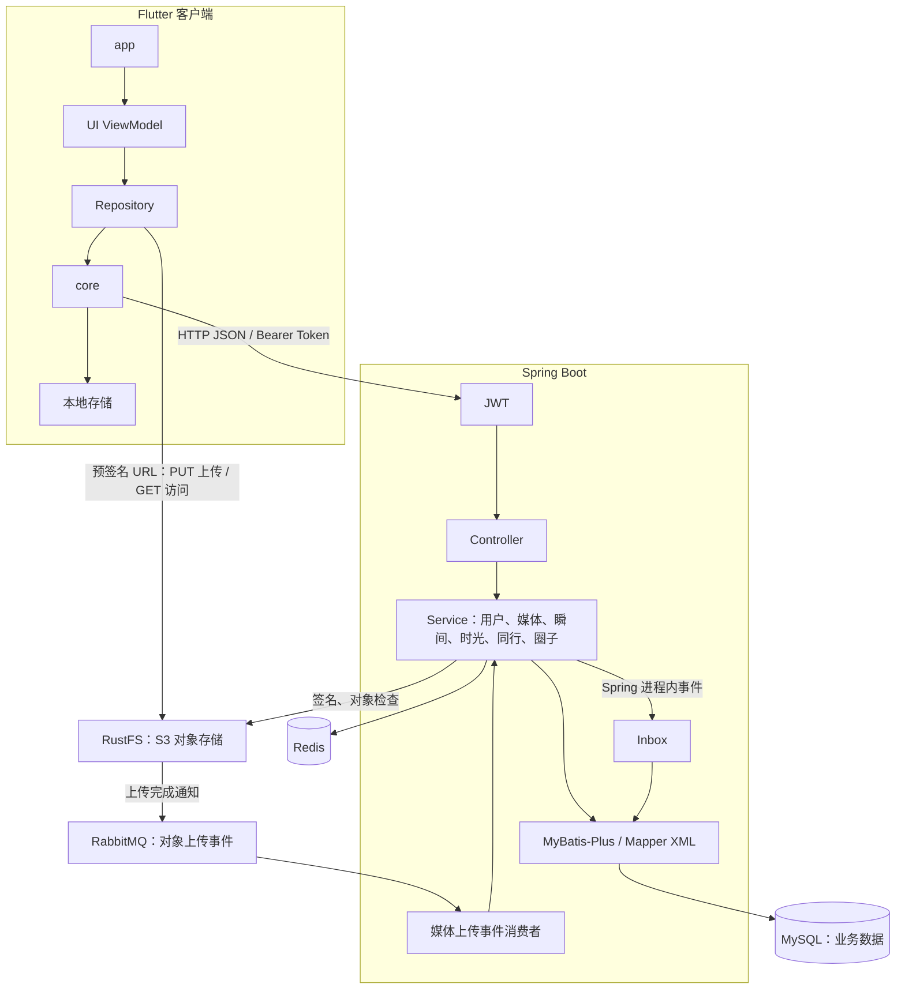
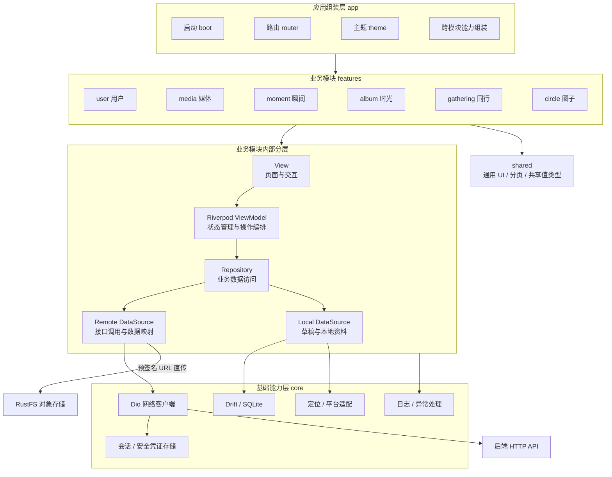
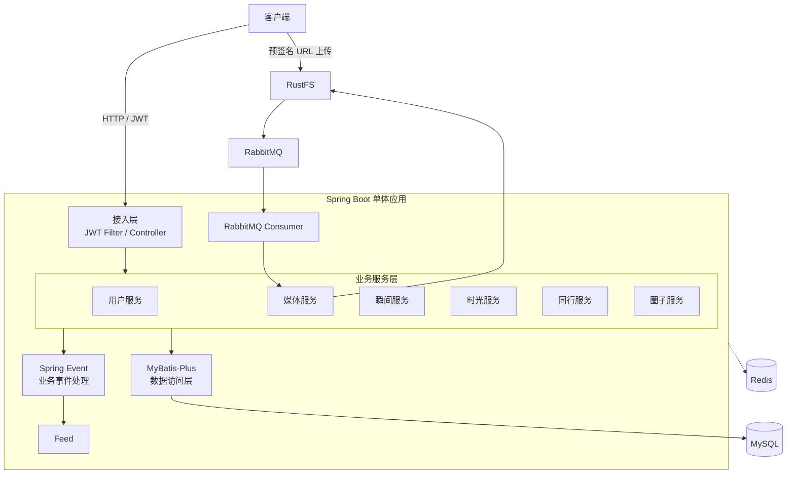

# YOU-TRD

## 系统架构

系统由客户端、服务端、数据存储和外部能力组成，如下面系统架构图。




## 业务模块

业务模块划分如下：

| 业务模块       | 主要职责                                               |
| -------------- | ------------------------------------------------------ |
| 用户           | 注册、登录、退出、账号找回、个人资料                   |
| 瞬间           | 图文发布、编辑、删除、标签、参与人员、关联及分享       |
| 时光           | 手动与 AI 整理、条件整理、自动更新、时间线、分享和回顾 |
| 同行           | 创建、加入、邀请、成员管理、状态与瞬间关联             |
| 圈子           | 创建、加入、邀请、成员管理、内容分享                   |
| 评论           | 评论发布、读取和删除                                   |
| 搜索           | 关键词、组合条件、自然语言与语义搜索                   |
| 消息           | 动态信箱、通知、已读状态                               |
| AI             | 辅助填写、整理、回顾、问答、建议确认与任务管理         |
| 隐私与数据管理 | 权限设置、数据导出、账号注销与清理                     |


## 技术架构

| 类别       | 选型                                    | 用途                       |
| ---------- | --------------------------------------- | -------------------------- |
| 前端框架   | Flutter / Dart                          | Android、iOS 客户端        |
| 状态管理   | Riverpod                                | 页面状态与依赖管理         |
| 路由       | go_router                               | 页面导航与登录跳转         |
| 网络请求   | Dio                                     | HTTP 请求、超时与认证处理  |
| 本地持久化 | Drift / SQLite                          | 草稿、未决请求、缓存元数据 |
| 安全存储   | flutter_secure_storage                  | 登录凭证                   |
| 后端框架   | Spring Boot + Spring MVC                | 应用运行与 REST 接口       |
| 业务逻辑   | Spring Service                          | 业务规则与流程编排         |
| 认证       | Spring Security                         | 身份认证与接口保护         |
| 参数校验   | Bean Validation                         | 请求字段校验               |
| 数据访问   | MyBatis Plus + HikariCP                 | SQL 映射与连接池           |
| 数据库     | MySQL                                   | 业务数据与本地事务         |
| 图片存储   | RustFS                                  | 图片、头像与封面           |
| API 契约   | OpenAPI、Scalar                         | 接口定义与前后端协作       |
| 后台任务   | MySQL 任务表 + Spring 调度 + 有界线程池 | AI、自动整理、通知与清理   |
| 监控       | Actuator / Micrometer / 结构化日志      | 健康状态、指标与故障定位   |
| 部署       | Docker                                  | 可重复交付                 |
| 消息队列   | RabbitMQ                                | 媒体服务                   |

## 前端架构



### 模块表

| 模块              | 主要职责                                                     | 模块边界                                                     | 主要依赖                                       |
| ----------------- | ------------------------------------------------------------ | ------------------------------------------------------------ | ---------------------------------------------- |
| `app` 应用组装    | 启动、路由、主题、主框架、Provider 注入                      | 负责应用级组装与导航；跨业务能力在此连接                     | `core`、`shared`、各业务模块                   |
| `core` 基础能力   | 网络请求、会话、安全存储、SQLite、日志、异常、定位与平台适配 | 提供通用技术能力；不承担瞬间、圈子等业务规则                 | Dio、Drift、平台插件等                         |
| `shared` 共享组件 | 通用 UI、分页模型、UUID、心情与内容版本等值类型              | 只放跨模块复用的组件和类型                                   | Flutter 及基础库                               |
| `user` 用户       | 登录、注册、个人资料及会话交互                               | 管理用户侧界面与数据；媒体上传交给 `media`                   | `core`、`shared`、`media`                      |
| `media` 媒体      | 申请上传地址、PUT 上传、查询就绪状态                         | 管理文件上传流程；不管理文件关联到哪个业务对象               | `core`                                         |
| `moment` 瞬间     | 内容流、瞬间详情、编辑、本地草稿                             | 管理瞬间的展示和编辑；账号、媒体和同行能力通过其他模块提供   | `core`、`shared`、`user`、`media`、`gathering` |
| `album` 时光      | 时光列表、详情、编辑、组织瞬间                               | 管理时光；通过 `AlbumInputs` 接收选择瞬间和上传能力          | `core`、`shared`；由 `app` 注入外部能力        |
| `gathering` 同行  | 同行管理、成员、邀请、面对面加入、关联瞬间                   | 管理同行场景；复用瞬间展示及用户信息                         | `core`、`shared`、`moment`、`user`             |
| `circle` 圈子     | 圈子管理、成员、分享及共享内容查看                           | 管理分享上下文；复用瞬间、时光内容，头像上传能力由 `app` 注入 | `core`、`shared`、`moment`、`album`            |
| `ai`              | 预留                                                         | 当前仅目录占位                                               | 无业务实现                                     |
| `settings`        | 预留                                                         | 当前未形成独立设置业务                                       | 无业务实现                                     |

### 目录结构

```shell
lib/                                  # Flutter 应用源码
├── main.dart                         # 程序入口，初始化环境并启动应用
│
├── app/                              # 应用级组装，连接各业务模块
│   ├── bootstrap.dart                # 初始化配置、数据库、凭证及依赖
│   ├── app.dart                      # 根 Widget，配置 MaterialApp.router
│   ├── router/                       # 路由表、登录守卫、深链与通知目标解析
│   ├── shell/                        # 四个一级 Tab、公共头部和发布入口
│   └── theme/                        # 颜色、字体、间距、圆角及主题配置
│
├── core/                             # 与具体业务无关的底层能力
│   ├── network/                      # Dio 配置、认证拦截、超时及错误转换
│   ├── auth/                         # 会话状态、凭证刷新及账号切换隔离
│   ├── storage/                      # 数据库、私有文件和安全存储基础设施
│   ├── platform/                     # 相册、定位、推送等平台能力适配
│   └── errors/                       # 通用错误类型，如网络失败、失权和冲突
│
├── api_generated/                    # 根据 OpenAPI 自动生成，不手工修改
│   ├── api/                          # 各业务 HTTP 接口客户端
│   └── models/                       # 与接口 JSON 对应的请求、响应模型
│                                     # 实际子目录以生成工具配置为准
│
├── shared/                           # 多个业务共用、无具体业务归属的代码
│   ├── ui/                           # 按钮、输入框、弹窗及加载/空/错误组件
│   └── models/                       # 游标分页等通用值类型
│
└── features/                         # 按业务功能组织的模块
    ├── moment/                       # 瞬间：浏览、发布、编辑、删除和分享
    │   ├── presentation/             # 展示层，负责界面与交互状态
    │   │   ├── pages/                # 路由对应的完整页面，组装业务组件
    │   │   ├── widgets/              # 瞬间业务组件，如卡片、编辑器、来源栏
    │   │   ├── viewmodels/           # 接收页面动作，调用 Repository 并更新状态
    │   │   └── states/               # 不可变页面状态，如列表、编辑及提交状态
    │   │
    │   ├── data/                     # 数据层，协调远端接口与本地数据
    │   │   ├── moment_repository.dart # 瞬间数据访问入口，对外提供业务数据方法
    │   │   ├── remote/               # 远端访问适配，封装生成客户端的调用
    │   │   ├── local/                # 瞬间相关本地查询、缓存及持久化操作
    │   │   └── mappers/              # API 模型、本地记录与业务模型之间的转换
    │   │
    │   └── models/                   # 前端瞬间业务模型，不依赖页面或 HTTP 库
    │
    ├── album/                   # 时光：集合、时间线、整理规则和回顾
    ├── gathering/                      # 同行：共同经历、成员管理和瞬间关联
    ├── circle/                       # 圈子：成员、分享动态和圈子管理
    ├── messaging/                    # 消息：动态信箱、通知及已读状态
    ├── ai/                           # AI：任务、建议、问答及来源引用
    ├── user/                         # 认证业务界面：登录、注册和账号找回
    ├── settings/                     # 设置：隐私、AI 偏好及数据管理入口
    └── media/                        # 媒体：上传、授权读取、预览及缓存管理
```

## 后端架构



### 模块表

| 模块               | 主要职责                                                     | 模块边界                                                     | 主要数据                                        |
| ------------------ | ------------------------------------------------------------ | ------------------------------------------------------------ | ----------------------------------------------- |
| `user` 用户        | 注册、登录、退出、JWT、令牌撤销、个人资料、公开用户信息      | 管理身份与用户资料；头像文件处理委托 `media`                 | `app_user`、Redis 令牌黑名单                    |
| `media` 媒体       | 预签名上传、上传事件消费、对象校验、文件登记、就绪查询、访问地址 | 管理文件生命周期；业务对象如何使用文件由调用模块决定         | `media_file`、RustFS 对象                       |
| `moment` 瞬间      | 瞬间增删改查、图片、标签、个人内容流、相关内容流             | 管理原始内容；其中 `RelatedFeedService` 额外承担跨内容聚合   | `moment`、`moment_image`、`moment_tag`          |
| `album` 时光       | 时光管理、封面、瞬间组织、分页查询                           | 管理时光及其包含关系；瞬间原文由 `moment` 管理               | `album`、`album_moment`                         |
| `gathering` 同行   | 同行管理、成员、邀请、面对面加入、关联及移除瞬间             | 管理同行关系与内容关联；瞬间本体由 `moment` 管理             | `gathering`、`gathering_member`、Redis 临时状态 |
| `circle` 圈子      | 圈子管理、成员、加入限制、邀请、内容分享、撤回及访问控制     | 管理分享关系和分享场景授权；原始内容由瞬间或时光模块管理     | `circle`、`circle_member`、`circle_share`       |
| `inbox` 内容收件箱 | 共享内容投递；退出、撤回、解散及删除时使投递失效             | 保存接收者与共享内容的索引；不保存原始正文，也不承担聊天功能 | `user_inbox`                                    |
| `common` 公共基础  | 统一响应、异常、分页、校验、UUID 映射、基础设施配置          | 提供通用技术规则；不管理独立业务对象                         | 无独立业务表                                    |

### 目录结构

业务包结构设计如下：

```Python
you-backend/
├── .mvn/                            # Maven Wrapper 配置
├── mvnw
├── mvnw.cmd
├── pom.xml                          # Maven 依赖与构建配置
└── src/
    ├── main/
    │   ├── java/com/you/youbackend/
    │   │   ├── YouBackendApplication.java
    │   │   │
    │   │   ├── album/               # 时光模块
    │   │   │   ├── controller/
    │   │   │   ├── entity/
    │   │   │   ├── event/
    │   │   │   ├── mapper/
    │   │   │   ├── model/
    │   │   │   ├── request/
    │   │   │   ├── response/
    │   │   │   └── service/
    │   │   │
    │   │   ├── circle/              # 圈子模块
    │   │   │   ├── controller/
    │   │   │   ├── entity/
    │   │   │   ├── event/
    │   │   │   ├── mapper/
    │   │   │   ├── model/
    │   │   │   ├── request/
    │   │   │   ├── response/
    │   │   │   └── service/
    │   │   │
    │   │   ├── common/              # 公共基础
    │   │   │   ├── config/
    │   │   │   ├── enumeration/
    │   │   │   ├── exception/
    │   │   │   ├── mybatis/
    │   │   │   ├── request/
    │   │   │   ├── response/
    │   │   │   ├── util/
    │   │   │   └── validation/
    │   │   │
    │   │   ├── gathering/           # 同行模块
    │   │   │   ├── controller/
    │   │   │   ├── entity/
    │   │   │   ├── event/
    │   │   │   ├── mapper/
    │   │   │   ├── model/
    │   │   │   ├── request/
    │   │   │   ├── response/
    │   │   │   ├── service/
    │   │   │   └── validation/
    │   │   │
    │   │   ├── inbox/               # 内容收件箱模块
    │   │   │   ├── entity/
    │   │   │   ├── listener/
    │   │   │   ├── mapper/
    │   │   │   ├── model/
    │   │   │   └── service/
    │   │   │
    │   │   ├── media/               # 媒体模块
    │   │   │   ├── consumer/
    │   │   │   ├── controller/
    │   │   │   ├── entity/
    │   │   │   ├── event/
    │   │   │   ├── mapper/
    │   │   │   ├── request/
    │   │   │   ├── response/
    │   │   │   └── service/
    │   │   │
    │   │   ├── moment/              # 瞬间模块
    │   │   │   ├── controller/
    │   │   │   ├── entity/
    │   │   │   ├── event/
    │   │   │   ├── mapper/
    │   │   │   ├── model/
    │   │   │   ├── request/
    │   │   │   ├── response/
    │   │   │   └── service/
    │   │   │
    │   │   └── user/                # 用户与认证模块
    │   │       ├── controller/
    │   │       ├── filter/
    │   │       ├── mapper/
    │   │       ├── model/
    │   │       ├── request/
    │   │       ├── response/
    │   │       └── service/
    │   │
    │   └── resources/
    │       ├── application.yaml     # 应用及基础设施连接配置
    │       ├── db/
    │       │   └── migration/       # Flyway 数据库迁移脚本
    │       └── mapper/              # 自定义 SQL XML
    │           ├── inbox/
    │           └── moment/
    │
    └── test/
        └── java/com/you/youbackend/
            ├── album/
            ├── circle/
            ├── common/
            │   └── mybatis/
            ├── gathering/
            └── moment/
```
