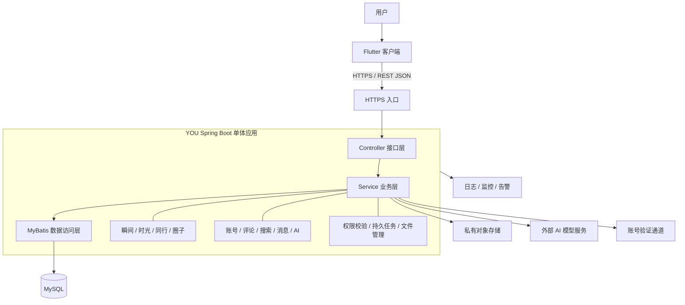
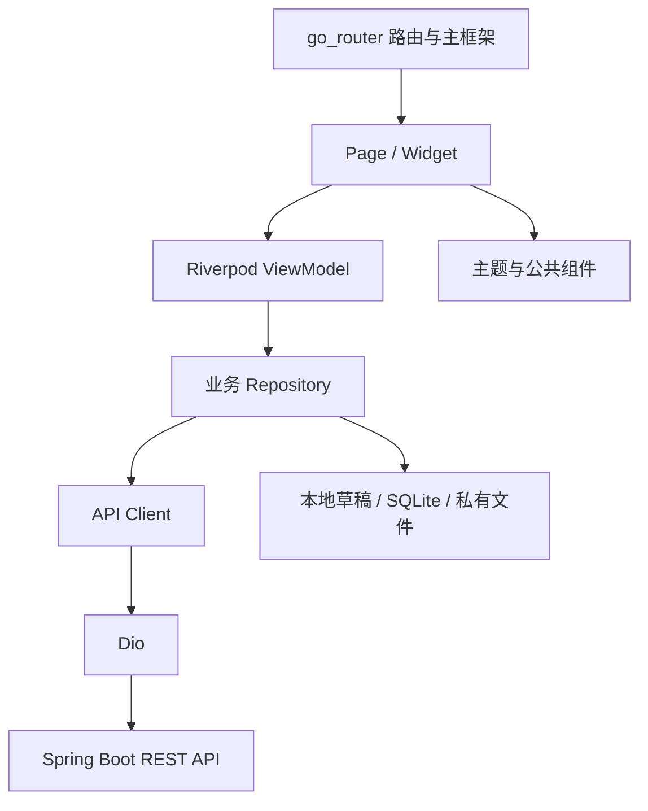
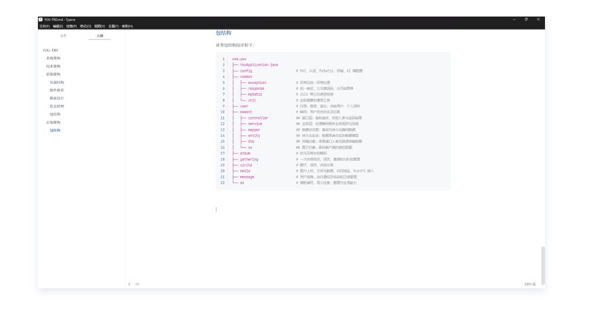

# YOU-TRD

## 系统架构

系统由客户端、服务端、数据存储和外部能力组成。服务端所有业务运行在同一个 Spring Boot 应用中，整体构建、整体部署。




对象存储用于保存图片，MySQL 保存业务数据和文件元数据。AI 服务通过适配器接入，邮件或短信通道根据账号验证流程选择。

业务模块划分如下：

| 业务模块       | 主要职责                                               |
| -------------- | ------------------------------------------------------ |
| 账号与用户     | 注册、登录、退出、账号找回、个人资料                   |
| 瞬间           | 图文发布、编辑、删除、标签、参与人员、关联及分享       |
| 时光           | 手动与 AI 整理、条件整理、自动更新、时间线、分享和回顾 |
| 同行           | 创建、加入、邀请、成员管理、状态与瞬间关联             |
| 圈子           | 成员管理、内容分享、发起同行、整理与问答               |
| 评论           | 评论发布、读取和删除                                   |
| 搜索           | 关键词、组合条件、自然语言与语义搜索                   |
| 消息           | 动态信箱、通知、已读状态                               |
| AI             | 辅助填写、整理、回顾、问答、建议确认与任务管理         |
| 隐私与数据管理 | 权限设置、数据导出、账号注销与清理                     |

## 技术架构

| 类别       | 选型                                    | 用途                       |
| ---------- | --------------------------------------- | -------------------------- |
| 前端框架   | Flutter / Dart                          | Android、iOS 客户端        |
| 前端组织   | View + ViewModel + Repository           | 分离界面、状态与数据访问   |
| 状态管理   | Riverpod                                | 页面状态与依赖管理         |
| 路由       | go_router                               | 页面导航与登录跳转         |
| 网络请求   | Dio                                     | HTTP 请求、超时与认证处理  |
| 本地持久化 | Drift / SQLite                          | 草稿、未决请求、缓存元数据 |
| 安全存储   | flutter_secure_storage                  | 登录凭证                   |
| 后端框架   | Spring Boot + Spring MVC                | 应用运行与 REST 接口       |
| 业务逻辑   | Spring Service                          | 业务规则与流程编排         |
| 认证       | Spring Security                         | 身份认证与接口保护         |
| 参数校验   | Bean Validation                         | 请求字段校验               |
| 数据访问   | MyBatis Plus + HikariCP                 | SQL 映射与连接池           |
| 数据库     | MySQL                                   | 业务数据与本地事务         |
| 图片存储   | 对象存储服务【待定】                    | 图片、头像与封面           |
| API 契约   | OpenAPI                                 | 接口定义与前后端协作       |
| 后台任务   | MySQL 任务表 + Spring 调度 + 有界线程池 | AI、自动整理、通知与清理   |
| 监控       | Actuator / Micrometer / 结构化日志      | 健康状态、指标与故障定位   |
| 部署       | Docker                                  | 可重复交付                 |

## 前端架构




### **页面结构**

保持四个一级 Tab，“＋”作为发布动作。

| 一级入口 | 主要页面                                         |
| -------- | ------------------------------------------------ |
| 瞬间     | Yours / Related、详情、发布、编辑、草稿          |
| 时光     | 列表、时间线、创建、内容调整、自动整理设置、回顾 |
| 同行     | 列表、详情、创建加入、成员管理、瞬间关联         |
| 圈子     | 圈子切换、分享动态、详情、成员管理、发起同行     |

全局页面包括搜索、消息、AI 任务与建议、个人资料、隐私和 AI 设置、数据管理等。

一级页面共用头部和底部导航；详情、发布、编辑、图片预览使用独立页面框架。

### **组件体系**

分成三个层次：

| 层次     | 示例                                                | 约束             |
| -------- | --------------------------------------------------- | ---------------- |
| 基础组件 | 按钮、输入框、头像、弹窗、加载/空/错误状态          | 不依赖具体业务   |
| 组合组件 | 图片预览、来源标签、分享选择、成员选择、AI 任务状态 | 接收数据与回调   |
| 业务组件 | 瞬间卡片、编辑器、时光线、圈子分享卡片              | 放在所属业务包中 |

颜色、字体、间距等集中由主题 Token 管理。展示组件不直接调用 API，避免组件内部隐藏网络请求和业务规则。

### **路由设计**

使用 **go_router**：

- 四个 Tab 使用 `StatefulShellRoute.indexedStack`，保留各自导航状态。
- 详情、发布和编辑页放在根导航栈，覆盖主框架。
- 路由传对象 ID，页面根据 ID 加载并校验权限。
- 登录守卫只检查登录状态，具体内容权限由服务端判断。
- 通知和深链统一进入路由解析流程，登录恢复后重新检查目标。
- 编辑离开时处理保存草稿、放弃或继续编辑。

这种分支导航方式适合保留底部 Tab 的导航状态。[go_router 官方说明](https://pub.dev/documentation/go_router/latest/go_router/StatefulShellRoute-class.html)

### **状态管理**

统一使用 Riverpod，但不同状态有不同归属：

| 状态                     | 管理方式                    |
| ------------------------ | --------------------------- |
| 焦点、图片页码、面板展开 | Widget 局部状态             |
| 列表、分页、筛选、详情   | 页面 ViewModel              |
| 编辑内容、上传及提交阶段 | 编辑 ViewModel              |
| 登录与当前账号           | 应用级 AuthController       |
| 跨页面实体变化           | Repository 数据流或变更通知 |
| 草稿、图片路径、未决请求 | Drift / SQLite 持久保存     |

Riverpod 是 ViewModel 的实现工具，不需要再叠加一套状态框架。

重点约束是：搜索丢弃迟到结果、分页避免重复请求、编辑保留冲突输入、账号切换隔离旧请求，以及权限失效后清除旧内容。内存状态不能替代可靠草稿。

### 包结构

```TypeScript
lib/                                  # Flutter 应用源码
├── main.dart                         # 程序入口，初始化环境并启动应用
│
├── app/                              # 应用级组装，连接各业务模块
│   ├── bootstrap.dart                # 初始化配置、数据库、凭证及依赖
│   ├── app.dart                      # 根 Widget，配置 MaterialApp.router
│   ├── router/                       # 路由表、登录守卫、深链与通知目标解析
│   ├── shell/                        # 四个一级 Tab、公共头部和发布入口
│   └── theme/                        # 颜色、字体、间距、圆角及主题配置
│
├── core/                             # 与具体业务无关的底层能力
│   ├── network/                      # Dio 配置、认证拦截、超时及错误转换
│   ├── auth/                         # 会话状态、凭证刷新及账号切换隔离
│   ├── storage/                      # 数据库、私有文件和安全存储基础设施
│   ├── platform/                     # 相册、定位、推送等平台能力适配
│   └── errors/                       # 通用错误类型，如网络失败、失权和冲突
│
├── api_generated/                    # 根据 OpenAPI 自动生成，不手工修改
│   ├── api/                          # 各业务 HTTP 接口客户端
│   └── models/                       # 与接口 JSON 对应的请求、响应模型
│                                     # 实际子目录以生成工具配置为准
│
├── shared/                           # 多个业务共用、无具体业务归属的代码
│   ├── ui/                           # 按钮、输入框、弹窗及加载/空/错误组件
│   └── models/                       # 游标分页等通用值类型
│
└── features/                         # 按业务功能组织的模块
    ├── moment/                       # 瞬间：浏览、发布、编辑、删除和分享
    │   ├── presentation/             # 展示层，负责界面与交互状态
    │   │   ├── pages/                # 路由对应的完整页面，组装业务组件
    │   │   ├── widgets/              # 瞬间业务组件，如卡片、编辑器、来源栏
    │   │   ├── viewmodels/           # 接收页面动作，调用 Repository 并更新状态
    │   │   └── states/               # 不可变页面状态，如列表、编辑及提交状态
    │   │
    │   ├── data/                     # 数据层，协调远端接口与本地数据
    │   │   ├── moment_repository.dart # 瞬间数据访问入口，对外提供业务数据方法
    │   │   ├── remote/               # 远端访问适配，封装生成客户端的调用
    │   │   ├── local/                # 瞬间相关本地查询、缓存及持久化操作
    │   │   └── mappers/              # API 模型、本地记录与业务模型之间的转换
    │   │
    │   └── models/                   # 前端瞬间业务模型，不依赖页面或 HTTP 库
    │
    ├── album/                   # 时光：集合、时间线、整理规则和回顾
    ├── gathering/                      # 同行：共同经历、成员管理和瞬间关联
    ├── circle/                       # 圈子：成员、分享动态和圈子管理
    ├── messaging/                    # 消息：动态信箱、通知及已读状态
    ├── ai/                           # AI：任务、建议、问答及来源引用
    ├── user/                         # 认证业务界面：登录、注册和账号找回
    ├── settings/                     # 设置：隐私、AI 偏好及数据管理入口
    └── media/                        # 媒体：上传、授权读取、预览及缓存管理
```

## 后端架构

使用 SpringMVC 架构。

### 包结构

业务包结构设计如下：

```Python
com.you
├── YouApplication.java
├── config                      # MVC、认证、MyBatis、存储、AI 等配置
├── common
│   ├── exception               # 异常及统一异常处理
│   ├── response                # 统一响应、公共错误码、分页结果等
│   ├── mybatis                 # UUID 等公共类型转换
│   └── util                    # 实际需要的通用工具
├── user                        # 注册、登录、退出、当前用户、个人资料
├── moment                      # 瞬间：用户发布的生活记录
│   ├── controller              ## 接口层：接收请求、校验入参与返回结果
│   ├── service                 ## 业务层：处理瞬间相关业务规则与流程
│   ├── mapper                  ## 数据访问层：查询与持久化瞬间数据
│   ├── entity                  ## 持久化实体：数据库表对应的数据模型
│   ├── dto                     ## 传输对象：承载接口入参及跨层传输数据
│   └── vo                      ## 展示对象：面向客户端的响应数据
├── album                       # 时光及其中的瞬间
├── gathering                   # 一次共同经历、成员、邀请码与阶段管理
├── circle                      # 圈子、成员、内容分享
├── media                       # 图片上传、文件元数据、访问地址、RustFS 接入
├── message                     # 用户信箱、站内通知及各自的已读管理
└── ai                          # 辅助填写、语义检索、整理与生成能力
```

