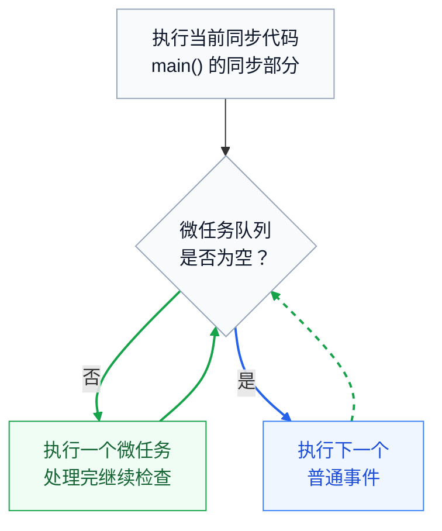

# Dart

Dart 是 Google 开发的一门现代化、面向对象、类型安全的编程语言，也是 Flutter 框架使用的主要编程语言。

如果你已经掌握 Java，那么学习 Dart 的成本并不高。因为两者在类、对象、继承、接口、泛型、异常处理等方面有很多相似之处。

不过，Dart 也吸收了现代编程语言的一些设计，例如类型推断、空安全、异步编程和简洁的函数语法。

# 运行第一个 Dart 程序

本地先准备 Dart SDK，让终端可以调用 `dart`。也可用 [DartPad](https://dartpad.dev/) 直接试写，不需要先搭建 Flutter 工程。应用从顶层 `main()` 开始执行。文件扩展名为 `.dart`，普通语句用分号结尾。

运行下面命令检查 SDK 是否安装并配置好 Path 系统环境变量，

```
dart --version
```

输出类似，

```
Dart SDK version: 3.12.2 (stable) (Tue Jun 9 01:11:39 2026 -0700) on "windows_x64"
```

编写一个最简单的代码：

```
 void main() {
   print('Hello, Dart!');
 }
```

保存为 `main.dart` 后，在文件所在目录执行：

```
dart run main.dart
```

输出 `Hello, Dart!` 。

运行下面命令，可以使用 Dart 静态分析器检查 `main.dart` 文件中的代码问题，但不会执行程序。它类似于 Java 开发中 IDE 的静态代码检查。

```
dart analyze main.dart
```

下面命令则可以格式化 Dart 代码，

```
dart format main.dart
```

# 变量和常量

| **写法** | **含义** | **常见用途** |
| --- | --- | --- |
| `int age = 20;` | 显式声明类型，可以重新赋值 | 让读者一眼看出类型 |
| `var age = 20;` | 从初始值推断为 `int`，可以重新赋同类型的值 | 局部变量 |
| `final now = DateTime.now();` | 只能赋值一次，值可以在运行时获得 | 当前时间、一次请求的结果 |
| `const days = 7;` | 必须是编译时常量 | 固定的数值、字符串、常量集合 |

示例代码，

```
 void main() {
   var age = 20;
   age += 1;
   final now = DateTime.now();
   const daysPerWeek = 7;
 ​
   final names = <String>['小林'];
   names.add('小陈'); // 可以修改列表内容，但不能让 names 指向另一个列表。
   const weekdays = ['周一', '周二']; // 常量列表的内容也不可修改。
 ​  
   // Dart 用 $ 解析变量，方便进行打印
   print('$age / $now / $daysPerWeek / $names / $weekdays');
 }
```

# 常用数据类型

| **类型** | **例子** | **备注** |
| --- | --- | --- |
| `String` | `'小林'` | 单双引号都可；$name 插入变量，$`{score + 1}` 插入表达式 |
| `int`、`double`、`num` | `3`、`3.5`、`num n = 3.5` | `num` 可容纳前两种类型；需要转换时可用 `toDouble()` 或 `toInt()`，后者向零截断 |
| `bool` | `true`、`false` | 条件需要布尔值，不能用数字或字符串代替 |
| `List\<T\>` | `\<int\>\[80, 95\]` | 有序，索引从 0 开始 |
| `Map\<K, V\>` | `\<String, int\>{'小林': 95}` | 按键查值；不存在的键返回 `null` |
| `dynamic` | `dynamic value = 42;` | 允许对值发起缺少静态检查的成员调用，错误可能到运行时才暴露 |

`var value = 42` 推断为 `int`，不能再赋字符串；`dynamic value = 42` 可以再赋字符串。只需要接收任意非空对象时，可用 `Object`，允许空值则用 `Object?`；通过 `is` 检查后再使用具体类型的成员。

示例代码，

```
 void main() {
   final scores = <int>[72, 95, 85];
   scores.add(92);
   // addAll 方法用于将一个集合中的所有元素添加到另一个集合中
   scores.addAll([60, 88]);
   scores.remove(60); // 删除第一个值等于 60 的元素。
   scores.removeLast(); // 删除末尾；空列表不能调用。
   print(scores[0]);
   print(scores.length);
   // every() 箭头函数语句表示判断是否所有 score 都 >= 60
   // 返回 true
   print(scores.every((score) => score >= 60));
   // where() 箭头函数配合 toList() 则可以实现根据条件筛选
   print(scores.where((score) => score >= 90).toList()); // [95, 92]
 ​
   final words = <String, String>{'cat': '猫'};
   words['dog'] = '狗';
   words.addAll({'bird': '鸟'});
   // 返回 true
   print(words.containsKey('cat'));
   print(words['fish']); // null
   // forEach 箭头函数遍历
   words.forEach((key, value) => print('$key: $value'));
   words.remove('cat');
   words.clear();
 }
```

`where()` 返回可迭代对象 `Iterable\<T\>`，需要列表时再调用 `toList()`。另一个常见操作 `map()` 用于逐项转换，例如 `scores.map((s) =\> '得分：$s').toList()`。

# 空安全

类型默认不可空，例如 `String`；只有显式写成 `String?` 才能持有 `null`。使用前先判断或提供默认值。

| **写法** | **行为** |
| --- | --- |
| `name?.length` | 空时返回 `null`，有值时才取长度 |
| `name ?? '访客'` | 空时使用默认值 |
| `name ??= '访客'` | 变量为空时才赋值 |
| `name!` | 断言有值；实际为空时抛出运行时错误 |

```
 String greet(String? name) {
   if (name == null || name.isEmpty) {
     return '你好，访客';
   }
   return '你好，$name';
 }
 ​
 void main() {
   final scores = {'小林': 95};
   final int score = scores['小陈'] ?? 0;
   print(score); // 0
   print(greet(null));
 }
```

这里即使 Map 的值类型是 `int`，按键查找的结果也是 `int?`。对查不到的数据要先想好策略：给默认值、显示缺失，或报告错误。

# 运算符

| **类别** | **运算符** | **例子** |
| --- | --- | --- |
| 算术 | `+ - \* / ~/ %` | `7 / 2` 得 `3.5`，`7 ~/ 2` 得 `3`，`7 % 2` 得 `1` |
| 赋值 | `= += -= \*= /= ~/= %=` | `count += 1`；`/=` 的结果要能赋回左侧变量 |
| 比较 | `== != \> \>= \< \<=` | `score \>= 60` 得到布尔值 |
| 逻辑 | `&& \\\|\\\| !` | `a && b` 在 `a` 为假时跳过 `b`；`a \\\|\\\| b` 在 `a` 为真时跳过 `b` |

# 流程控制

用 `if / else if / else` 做范围判断，用 `条件 ? 值1 : 值2` 在两个值之间选择，用 `switch` 匹配离散值。Dart 3 中，有执行体的普通 `case` 不会自动落入下一分支。

```
 String grade(int score) {
   if (score >= 90) {
     return '优秀';
   } else if (score >= 60) {
     return '及格';
   } else {
     return '待提高';
   }
 }
 ​
 void main() {
   final scores = [59, 72, 95];
   for (var i = 0; i < scores.length; i++) {
     print('第 ${i + 1} 项：${grade(scores[i])}');
   }
 ​
   var passed = 0;
   for (final score in scores) {
     if (score < 60) continue;
     passed++;
   }
   print(passed > 0 ? '有人及格' : '无人及格');
 ​
   var remaining = 2;
   while (remaining > 0) {
     remaining--;
   }
 ​
   switch (grade(scores.last)) {
     case '优秀':
       print('继续保持');
     case '及格':
       print('已经达标');
     default:
       print('需要复习');
   }
 }
```

需要索引用普通 `for`，只需要元素用 `for-in`，由某个条件决定重复次数时可用 `while`。在循环中，`break` 结束循环，`continue` 跳到下一轮。

# 函数

函数声明写明返回类型和参数类型。没有有用的返回值时用 `void`。箭头体 `=\>` 后是一个表达式，其值作为结果；要执行多条语句，用花括号。

```
 int add(int a, int b) => a + b;
 ​
 // 用 [] 包裹参数代表是可选参数
 String greet(String name, [String ending = '！']) => '你好，$name$ending';
 ​
 // 用 {} 包裹参数参数是命名参数
 // 命名参数是指，调用函数时，通过参数名称指定传入的值，而不是依赖参数的位置或顺序
 String describe({
   required String name,
   required int? score,
   String label = '成绩',
 }) {
   return '$name 的$label：${score ?? '未录入'}';
 }
 ​
 void main() {
   print(add(2, 3)); // 5
   print(greet('小林'));
   print(greet('小林', '。'));
   print(describe(name: '小林', score: null));
 ​
   final int Function(int) twice = (value) => value * 2;
   print([1, 2, 3].map(twice).toList()); // [2, 4, 6]
 }
```

1. 必传位置参数按顺序提供；`\[\]` 包围可选位置参数。
2. `{}` 包围命名参数，调用时写 `参数名: 值`。用 `required` 把某个命名参数变成必传。
3. 可选参数省略时使用默认值。未提供默认值的可选参数必须允许 `null`。
4. 匿名函数可赋给变量或作为回调；有明确签名时，`int Function(int)` 比宽泛的 `Function` 更能约束调用。

# 面向对象

## 类

```
 class Student {
   final String name;
   // _ 下划线开头的是私有属性或方法
   int _score;
 ​  
   // 定义构造方法
   Student(this.name, this._score);
   Student.ungraded(this.name) : _score = 0;
 ​  
   // 定义一个 getter 方法访问私有字段
   int get score => _score;
   void addPoints(int points) {
     _score += points;
   }
 }
 ​
 void main() {
   final a = Student('小林', 80);
   final b = Student.ungraded('小陈');
   b.addPoints(5);
   print('${a.name}：${a.score}');
   print('${b.name}：${b.score}');
 }
```

1. `Student(...)` 是未命名构造函数，`Student.ungraded(...)` 是命名构造函数。没有声明任何构造函数时，Dart 才会提供隐式的默认无参构造函数（还需满足父类初始化要求）。
2. `this.name` 是用参数初始化同名字段的简写。
3. 下划线成员对 **库** 私有，同库里的其他类也可访问。

## 继承和接口

Dart 的核心思想是：一个类既可以提供具体实现，也可以定义对外的接口契约。至于其他类是继承它的实现，还是仅遵守它的接口，由 `extends` 和 `implements` 决定。

展示多态，

```
abstract class Payment {
  void pay(int money);
}

class CreditCardPayment implements Payment {
  @override
  void pay(int money) {
    print('Paid $money using Credit Card');
  }
}

class PayPalPayment implements Payment {
  @override
  void pay(int money) {
    print('Paid $money using PayPal');
  }
}

void main() {
  final methods = <Payment>[
    CreditCardPayment(),
    PayPalPayment(),
  ];  
  for (final method in methods) {
    method.pay(100);
  }
}
```

注意两种关系：

- `implements`：实现接口，必须提供接口要求的实现。
- `extends`：继承父类，可以复用父类实现并重写方法。

`extends` 会继承父类已有的实现，可以直接复用代码；`implements` 只要求遵守接口契约，不继承原有实现，必须自己实现接口要求的成员。

| 对比 | `extends` 继承 | `implements` 实现接口 |
| --- | --- | --- |
| 核心目的 | 复用和扩展父类功能 | 遵守统一接口规范 |
| 是否继承方法实现 | ✅ 是 | ❌ 否 |
| 是否继承实例字段 | ✅ 是 | ❌ 否 |
| 是否可以重写方法 | ✅ 可以 | ✅ 必须实现接口要求的成员 |
| 是否可以调用 `super` | ✅ 可以 | ❌ 不能通过接口调用实现 |
| 是否支持多个类型 | 只能继承一个父类 | 可以实现多个接口 |
| 是否形成子类型关系 | ✅ 是 | ✅ 是 |

1. `extends` 复用父类实现，一个类只能有一个直接父类。构造函数不继承；
2. 如果父类没有可隐式调用的无参构造函数，子类就要明确调用相应的 `super(...)`。


## 混入与泛型

Dart 的 Mixin（混入） 和 Generic（泛型） 是两个完全不同的机制：

- Mixin（混入）：解决代码复用问题，让不同的类能够复用同一组方法或行为，而不需要建立父子继承关系。
- Generic（泛型）：解决类型复用问题，让同一份类或函数代码可以适用于不同的数据类型，同时保留类型安全。

### 混入

假设我们有两种角色：学生和老师。

两者都可以唱歌，但学生和老师并不一定存在父子类关系。

使用继承，为了复用 `sing()`，可能需要引入一个共同父类：

```
class Singer {
  String sing() => '开始唱歌';
}

class Student extends Singer {}

class Teacher extends Singer {}
```

但问题是：学生和老师真的应该继承自 `Singer` 吗？

更自然的设计是，把唱歌看作一种可以组合的能力：

```
mixin CanSing {
  String sing() => '开始唱歌';
}

class Student with CanSing {}

class Teacher with CanSing {}

void main() {
  var student = Student();
  print(student.sing());

  var teacher = Teacher();
  print(teacher.sing());
}
```

一个类只能使用 `extends` 继承一个直接父类，但可以使用 `with` 混入多个 Mixin。

`mixin` 定义可复用的成员，`with` 把它加入类。多个混入含同名实现时，后应用的混入可以覆盖先应用的实现。

一个混入可以定义，

```
mixin CanSing {
  // 1. 实例字段
  int singCount = 0;

  // 2. Getter
  int get totalSings => singCount;

  // 3. Setter
  set count(int value) {
    singCount = value;
  }

  // 4. 实例方法
  void sing() {
    singCount++;
    print('开始唱歌');
  }
}
```

### 泛型

泛型解决的是另一个问题：如何编写适用于不同数据类型的通用代码，同时保留类型信息？

泛型用类型参数保留类型信息，例如 `List\<String\>`、`Box\<int\>` 或 `firstOrNull\<T\>()`。

```
class Box<T> {
  final T value;

  Box(this.value);
}

void main() {
  final a = Box<int>(42);
  final b = Box<String>('Hello');
  final c = Box<bool>(true);

  print(a.value); // 42
  print(b.value); // Hello
  print(c.value); // true
}
```

# 异步编程

理解 Dart 的异步编程，最重要的是弄清楚三个概念：

1. 事件循环（Event Loop）：Dart 如何调度和执行任务。
2. Future：Dart 如何表示一个未来才能得到的结果。
3. async / await：Dart 如何以接近同步代码的方式编写异步逻辑。

可以将 `Future\<T\>` 初步理解为 Java 的 `CompletableFuture\<T\>`，但 Dart 的事件循环与 Java 常见的线程池执行模型不同。

在 Dart 中，Isolate（隔离单元）是 Dart 程序中独立执行代码的基本单位。每个 Isolate 都有自己的内存空间和事件循环（Event Loop）。

你可以先把 Isolate 理解为一种具有独立内存、能够与其他 Isolate 并行执行任务的执行单元。

它与 Java 的线程（Thread）有些相似，但一个非常关键的区别是：

- Java Thread：同一个进程内的线程通常共享堆内存。
- Dart Isolate：不同 Isolate 之间不共享可变内存，主要通过消息传递进行通信。

## async / await

```
Future<void> main() async {
  print('1 开始');

  final score = await func();

  print('2 成绩：$score');
}
```

- `async`：声明这是一个异步函数，返回 `Future`。
- `await`：等待 Future 完成，并取得其中的结果。

`await` 暂停的是当前异步函数后续的执行，而不是阻塞整个 isolate


## Future

你可以将 `Future\<T\>` 理解为一个异步结果的容器。

例如：

```
Future<int> loadScore() async {
  return 95;
}
```

虽然函数内部返回的是整数 `95`，但调用这个异步函数得到的是：

```
Future<int> future = loadScore();
```

而不是直接得到 `int`。因为 `async` 函数会返回一个 Future。

Future\<T\> 的 3 种状态：

- Pending：尚未完成
- 成功：获得 T 类型的值
- 失败：获得错误与堆栈信息

```
Future<int> loadScore(String name) async {
  // 模拟查询成绩需要50毫秒
  await Future<void>.delayed(
    const Duration(milliseconds: 50),
  );

  if (name.isEmpty) {
    throw ArgumentError('姓名不能为空');
  }

  return 95;
}
```

这个函数实现的时异步查询学生的成绩：

1. 调用 `loadScore()`，立即得到一个 `Future\<int\>`。
2. 函数等待约 50 毫秒的计时器。
3. 如果姓名为空，让 Future 以错误完成。
4. 否则让 Future 以整数 `95` 成功完成。


## 事件循环

在一个 isolate 中，事件循环逐个处理工作。当前同步代码执行完后，已排队的微任务先于下一个普通事件执行；处理一个事件后也会先处理新产生的微任务。每个 isolate 有自己的内存和事件循环；`async` 本身不会把重计算移到其他 isolate。

示例代码，

```
void main() {
  print('1 同步开始');

  Future<void>(() => print('4 普通事件'));

  Future<void>.microtask(() => print('3 微任务'));

  print('2 同步结束');
}
```

输出，

```
1 同步开始
2 同步结束
3 微任务
4 普通事件
```

一个 Dart isolate 通常有两种任务队列：

- Microtask Queue（微任务队列）：存放优先处理的微任务。
- Event Queue（事件队列）：存放计时器、I/O 完成事件等普通事件。

Dart 在处理事件时，会优先清空微任务队列，再处理下一个普通事件。

简化 Dart 事件循环模型，



代码示例：

整个程序会执行两次成绩查询：

1. 第一次查询 `"小林"`，返回成绩 `95`，然后加 `2`，最终打印 `97`。
2. 第二次查询空姓名 `""`，触发异常，由 `try/catch` 捕获并打印错误信息。

```
 Future<int> loadScore(String name) async {
   await Future<void>.delayed(const Duration(milliseconds: 50));
   if (name.isEmpty) throw ArgumentError('姓名不能为空');
   return 95;
 }
 ​
 // Dart 规定 await 只能在 async 函数内部使用
 Future<void> main() async {
   // 链式写法：每个 then 的返回值传给下一步。
   await loadScore('小林')
       .then((score) => score + 2)
       .then<void>((adjusted) => print('调整后：$adjusted'))
       .catchError((Object error) {
         print('读取失败：$error');
       });
 ​
   // 顺序写法：先等读取完成，再执行下一行。
   try {
     final score = await loadScore('');
     print('成绩：$score');
   } on ArgumentError catch (error) {
     print('参数有误：$error');
   }
 }
```


# 运行与编译机制

Dart 支持多种运行方式，这也是它特别适合 Flutter 的重要原因。

- JIT（Just-In-Time）：在程序运行期间进行编译，适合开发和调试。存在 Dart VM。
- AOT（Ahead-Of-Time）：在运行前编译为机器码，适合生产环境部署。
- Hot Reload（热重载）：Flutter 开发时能够快速应用代码修改，通常可以保留当前 UI 状态。

与 Java 主要围绕 JVM 运行的生态不同，Dart 的工具链会根据目标平台选择相应的编译与运行方式。  

