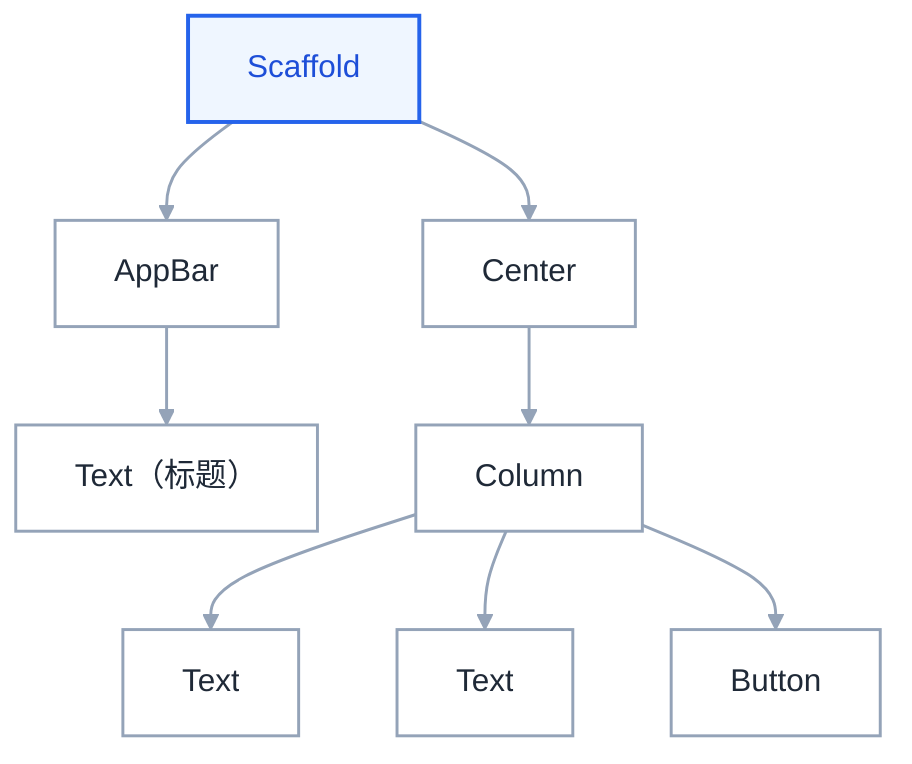
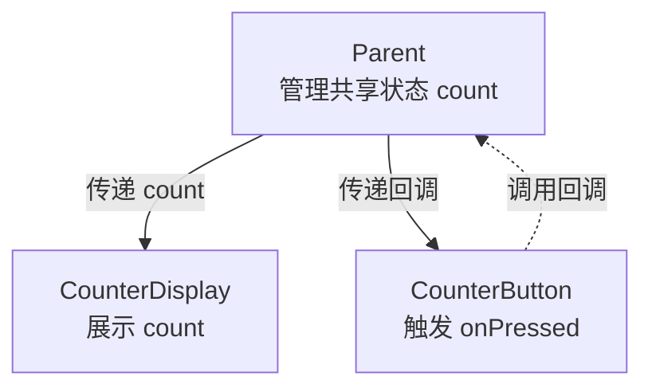
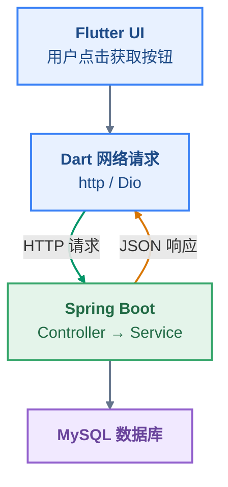
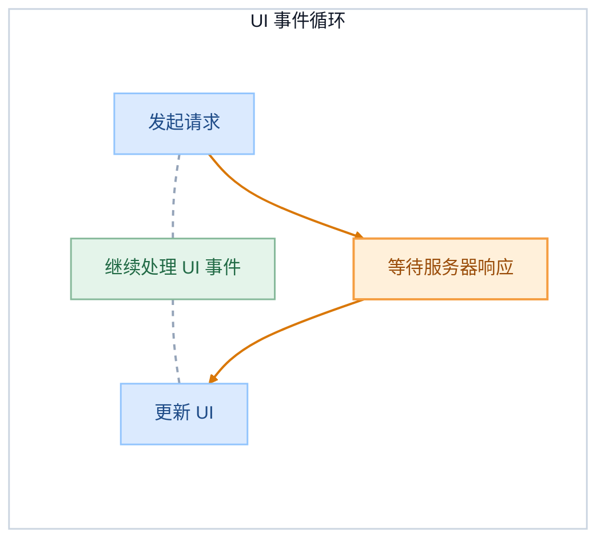
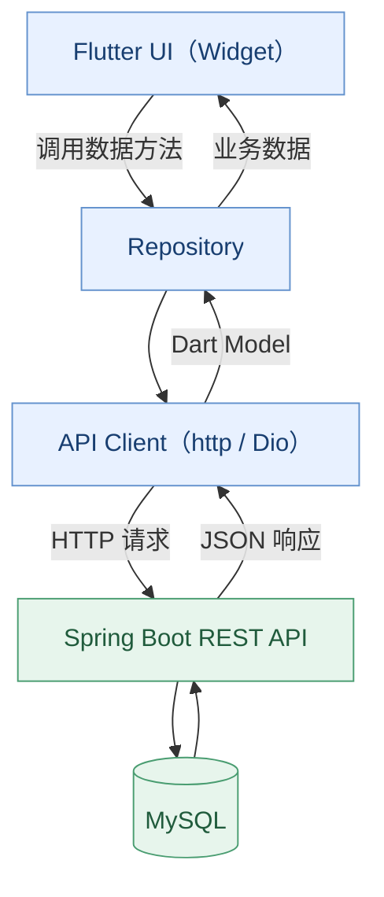
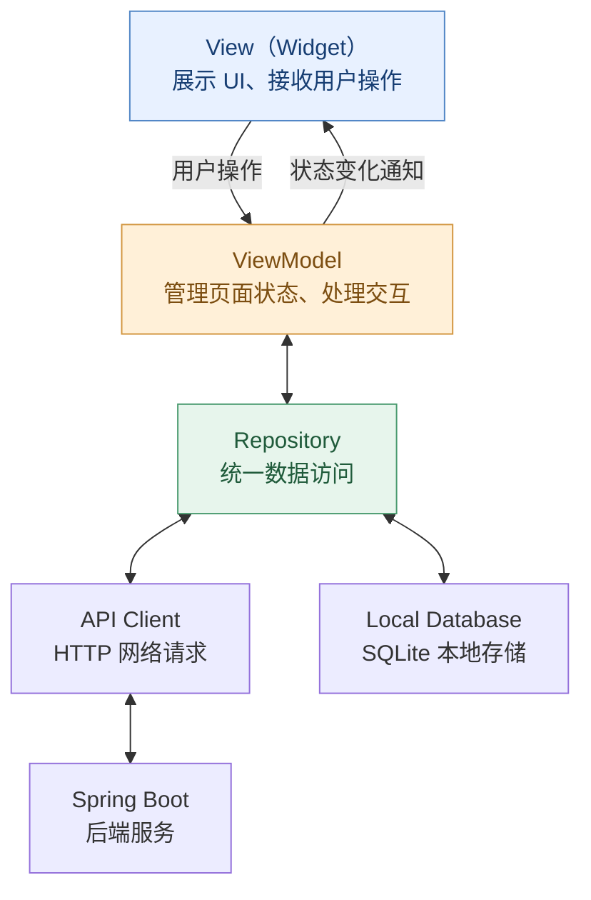
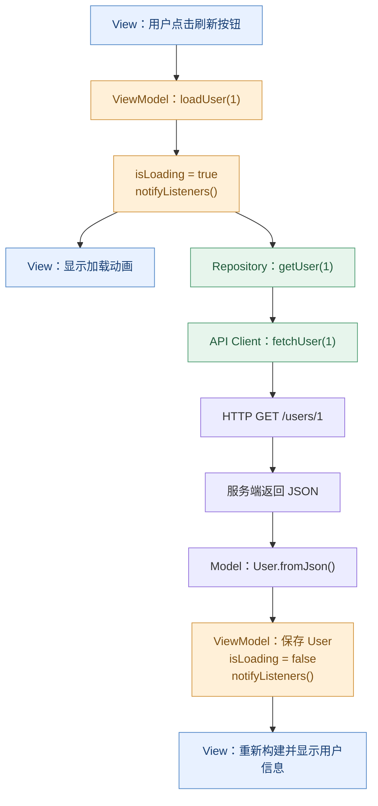

# Flutter

Flutter 是 Google 推出的开源、跨平台 UI 应用开发框架，开发者可以使用一套 Dart 代码，构建运行在 Android、iOS、Web、Windows、macOS 和 Linux 等平台上的应用程序。

Flutter 不只负责绘制界面，还提供组件体系、布局系统、动画、手势交互、路由、状态管理基础设施以及平台原生能力接入机制。

> 参考资料：
> 
> 官方文档：[https://docs.flutter.dev/learn](https://docs.flutter.dev/learn)

# 环境配置

下面命令全面检查 Flutter SDK、Dart SDK、Android SDK、Android Studio 等开发环境。

```
flutter doctor -v
```

下面命令检查 Flutter SDK 安装版本。

```
flutter --version
```


# 项目创建


```
flutter create --platform <具体平台> <项目名称>
```

- platform 参数：
  
  - 移动端：`android`、`ios` 
  - 桌面端：`windows`、`macos`、`linux` 
  - Web 端：`web`

示例创建，

```
flutter create --platform android,ios my_app
```


## 初始项目结构

my\_app/

- android/：Android 原生工程
- ios/：iOS 原生工程
- lib/：Dart 业务源码
- test/：测试代码
- web/：Web 工程
- pubspec.yaml：项目及依赖配置
- pubspec.lock：锁定依赖的具体版本
- analysis\_options.yaml：Dart 静态分析规则
- .dart\_tool/：Dart / Flutter 工具生成的缓存及元数据
- .metadata：Flutter 项目元数据
- .gitignore
- README.md


## 运行项目

检查项目依赖，

```
flutter pub get
```

查看可用设备，

```
flutter devices
```

启动 Android 模拟器后运行，

```
flutter run
```

## main.dart

```dart
import 'package:flutter/material.dart';

void main() {
  runApp(const MyApp());
}
```

- runApp 是 Flutter 内部提供的一个函数，是启动一个 flutter 应用的入口
- MyApp() 本质是一个 Widget，在 flutter 中，Widget 代表一个组件、部件，flutter 中万物为 Widget
- materia 库是 flutter 的内置库，是谷歌推出的一套 UI 设计风格/规范库，提供了统一的视觉/交互体验，比如颜色、文字排版、动画


# 核心知识

## Dart 基础

[Dart](coolnote://note/422a84bd-80e4-4f94-bf76-6ab986a9eeca)


## Widget

Widget 是 flutter 的核心抽象，是 flutter 最重要的概念。

Flutter 与传统 Android 原生开发、Web 前端开发最大的不同之一，就是它采用 Widget 组织整个 UI。

Widget 是 Flutter 用来描述用户界面（UI）的基本单位。

在 Flutter 中，几乎所有界面元素都由 Widget 描述，例如文本、按钮、图片、布局、间距，甚至整个应用。

但理解 Widget 最重要的一点是：

**Widget 本身不是实际显示在屏幕上的 UI，而是一份描述 UI 应该长什么样、如何组织、如何配置的对象。**

例如，我们想在屏幕上显示一段文字：

```dart
const Text(
  'Hello Flutter',
  style: TextStyle(
    fontSize: 24,
    color: Colors.blue,
  ),
)
```

这里的 `Text` 就是一个 Widget。

它描述了三个信息：

- 显示的内容是 `Hello Flutter`。
- 字体大小是 `24`。
- 字体颜色是蓝色。

但 `Text` 对象本身并不负责直接把像素绘制到屏幕上。

Flutter 会根据这个 Widget 创建和管理相应的底层对象，最终完成布局与绘制。

因此，我们可以把 Widget 理解为一种声明式 UI 配置对象。


### Widget Tree

Widget 可以相互组合，形成 Widget Tree。假设我们要实现下面这个组件，

![image.png](data:image/png;base64,iVBORw0KGgoAAAANSUhEUgAAA40AAAFUCAIAAAAPmE6gAAAQAElEQVR4AezdC7AX1YHn8X/fJ28UdJKIEVEUzcZZN4sKmq0xsXYzalhxdTIpVsHd0h2FdaR8FCguSbkQwZhkNwTUOFUhV8fJukaxGHSSdZXUqheRZHxkfBtEQc0oyPtxuY/93XuKpvm/bv/73/3vc7q/t46d8z99+vQ5n/YPv5z/vdembr4QQAABBBBAAAEEELBPoKnAFwIIIIBAnAKMhQACCCAQjwA5NR5HRkEAAQQQQAABBBCIV+BQTo13VEZDAAEEEEAAAQQQQKA+AXJqfX5cjQACCFQSoB0BBBBAoD4Bcmp9flyNAAIIIIAAAgggkIxAcU5N5i6MigACCCCAAAIIIIBAbQLk1Nq86I0AAgjUKkB/BBBAAIFoAuTUaG5chQACCCCAAAIIIJCsQKWcGuddPc/TcH19fTpSEEAAAQQQQAABBNISMHnM8/qzWVpzCH/fRuRUt0TC29ETAQQQqEWAvggggED6Ap7Xn1BNNkt/NoPNoBE5dbA5cB4BBBBAAAEEEEAAgWKBwXJqcX9eI4AAAggggAACCCDQCAFyaiOUuQcCCCBwWIAaAggggEA4gThzquf1f8dDuPvSCwEEEEAAAQQQQMAuAc+zK8uFzalhFF35ntwwa6EPAggggAACCCCQN4He3l6rlhxnTrVqYUwGAQQQsFyA6SGAAAK2CXhedvdTbbNmPggggAACCCCAAALuCtS6n+ruSpk5AggggAACCCCAgEsC5FSXnhZzRQCBLAqwJgQQQACB8gLk1PIutCKAAAIIIIAAAgikKxA1px6atefZ9f22h+bF/yKAAAIIIIAAAghEF/C89DNevTmV30UV/flzJQIIIBAUoI4AAgjYJGBDxqs3p9rkyVwQQAABBBBAAAEEsiNQb061IWtn52mwEgQQQAABBBBAwA4BGzJevTnV89L/3gU7niazQAABBOIRYBQEEEDABgHPSz/j1ZtTbXBkDghYKKD/G9rd3X1g4GsfXwggYJnAwFvzgN6keqta+AcIU0IAASMQV041o3FEAIGC/trr6urav3//wYMHewe+QEEAAdsEBt6avXqT6q2qN6zetrbNkPkggIAEyKlCoCAQm4D5a6+npye2ERkovwKsvEECesMqrWpvtUH34zYIIBBagJwamoqOCFQV0H6MPknkr7qqSJxEwF4B/Z9MvYX1RrZ3iswMgfwJxJ1T8yfIihEwAvroUJ8kmjpHBBBwUUBvYb2RXZw5c0YgqwLk1Kw+WdbVUAHtxOhvuIbekpvlR4CVNlBAb2S9nRt4Q26FAALVBMip1XQ4h0AYAf3Fxsf9YaDog4ATAno7603txFSZJAKZF0gqp2YejgUi4AvobzW/TgUBBDIgwJs6Aw+RJWRDgJyajefIKlIT0L5LDz/dnxp/vm7MahsmoDe13toNux03QgCBSgLk1EoytCMQSkB/n4XqRycEEHBKgLe2U4+LyWZWIOmcmlk4FoaAEeC32BgHjghkTIC3dsYeKMtxVICc6uiDY9q2CPCXmS1PIkfzYKmNEOCt3Qhl7oHAYALk1MGEOI9AVQG+ia0qDycRcFWAnOrqk2Pe2RJoVE7NlhqrQQABBBDItgA5NdvPl9W5IkBOdeVJMU8EEEDgSAFeIYAAAlkXIKdm/QmzPgQQQAABBBBAwE2BRudUN5WYNQIIIIAAAggggECjBcipjRbnfggggEC8AoyGAAIIZFWAnJrVJ8u6EEAAAQQQQAABtwXSyqluqzF7BBBAAAEEEEAAgaQFyKlJCzM+Aggg0BgB7oIAAghkTYCcmrUnynoQQAABBBBAAIFsCKSdU7OhyCoQQAABBBBAAAEE4hYgp8YtyngIuCDw4YcfHnfccS7MlDnWLsAVCCCAQFYEyKlZeZKsw2WBqVOnKjWqrB/4MhUTJVetWlW6MvVXKWqfP39+aWNRn6KXuqSohZcIIIAAAgjYI2BLTrVHhJkg0AABxVGFUb/MmzdPqVTl+IEvfwIrVqyYPXv2jBkz/BZVlFw3bdr0y1/+UnW/6NqOjg6N47dUr+jWCxYs0CVVuinFqluYop5VxuEUAg0Q0Jvi3nvvffjhhxtwL26BAAINEyCnNoyaGyFwWODss89WsjTlcGuhoFBoXuqU6tOnT1dl7dq1y5cvV7tJt0quqk+ePFkdVMypxx57TI06pRa/+AFXOdJv9CuLFy/WJf5Lv6LOajfl/PPP1wT8otysdv+lqaiPGikWCuRqSuvWrXvllVf0Zvn4449ztXAWi0C2Bcip2X6+rC4LAoqDc+bM8VeyYcMGtZgyfvx4067QuWrVKtNojqXx0bQPelyyZIkZkyMCDgmcdNJJmu3o0aPHjh2rCgUBBLIhYFtOzYYqq0AguoD2NWu9WDugSqXao63pQt3I7MXWdBWdEbBT4Kyzzlo08NXa2mrnDJkVAghEECCnRkDjEgTqFZh66AenFBY1VtHn9aUt6uZ/iK+zwfLBBx90dHTcfffdwcaydfNtAzqas4q2zz33nKnrqO1Y3UVH1SnZEsjLasaMGdPc3JyX1bJOBPIhQE7Nx3NmlZYJdHZ2+p+/a2orVqzwX6qiT/MXLFigSrA89NBD6llavvjFL6qb0mfp5ugJJ5wQ7G82XF988UXTeN55561du9bUdVy3bp2O06dP19Ev6qDw6hflaZ3yX5qK+qiRgkC6AvwcVbr+3B2BhARszakJLZdhEXBBYMKECdol9WeqndRBtzm3bNmyePFiBVb/qqKKsq9agnuo48aNU4sCro4qv/nNb3RWlWBRi8b0i/K0zvovTUV91EhBIF0B/R8tfo4q3UfA3RFIQoCcmoQqYyJQs4B2Q832pMKf9kHff/99M4TatWGpGGpe6uj/pL/6aw9JLSpz5syZOXPmZZddpnqVEtxDNdurup3666ihvvWtb6lOyaxAphfGz1Fl+vGyuPwKkFPz++xZeeoC2ihV1tQ0zOfpCosqatFH+cqmaldI1S6pdjEVQ/XSlLI/769TS5YsUdbUJaqbonFMxT+eddZZqps9VN1Ide1C6Wh+rZVJrnrpFyVmv04FAZsF9O/2wI9RLeLnqGx+TMwNgVoFbM+pta6H/gg4IWAS6ty5cxVMNeGiJKq/cdU4depUE1KLvmdUpyoVjaNLzJgbN24MdpswYYJemiTqf4uqPrI3G7fPPfec6ia5qpsp5pSpc0TAfgF+jsr+Z8QMEahVgJxaqxj9EYhB4KGHHlKaNKmxdDjTrs3RVatWmZA6f/58RdvSnkUt6jx+/PjNmzcXtStx+jujyqNKpaaDGs3GrY7nnXeeafSPSrodHR0Kr34x+77+S1PRtf4lVJwQyOQkd+7c+fTTT7/88suZXB2LQiC3AuTU3D56Fm6pgLKp8p+ZnAmsqgeDpl5WKZ2dnf5V5iel1FlRcsqUKaqoKI/qpSoqS5YsUVzWHVW/9NJLdQwWBeWiXzug/Vp10CXBouCrRgoC6QoopD7yyCP33Xffrl270p0Jd0cAgRgFXMmpMS6ZoRCwVEDhTwlVe5aKgxs2bNAs/W821damHzTVHqYoZZpu69evV6UovJpGtas8/PDDypq6tep+MR3MdyD4jVQQsFagra1Nc/M8T0cKAghkRoCcmplHyUIcFlBG1Cf7kydPVkJVWtXH92pRffHixdrsVItCpx80w69Tg6jzo48+GoyhGlwD+qOpru3V0p/011W61u+mOiVzApla0De+8Y1Zs2bpE4CRI0dmamEsBoF8C5BT8/38WX16AgqRpowfP15x0HwErxDpz0h1hVRtryq/zpw5U53NKb1U3RTlV9NYdDQbsccff7xiaEdHh2Ko9kfNJUVHjaZrdRe/ferUqeYq/ZWvU4MW7fWW/mKBQa+iAwLxCjQ3N59zzjn61zjeYRkNAQTSFXAtp6arxd0RiE9AWdCUzs7OSqMqv5o+SrF+nw0bNphGHZVx/Xb9De0XbcRqO1Yvf/zjH2szVZHXH0pXVS+az2OPPaaRg78My7+LqQRTr7JylZ6mP0cEEEAAAQQiCJBTI6BxCQLpCJisqfTp316Z0s+IRelT2VTdFHAfqvAfXNXZSkVjauTSsxpTd1G7mYnqpqiF4rAAU0cAAQRsFSCn2vpkmBcCCCCAAAIIIJBvAVdzar6fGqtHAAEEEEAAAQSyL0BOzf4zZoUIIIBAGAH6IIAAArYJkFNteyLMBwEEEEAAAQQQQKBfwPWc2r8G/kEAAQQQQAABBBDIngA5NXvPlBUhgAAC9QhwLQIIIGCLADnVlifBPBBAAAEEEEAAAQSCAlnJqcE1UUcAAQQQQAABBBBwX4Cc6v4zZAUIIIBAEgKMiQACCKQtQE5N+wlwfwQQQAABBBBAAIFyAlnLqeXWSBsCCCCAAAIIIICAewLkVPeeGTNGAAEEGinAvRBAAIG0BMipaclzXwQQQAABBBBAAIFqAlnNqdXWzDkEEEAAAQQQQAAB+wXIqfY/I2aIAAII2CDAHBBAAIFGC5BTGy3O/RBAAAEEEEAAAQTCCGQ9p4YxoA8CCCCAAAIIIICAfQLkVPueCTNCAAEEbBZgbggggECjBMipjZLmPggggAACCCCAAAK1COQlp9ZiQl8EEEAAAQQQQACB9AXIqek/A2aAAAIIuCjAnBFAAIGkBcipSQszPgIIIIAAAggggEAUgbzl1ChGXIMAAggggAACCCDQeAFyauPNuSMCCCCQJQHWggACCCQlQE5NSpZxEUAAAQQQQAABBOoRyGtOrceMaxFAAAEEEEAAAQSSFyCnJm/MHRBAAIE8CLBGBBBAIG4BcmrcooyHAAIIIIAAAgggEIdA3nNqHIaMgQACCCCAAAIIIBC/ADk1flNGRAABBPIswNoRQACBuATIqXFJMg4CCCCAAAIIIIBAnALkVKPJEQEEEEAAAQQQQMAuAXKqXc+D2SCAAAJZEWAdCCCAQL0C5NR6BbkeAQQQQAABBBBAIAkBcuqRqrxCAAEEEEAAAQQQsEOAnGrHc2AWCCBgmUBfX+FAd2H3gcKOfX3b93qf7i78867CH3f2H1VXi9p1Vn3U07K5WzYdpoMAAghEFSCnRpXjOgQQyKJAT29hb1dh+97+PKrjngOF/Qe9A919ajd5VEfV1aJ2nVUf5VcddZXas0jCmhBAAIHUBMip5elpRQCBvAn09hV27i9or3TX/v6d1JqWr11VXbV1T0FHjVPTtXRGAAEEEKgkQE6tJEM7AgjkRUBbpPoEXwl1X1ddS9Y42lXVOBpN9brGyuLFrAkBBBCoVYCcWqsY/RFAIFMCPb3etj0FfYIfV7LUOBpNY/b0ZgqKxSCAAAKNFyCnVjfnLAIIZFmgq7uwbU9fdwKBUmNu2+sd7MmyHmtDAAEEkhYgpyYtzPgIIGCpwL6Dhe37vOS+nbS3t++zvYX9By1dfnrT4s4IIIBAWAFyalgp+iGAQJYE9nYVdu4r9OlD+iRXpeF37Ov/BQJJ3oSxEUAAgcwKkFPDPVp6q83xngAAEABJREFUIYBAhgS6evp/MWrDFrT7QIFvAGiYNjdCAIEsCZBTs/Q0WQsCCAwu0NNX0B6ndjoH7xpTD91r+76C7hvTeFkZhnUggAACgwmQUwcT4jwCCGRIoD8y7i30JvCDU9WRdMftewu6e/VunEUAAQQQCAqQU4Mag9fpgQACTgvs6Sp0p/Qz+Lqv7u60HpNHAAEEGixATm0wOLdDAIHUBHp6C3X+Jv86p667J/frBeqcW4qXc2sEEECgkgA5tZIM7QggkDWBPV196cZE3X3Pgaypsh4EEEAgOQFyajRbrkIAAccEtJm6/6AXedLb93T//r09KqpEHkQXaktVM1GFggACCCAwqAA5dVAiOiCAQBYEDnRH/DGm7p6+lf/no6t+8NrtHe+qqPLg0x93a2s0kkpfoaCZRLo08xexQAQQQKBYgJxaLMJrBBDIpEBXd8Rl/WT15lWdn+jizx3drqLKI8/+889+/ZEq0UrkmUS7HVchgAAC7gqQU+t7dlyNAAIuCPT1Fboi/Zj/Gx/sWfvKZ0PamhbNOvm+6yep/PcrT2pp9tas/3Tz1v3Rlh5tJtHuxVUIIICA0wLkVKcfH5NHAIFQAvqoXVE1VNcjO214e5capk859svjh6uicsaEEd88+xhV/vGd3TpGKJqJ5hPhwrxcwjoRQACBQwLk1EMS/C8CCGRXIPJ/tnRfV/9/EuDk44YGbU4/oT+zfrLjYLCxpnrk+dR0FzojgAACrguQU+N5goyCAAI2C/RqDzPS/I4e0arr3v1on45+eXvLXtXHjGzRMVrpifpjWNFux1UIIICAowLkVEcfHNNGAIEaBHr7Iv5Gqj87Y3RzU2FV5yevf7DH3O/37+1Zve7TtpamPzvjaNMS4Rh5PhHu5e4lzBwBBBAgp/LvAAIIZF8g8q8sPXZ023/6d8ft7+q99Wfv/tWyN1Vu73j3QHfvX1183NEj6tlPzb45K0QAAQTqFyCn1m8YHIE6AgjYKNDbF31W3zz7mNu+feLxx7T/8bMDKid9fuiimSdf8C/HRB+xUKhnPvXcl2sRQAABtwTIqW49L2aLAAIpCJx96qifzJ60auGfqvzwv5zy5RP7f44qhXnk9JYsGwEE8itATs3vs2flCORHoCnit6f2C732/p571my+beW7V37/n1RUue+JLW8c+nbV/h61/1PPfGq/G1cggAACrgqQU5N5coyKAAI2CTRH+qOuu6fvJ6v7E+qvfrvt050Hx//JEJVPdhx8csPW+T97V2k18sf30eZjkyhzQQABBBohEOkP70ZMjHsggAACsQlE2L/sOtj73b/9w1P/uO34se3z/+LE+64/bdGsk1Xu++vTbr78hC+MaVdavet/vxftJ7QizCc2C3cHYuYIIJA/AXJq/p45K0YgfwKeV/MPUq1Ys+X37+058+SRd19zypTTR3mHvnNAEfOrXzrq7msmfumE4eve2Nnx1EcROCPMJ8JduAQBBBBwXYCcmuwTZHQEELBBoK35UMwMN5t3Pty79pXPtGl621+eOKStzJ+Tw9ubF86YcPSIlr9f/8kft3eFG/Vwr1rnc/hKaggggECeBMr8+Zun5bNWBBDIhUB7a8HfEA2z4F//bpu6/cW/ObatpWLAVX69ZOqx+txfiVadwxfNpD36r14Nf5/M9mRhCCCQHwFyan6eNStFIL8CCpttzTUs/8NtB9T7X508Sscq5SsT+zts/OMR/1XVKv3NKc1EUdXUOSKAAAIIVBEgp1bBifEUQyGAQMoCbbVsYR47qm3E0ObRwwe55rixbZ87qq1Q4/e+1jSTlNW4PQIIIJCqADk1VX5ujgACjRKo6aP2OdOOX/FfJzVpG7bq9FqavLuuPuWWy0+s2qv4ZE0zKb6Y14cFqCGAQPYFyKnZf8asEAEEJNDcVBjerv8NVVqavVFDB9lMNQONHtaskU09zFFzqKl/mDHpgwACCGRVgJza2CfL3RBAID0BZcRBt0gTnV1TU2F4W6J3YHAEEEAgUwLk1Ew9ThaDAAJVBPQxvqJqlQ5Jn1JI5Seo4kdmRAQQyK4AOTW7z5aVIYBAicCwtkJaP8bU1uLp7iUzogEBBBBAoKIAObUiTaInGBwBBNISGD200PjvENUdRw+t8fcCpAXEfRFAAAFrBMip1jwKJoIAAg0RaPIKiqqe15CbDdxEt9Iddd+BVxySEmBcBBDIngA5NXvPlBUhgMAgAq3NhRHtg/SJ8fSoYQXdMcYBGQoBBBDIiQA5Nd0Hzd0RQCAdgWFthVFDC0nvqmr8UUMKQ0L9hqt0HLgrAgggYLMAOdXmp8PcEEAgQYGhrYWjhhWaEvs8XgMfPawwtC3BJTB0OQHaEEAgOwLk1Ow8S1aCAAK1CrQ1F8YM62tprvW6wftrzDHD+bh/cCh6IIAAAlUEyKlVcBp4ilshgEBKAs1NhbHDCyPa+5r0IX0cc9A4Gk1jauQ4xmMMBBBAIL8C5NT8PntWjgACvsDwdm/siL6hrXX96igF3WFtfRpHo/kjU0lNgBsjgID7AuRU958hK0AAgTgEmrzCqKHeMSMKI4cU2mv8ySf111XaQx05xNM4cUyHMRBAAAEECuRUu/4lYDYIIJCugD6sH9bW//NVfzKycNSwwvD2wpDWvvYWT+3aLtXcdFRdLWrXWfUxPXWV2tWBggACCCAQlwA5NS5JxkEAgUwJKI+2txRGtBdGD/WOGtanfVbl0c+NKuioulrUrrPq43kFvmwWYG4IIOCuQJO7U2fmCCCAAAIIIIAAAhkWIKfa+XCZFQIIIIAAAgggkHcBcmre/w1g/QgggEA+BFglAgi4J0BOde+ZMWMEEEAAAQQQQCAPAuRUu58ys0MAAQQQQAABBPIqQE7N65Nn3QgggEA+BVg1Agi4I0BOdedZMVMEEEAAAQQQQCBPAuRUN542s0QAAQQQQAABBPImQE7N2xNnvQgggAAC/QL8gwAC9guQU+1/RswQAQQQQAABBBDIowA51a2nzmwRQAABBBBAAIG8CJBT8/KkWScCCCCAQDkB2hBAwF4Bcqq9z4aZIYAAAggggAACeRYgp7r59Jk1AggggAACCCCQdQFyatafMOtDIDcCM2bMOG7ga/ny5WbRpS2mPYnjwJ37D+vXr09ifMZMXIAbIICAfQLkVPueCTNCIB8C/Zlu4J/SYKeWgTPHKWhagqHsa6ZUetRsLZkk00AAAQQyJkBOdfuBMnsEEHBdYOfOnatWrZo/f/51111XtJann376zjvvnDp1alE7LxFAAIGcCJBTc/KgWSYCCMQjMGLEiPOP/Bo9enQ9Q7/xxhuzZ8/u6OjYsWNH0ThXXHHFsmXLNm3aVNTOy0QFGBwBBOwRIKfa8yyYCQIIOCAwefLkh478mjRpkgPzZooIIICAgwLkVAcfWpkp04RALgT0Ebk+H9fn4OabRGfMmKFPzCOsXFfpWjOIjvrAXZ+wRxinyiXr16/XyKb43Uob1WH69Ommw9q1a/VSRd3M9Ey7jmpUWX7o58PUovpFF12kRhVV9FI4alfR5WpU0SBq1FF1ddApCgIIIOCWQJNb02W2CCCQW4E333xTe5n6fNz/HFzBTp+YK7mGN1FuU6rTVbrWv+rxxx/XJ+w1jeNf2/iKWcLixYtfeuklc3dV9PLb3/62TpkW/3jttdcGV+q3UwkhQBcEEEhfgJya/jNgBgjkXEAbitrwCxa1lJpcddVVu3fvPvPMMx988EFtiKqcf/756qbkqgirSpgyb948pTr1HDFixPXXX79gwYKZM2fqpYrG0ZiqVC+KfcGpareyev/qZ3XHpUuXmj5aml6qnHbaad/5zndUMe06qq5y6aWXqv69731PS9D8V6xYoUYVLUTtalTgVsUvGzdu1Gz9l1QQQAAB5wTIqc49sqoT5iQCGRVQGjPbqEpj2vtUkFXxQ9hTTz0VZt0ffvihn+QUdm+99dY5c+YsWbJEadVc7kdG87IBx7PPPtv/9tajjjpKL1VGjRqlRlX8CaiuonysJShPq12RXbvCQlBZtmyZWlSefPJJHf0iMUX5N954Q1dppX47FQQQQMAVAXKqK0+KeSKQWQHtIypOBYtailb7+uuvF7VEeLn+0G/g1/iKff4IZp9SLxXsdKxetJEZnOoZZ5xRvX+8ZxU6axrw3nvvVeqt6RI6FwvwGgEE0hMgp6Znz50RQGBA4Lvf/e6RP0D/kFoGzhw+vPrqq+aF9j61O1hUQm4WbtmyxQyinUtTMUftU5qKjqXf4qnGYJl85M/7a1M2eDbpup/XlZWLEPRSjMEJKI4TUoMg1BFAwDkBcqpzjyzUhOmEQMYE/N9R+sEHH0Re2rhx48y127dvNxVzDH57q+XBzp/exo0bzeSrHIvieJWenEIAAQTsFCCn2vlcmBUCCBwhcO6555rXjz76qDYOTd0cB90BNd109D/rf+mll4LZ1P/2Vm1AqlvsxZ9w8Kald6kSPf0R/CVs2rSp6HdphXcovTUtYQTogwACjRcgpzbenDsigEDNAhdccMGIESN02e7duy+77LJVq1atX79ex/nz5z/wwANqD1P0+b4+Ljc9p02bdueddy5fvlwjLF682DTefPPNplL/0Q+UGurqq6/WjXS7efPm6WWlouh53XXXqaefSv2eZgQtedKkSX6Yvvbaa9VZjQqsgw7uD0UFAQQQcEiAnOrQw4owVS5BICMCiph33XWXWYzynPlRdx3ND7+b9jDHe++91+Q85d1ly5YpofojXH/99V//+tfDDBKyjwY0PbV9qxvpdubWptE/KtGOHz/evHz88cfVc/Pmzeal/zuzzAgvvvii2n/0ox/5kV2dp0+ffsUVV2jwHTt26CwFAQQQyJIAOTVLT5O1IJBlAQWyZ555RtHNpDQtVfFOL/2f1lfLoGXUqFG/+MUvli5d6kdGjXbJJZdoazb2n4jSgAsWLND4mpWmqpuW/nyYTqmsXLlSc1BFRf39b8a97bbbtEC1qF3FfH+ttlQ3bNigEKwx1aiiDrp87ty5qlOSF+AOCCDQOAFyauOsuRMCCAQF9Om2KdpQDLarrhZzqugH2BXRlixZ8tZbb5mznZ2deqmtVl2ios6m3f/x/9IWdVNUvfLKK5944gnTWaPdc889uqNOVSka0/TXmGW7mbM6BofSVRpfjZqqbqpTqpsSHETr0hxMu/rrpTmrqWqBajGnlNT9doVgjWna1UGXa3BzVhXTXmmqphtHBBBAwH4Bcqr9zyiOGTIGAggggAACCCDgmgA51bUnxnwRQAABBGwQYA4IIJC8ADk1eWPugAACCCCAAAIIIFC7ADm1djOXr2DuCCCAAAIIIICAKwLkVFeeFPNEAAEEELBRgDkhgEByAuTU5GwZGQEEEEAAAQQQQCC6ADk1up3LVzJ3BBBAAAEEEEDAdgFyqu1PiPkhgAACCLggwBwRQCB+AXJq/KaMiAACCCCAAAIIIFC/ADm1fkOXR2DuCCCAAMIs0UgAABAASURBVAIIIICArQLkVFufDPNCAAEEEHBRgDkjgEB8AuTU+CwZCQEEEEAAAQQQQCA+AXJqfJYuj8TcEUAAAQQQQAAB2wTIqbY9EeaDAAIIIJAFAdaAAAL1C5BT6zdkBAQQQAABBBBAAIH4Bcip8Zu6PCJzRwABBBBAAAEEbBEgp9ryJJgHAggggEAWBVgTAghEFyCnRrfjSgQQQAABBBBAAIHkBMipydm6PDJzRwABBBBAAAEE0hYgp6b9BLg/AggggEAeBFgjAgjULkBOrd2MKxBAAAEEEEAAAQSSFyCnJm/s8h2YOwIIIIAAAgggkJYAOTUtee6LAAKDCCxcuPCdd94p7bRt27bZs2cXtatzaaPf58GBL/Pyfw58mbqOL7zwgq5VxRQzuIaqXtTN9A951GhPPvlkyM50y7YAq0MAgfAC5NTwVvREAIGkBJQUleT8oniq8umnn06cOLH0lmPGjJk2bZo6m1OqqIwdO3bFihWqBIufJq+44gp1VkDV8YYbblBnU1d2XLNmzdy5c/2eGlzjVCmLFi3SIJWKhg1OQHV/5EqX0I4AAgggUEmAnFpJhvagAHUEkhW44447/GioOyksvv3226oo5xUVNapceOGF5557rjZJVVe58cYblT5VOeaYY1TXUME0aUZ4/vnn33zzzaL66tWrlYZvH/hSZtUI9ZdJkyZpAn7RWmoaU0lXJXiJ5hzX3ILDUkcAAQTsFyCn2v+MmCEC2RdQMjP7juaobNfZ2Tlr1iw/7amiPVRFQN9CW6Qq/svqFRNeNUilEhxZQ73wwgtKh9rTVZ2CQDICjIoAAoMLkFMHN6IHAggkLXDxxRdrT1N3UU7VnqgCorY5zznnHFUWLlyodhXtfU6ZMkWVaEVRWNGzbCkd8JRTTlGiXbNmjfqX3ctUki69KmSLVuTvBOsSja+7qKK1q6JNXxVVNGETl3VKa1eLeqquosv10hQRqUVFFbWYoyoaTY0UBBBAwGkBcqrTj6/hk+eGCCQjMHHiRG2XKpnp4/5TTz1VAVEf6wdvpYim/KrkqkZ1Uw5TUSbTy0GLEqfGv+GGG1QJFt1R15qjzl544YV6aYqJoWpU/61bt+pepj3Ro26q22lnV0UV3V3rVUU31SRVMTPU8jUlvVTRlvMPf/jDoINeql1Fo+lCCgIIIOC0ADnV6cfH5BHIjoBCmOKXNg61l6mIZj7TV4s2VrVInb3jjjtUUdFZ5TBV6ina1NS9Fi1apJGrj6OZmNtpd1MZcdB9SrMbqmirortUH7zWs4qkGv/KK680FyrIKr4r3JuXOirR6khxSYC5IoBAZQFyamUbziCAQGMFZs6cqRsqp+poigmFCmfmZZWjNlz1aXhRh0p7iuo5duD3A1TqUDSO4qZCp+KgInLRqdKXZjdU0VbFz9al3aK1aA668Pbbb9d8TFGOV5pXoylBPdPCEQEEEHBXgJzq7rNLc+bcG4EkBDo6OjTsAw88oKMpnZ2din1r1qwxLysd9WG3emrjUx3WrVunAKckpwv1UvlVL4tK8Gf/g6fUP1i0gWrOzp07V6HTjK8O2sLUMcWiyQSLP7EUp8StEUAAgSQEyKlJqDImAgjULKA9Tl2j+KXdQQVE1XXUZqG2MPVJd6UtVdOuq/ydyylTpuilii7UIPpYX/Wicu7AV1GjXqq/KSaeKvKqUSXktqu5ttaj1hv+EjMTs+rwV9HTCQEmiQACpQLk1FITWhBAoNEC2vXUHqfJmvr0XxuoimI///nPb7zxRk3F/LSQ+R4AvVTRWR1VJk6cqBypSlxFIyuk6r4a1iTdopEVK8eOHVvUWNPLqVOnarFmObqd6sHLNbhuEWzR9q3fYr4hVfvHfocw3zLrd6aCAAIIuCVATnXredk2W+aDQAwCymqrV69WLjRjKXqeeuqpimIKi6qrUeFs2rRp+ijfZDuFWnNWR12rDn5R0jWX+C2VKoqDZU/pcs1Ex7Jn1agMrempErloi3fSpElajgKxRtPSgkNddNFF2kXWKQVQ037xxRcry6pFC1eL1qjkqpem6KzZZNUpCgIIIJAxAXJqxh4oy0HAPQGFQkVDf94LFy7U9qFa1O43KttpV1XZTsH0rbfeMhFWfRRVTVwre/SjnhlHOc90U+wL//NGuqO5yhwVUjUZM2DpUVuwKqXtmmrwKvVRi4oqalfFv0ShUy9VdMo0KqbrpYp6mhZFVb00xVdSRS06mj4cnRVg4gggcFiAnHrYghoCCNggoBDmR7TgfExcUw7TWR3NKSWzKkU9TTdzVM7zO/sjmFNVjurpX6UKP7RUxYpTCCCAQLwC5NR4PfM6GutGAAEEEEAAAQTiFiCnxi3KeAgggAACCNQvwAgIIFAokFP5twABBBBAAAEEEEDARgFyqo1Pxd05MXMEEEAAAQQQQCAuAXJqXJKMgwACCCCAQPwCjIhAngXIqXl++qwdAQQQQAABBBCwV4Ccau+zcXlmzB0BBBBAAAEEEKhXgJxaryDXI4AAAgggkLwAd0AgjwLk1Dw+ddaMAAIIIIAAAgjYL0BOtf8ZuTxD5o4AAggggAACCEQVIKdGleM6BBBAAAEEGi/AHRHIkwA5NU9Pm7UigAACCCCAAALuCJBT3XlWLs+UuSMQXuClP/Te/6vuv/7pwa8tOPCVufsp1QWkJKu/+XW33MIj0xMBBBBwQoCc6sRjYpII5ELg48/6bvhp13/+cdc9T3Y/+1rPjj19uVh2fYuUkqxWPNEtN+nJsL7xuNoZASaKQB4EyKl5eMqsEQHbBbp7Civ/b89/uPPA/3ut1/a5Wjw/6V1254GfP90tT4unydQQQACBsALk1LBS9ItDgDEQKC/w0We9P/3Vwf1d5c/SGl5gX1fhvn/olmf4S+iJAAIIWCtATrX20TAxBPIi0Nvb998eJKTG9rgV9xf+7UGpxjYiA1ktwOQQyLIAOTXLT5e1IeCEwO/+0PfKe3wrapzP6uWNfVKNc0TGQgABBNIQIKemoc49EUAgILDhbb4nNcARU/VVon9MkgyDAAIpCpBTU8Tn1ggg0C/w6iZyar9DvP+88l5PvAMymu0CzA+BLAqQU7P4VFkTAu4I9Pb2/dP75NT4H9jLG3t7e/luivhhGREBBBopQE5tpDb3KhbgNQJNTd7OvTDEL7B9T0G28Y/LiAgggEADBcipDcTmVggggAACCCQswPAIZEmAnJqlp8laEEAAAQQQQACB7AiQU7PzLF1eCXNHAAEEEEAAAQSKBcipxSK8RgABBBBAwH0BVoBAFgTIqVl4iqwBAQTKCjy+8Ki3/uaYsqeqND6zdMxvl42t0kGn1GHlTaNVKSq63eVfHVLUaF6qXWdvuXy4eckRAQQQQGBQAXLqoER0aKAAt0LAZQEl0S1be+dMG1Z2EVd+fciufX3ff2SPOavMWqmUTcDmKo4IIIBArgTIqbl63CwWgTwKlI2D2mqN3eKRZ/f/7p2D48Y2KbAWDa6W009oefW9br/91Ks/VXn+9YMKr6r4RS/9PlQQiEGAIRBwWYCc6vLTY+4IIBBCwI+Awcold2zXpT+4ZmRpilXQHDnUK20vu82pABrsOe2cdg37vatG+I0mEGszVe3nnt5q2k2jWlR27uW38YuBggACCJQRIKeWQaEpdQEmgEBjBG66f1cwvJq6PrvXpqapB49X/WCHZmWCpoKsCZ3fHAim9//DvmBPv66hdMktlw/XZmqwj0nJOlW2bN3Jf6CrLAyNCCCQOwFyau4eOQtGIKsCRVubCpRKh1qsKkVFPdUerZgMqiCrj+xV//sXDvjjPLN0jG7kv/QrX/1Sqzr735nqt6ty9HBPRwoCDRDgFgi4KEBOdfGpMWcEEKgoENy2VI4sKjpb8cpIJx55dr9uoQyq7DtubJPyaHCYr83bpq1TFTUqwvpFO6xqMWXnniN2T7VTa9o5IoAAAgiQU/l3wGYB5oZAggKPL+z/rVV+dvQripsKi/7LYEWXVJqQ+QYA870BpX3UbiLybSt3m1xb4AsBBBBAYDABcupgQpxHAIGMCmibU5GxtGzZ2quP9Uvb1aJLfAx9ZK8Iu/Km0TqqnHt6q06pUlq01apTwaIW0+30E1pUTN0c1e3jz47YYVULBYH4BBgJAZcEyKkuPS3migACNgj8dtlYbbgef2yzkqs2SnV8/f3uomj7fOAXTj3y7P6iaatFV6koE6unKn4p6slLBBBAIM8C5NQ8P3131s5MEQgtcM2fDzUbk2WPOls0krpV+TTfdDabpqqbfdA7/9cepVL/l6GqUXuia1/pUge/nHHi4d+WqvF1F3Nr8yurnlk6xu8ZrGio4EvqCCCAQM4FyKk5/xeA5SOQNYH7K/yKKLNhqbP1LNjsg+oYHMT8B6iCH9b/4JqR2nD1fxXAJXds193NrW8b+P7Ur83bVhj4GjWszM/7b/y4Z+AkBwSSFGBsBFwQIKe68JSYIwIIhBBQfFQc/P6h/zBp2St0Vn3Us+zZaI0KnRpT26XaNNXOq/ZEp53Trk/zQ96F35YajZ2rEEAgDwLk1Dw85eyskZUgUEVAu5jm83QlRUVGvTSdf7tsrD55N/VbLh+uU6Ye71FRVeXo4Z4+2d+ytfeqgf8oQNlbaGL+fIo6TPh8c1ELLxFAAIE8C5BT8/z0WTsC2RFQNtUupvldpNrIfP397vP/tM0s79X3uk8/ocXU9ZH6rn19lWKi6RP5qECsG61+4YA+zVca1pSCQ33+6P4/b5ViJ36h+ZKB/2qrzo4cWuZzf7VTEGiYADdCwGaB/j83bZ4fc0MAAQTCCNz6l8O1i+nnv2dfO6gIqN1TXWu+T1S7mKorwv7iN/uVJs0ptajopWKlX0p/f6r5nVPqGSz+5/XKo+bazZ/0aEv1pvt3/evrt962crciqZJr4dDXVya2aobqoElq39dcopOK16au4zV/PlQtunDlTaNVoSCAAAI5FyCn5vxfAEeXz7QROEJAGVSp9GuHfjhJ577/SP+P5H/1S/2/01TZVAFRu5hqV9Ep7baaU3qp4Dhoef71g+ppitKkim6nPKo0qboishlBAdT00VE3VaOSqx9VNT0VnVJRRWerlCrfNqDLKQgggEBOBMipOXnQLBOBLAsoMirzFa1Qm5p+cFQu9OvqprqKKiGLUqM/viqm6FrTrhupXrboLlXOlr2ERgRSEuC2CNgoQE618akwJwQQQAABBBBAAAFyKv8OuCzA3BFAAAEEEEAguwLk1Ow+W1aGAAIIIIBArQL0R8AmAXKqTU+DuSCAAAIIIIAAAggcEiCnHpLgf10WYO4IIIAAAgggkD0Bcmr2nikrQgABBBBAoF4BrkfABgFyqg1PgTkgkGuBM8bzB1H8/wKgGr8pIyKAQMMF+Ouh4eTcMEEBhnZS4NRxnpPztnvSXz6RP97tfkLMDgEEQgjwB1kIJLoggECSApPG8QdR/L5njCf9x6+ayxFZNAJpCvDXQ5r63BsBBCSR9FopAAAG5klEQVTwja80fWEMoUoSsRV5nnc6f7zH5slACCCQlgB/kKUlz32TFGBspwRGDvWWzmptaXZq0hZPtqWpcNdVrVK1eI5MDQEEEAglQE4NxUQnBBBIVODL45tumNaS6C3yM/gN/77lX5zAn+35eeCNWin3QSANAf4sS0OdeyKAQInAfzy/5Zfz2078HN8AUEITumHSOE+Gkgx9BR0RQAABqwXIqVY/HiZXpwCXuyUw4fNNf3dzuzZW/+2ZzYpcQ9vcmn46s5WSrCQmt7+7pV2G6cyDuyKAAAIJCJBTE0BlSAQQiCrQ3lqYdUHL0qtaFbmeu2vI7/4HZRABKclKYnKLqs51CNQgQFcEGilATm2kNvdCAAEEEEAAAQQQCCtATg0rRT+XBZg7AggggAACCLgnQE5175kxYwQQQAABBNIW4P4INEKAnNoIZe6BAAIIIIAAAgggUKsAObVWMfq7LMDcEUAAAQQQQMAdAXKqO8+KmSKAAAIIIGCbAPNBIEkBcmqSuoyNAAIIIIAAAgggEFWAnBpVjutcFmDuCCCAAAIIIGC/ADnV/mfEDBFAAAEEELBdgPkhkIQAOTUJVcZEAAEEEEAAAQQQqFeAnFqvINe7LMDcEUAAAQQQQMBeAXKqvc+GmSGAAAIIIOCaAPNFIE4BcmqcmoyFAAIIIIAAAgggEJcAOTUuScZxWYC5I4AAAggggIB9AuRU+54JM0IAAQQQQMB1AeaPQBwC5NQ4FBkDAQQQQAABBBBAIG4BcmrcooznsgBzRwABBBBAAAF7BMip9jwLZoIAAggggEDWBFgPAvUIkFPr0eNaBBBAAAEEEEAAgaQEyKlJyTKuywLMHQEEEEAAAQTSFyCnpv8MmAECCCCAAAJZF2B9CEQRIKdGUeMaBBBAAAEEEEAAgaQFyKlJCzO+ywIh5u55XohedEEAAccEPI+3tmOPjOlmUoCcmsnHyqIaJ9DUxJuocdrcCYGGCfDWToqacRGoRYC/YmvRoi8CJQLNzc0lbTQggIDzAry1nX+ELCATAuTUTDxGFpGwQJXh2XSpgsMpBNwV4K3t7rNj5lkSIKdm6WmylhQEPM/j77MU3LklAkkK6E2tt3aSd2DsAgQIhBEgp4ZRog8C1QRaW1urneYcAgi4JsCb2rUnxnwzK0BOzeyjZWEJCJQfUlsvLS0t5c/RigACrgno7aw3tWuzZr4IZFOAnJrN58qqGiyg3Rd+6qLB5twOgSQElFD1dk5iZMasIEAzAtUEyKnVdDiHQHiBtrY2vqEtPBc9EbBQQG/h9vZ2CyfGlBDIrQA5NbePnoXXIVDh0iFDhrCrWsGGZgRsF9CbV29h22fJ/BDImQA5NWcPnOUmLKBdVRXtyiR8H4ZHAIHYBPSG1dtWJbYRGSiCAJcgUE6AnFpOhTYE6hAwuzL6O6+1tbVp4KuOwbgUAQQSEVA21buzpaVFb1Vto+ptm8htGBQBBOoTIKfW58fV+Raosnr9tae/AtsHvobyhQAClgkom+rdqf8zqbdqlTcypxBAIF0Bcmq6/twdAQQQQAABBA4LUEMgKFBvTu3r6wsORx0BBBBAAAEEEEAgAwI2ZLx6c6rneRl4EiwBgfoEuBoBBBBAAIGsCXhe+hmv3pyatWfCehBAAAEEEEAgfQFmgEC/QL051fPSz9r96+AfBBBAAAEEEEAAgfgEPC/9jFdvTrXhexfieyKMhEB9AlyNAAIIIIBAVgRsyHj15tSsPAvWgQACCCCAAAL2CTCjfAuQU/P9/Fk9AggggAACCCBgqwA51dYnw7xcFmDuCCCAAAIIIFC/QGw51YZvYqifgxEQQAABBBBAwEIBppRPgdhyquel/0Nh+XyErBoBBBBAAAEEEMikQGw5NZM6LAqB+gS4GgEEEEAAAQSiC8SfU/kGgOhPgysRQAABBBBAoJoA55ISsDO/xZ9TPY9vAEjq3yHGRQABBBBAAAEEkhDwPBvzW/w5NQk7xkTAbQFmjwACCCCAAAK1C5BTazfjCgQQQAABBBBIV4C750OgETnV8/p3ku38vod8PGVWiQACCCCAAAII9AuYPOZ5/dms/7Xd/zQip7olYvfzYnZuCzB7BBBAAAEE0hXwvP6EarJZujMJc/dG5NQw86APAggggAACCCBQqwD9sy1ATs3282V1CCCAAAIIIICAqwLkVFefHPN2WYC5I4AAAggggMDgAuTUwY3ogQACCCCAAAJ2CzC7bAqQU7P5XFkVAggggAACCCDgugA51fUnyPxdFmDuCCCAAAIIIFBZgJxa2YYzCCCAAAIIIOCWALPNlgA5NVvPk9UggAACCCCAAAJZESCnZuVJsg6XBZg7AggggAACCJQK/H8AAAD///VSzAMAAAAGSURBVAMAV6tI3mxe1CoAAAAASUVORK5CYII=)

我们可以使用下面的 flutter 代码来进行组织，

```dart
Scaffold(
  appBar: AppBar(
    title: const Text('我的应用'),
  ),
  body: Center(
    child: Column(
      mainAxisSize: MainAxisSize.min,
      children: [
        const Text('Hello Flutter'),
        const Text('欢迎学习 Flutter'),
        ElevatedButton(
          onPressed: () {},
          child: const Text('点击按钮'),
        ),
      ],
    ),
  ),
)
```

这段代码其实组成了一颗 Widget Tree，



所以我们可以发现，Flutter 的 UI 本质上是通过嵌套组合 Widget，声明整个界面的结构，有点像 HTML 的标记语言形成 DOM 树。

类比 Web 前端，

| Web 前端 | Flutter |
| --- | --- |
| HTML | Widget |
| DOM Tree | Widget Tree |
| CSS | Widget 属性、Theme |
| React Component | Flutter Widget |
| JSX | Dart Widget 组合表达式 |

前面我们提到过 Widget 本质是 UI 组件的配置对象，该对象并不负责最终实际的 UI 渲染。要理解 Widget 声明式 UI 配置对象与实际 UI 渲染的关系我们还需要理解 Flutter Rendering。

### Flutter Rendering

Flutter Rendering（渲染）是指 Flutter 将开发者编写的 Widget UI 描述，经过布局计算、绘制和图层合成，最终转换为屏幕像素的过程。

核心理解 3 个概念，

| 概念 | 主要职责 | 理解方式 |
| --- | --- | --- |
| Widget | 声明 UI 配置 | UI 的设计图 |
| Element | 管理 Widget 在树中的位置、生命周期与更新 | UI 实例的管理者 |
| RenderObject | 计算布局、执行绘制、命中测试 | UI 的实际布局与绘制对象 |

假如我们声明一个 Text Widget 对象，

```dart
const Text(
  'Hello Flutter',
  style: TextStyle(
    fontSize: 24,
    color: Colors.blue,
  ),
)
```

**第一步：Element 管理**

Flutter 将 Widget 挂载到 Element Tree 中。Element 负责维护 Widget 在界面中的位置、生命周期，以及更新时的对象复用。

**第二步：RenderObject 布局与绘制**

以 `Text` 为例，Flutter 底层使用 `RenderParagraph` 来处理文本的布局和绘制。

它会参与：

- 根据父节点传递的布局约束计算文本尺寸。
- 确定文本在界面中的位置。
- 根据字体、颜色等配置生成绘制内容。

需要注意，`Text` 本身不会直接创建 `RenderParagraph`，它会通过 `RichText` 等 Widget 间接建立相应的渲染对象。

**第三步：渲染引擎生成像素**

Flutter 将绘制结果交给渲染引擎，经过光栅化等处理，最终提交到屏幕显示。


## Material Design

Material Design 是 Google 推出的一套跨平台用户界面设计系统（Design System），用于规范应用的视觉样式、交互行为和组件设计。

它是一套指导开发者如何设计和实现 UI 的规范。例如，一个移动应用需要设计按钮、导航栏、输入框、弹窗时，Material Design 会提供相应的设计原则和组件规范。

如果没有统一的设计系统，每个开发者都需要自行决定这些问题。

Material Design 就是为了解决这类问题而建立的。

它提供了一套相对完整的设计规范，包括：

| 设计领域 | 具体内容 |
| --- | --- |
| Color（颜色） | 主题色、背景色、文本颜色、深浅色模式 |
| Typography（排版） | 字体大小、字重、文本层级 |
| Shape（形状） | 圆角、组件轮廓 |
| Layout（布局） | 间距、对齐、响应式布局 |
| Motion（动效） | 页面切换、状态变化、交互动画 |
| Components（组件） | 按钮、卡片、导航栏、弹窗、输入框 |

Material Design 不只是规定界面长什么样，还会规定部分组件应当如何响应用户操作。

而 Flutter 作为一套 UI 开发框架，提供了实现 Material Design 的一整套 Widget。

比如我们在前面见到的 MaterialApp、ThemeData、ThemeData 这 3 个类，

- `MaterialApp`：为应用配置主题、路由等 Material 应用级能力。
- `ThemeData`：定义应用的主题配置，例如颜色体系、字体、组件样式。`ColorScheme.fromSeed` 可以根据种子颜色生成一组协调的主题颜色。
- `Scaffold`：提供典型 Material 页面结构，例如顶部导航栏、主体内容、底部导航栏等。

示例，

```dart
import 'package:flutter/material.dart';

void main() {
  runApp(const MyApp());
}

class MyApp extends StatelessWidget {
  const MyApp({super.key});

  @override
  Widget build(BuildContext context) {
    return MaterialApp(
      title: 'Material Demo',
      theme: ThemeData(
        colorScheme: ColorScheme.fromSeed(
          seedColor: Colors.blue,
        ),
      ),
      home: Scaffold(
        appBar: AppBar(
          title: const Text('我的应用'),
        ),
        body: Center(
          child: FilledButton(
            onPressed: () {},
            child: const Text('点击按钮'),
          ),
        ),
      ),
    );
  }
}
```

Flutter 默认启用 Material 3。


### MaterialApp

整个应用被 MaterialApp 包裹，方便我们对整个应用的属性进行整体设计。  
常见属性：title/theme/home

- title：用来展示窗口的标题内容（可以不设置）
- theme：用来设置整个应用的主题
- home：展示窗口的主体内容

示例代码，

```dart
import 'package:flutter/material.dart';

void main() {
  runApp(
    MaterialApp(
      title: 'Flutter Demo',
      theme: ThemeData(scaffoldBackgroundColor: Colors.purple),
      home: Scaffold(
        appBar: AppBar(title: Text('Flutter Demo Home Page')),
        body: Center(child: Text('Hello, World!')),
      ),
    ),
  );
}
```

### Scaffold

Scaffold：用于构建 Material Design 风格页面的核心布局组件，提供标准、灵活配置的页面骨架。

Scaffold 负责组织一个页面的主要结构，例如顶部应用栏、主体内容区域、底部导航栏和悬浮操作按钮等。

Scaffold 常用属性：

| 属性 | 主要作用说明 |
| --- | --- |
| `appBar` | 页面顶部的应用栏，通常用于显示标题、导航按钮和操作菜单 |
| `body` | 页面的主要内容区域，可以放置任何其他组件，是页面的核心 |
| `bottomNavigationBar` | 底部导航栏，方便用户在不同核心功能页面间切换 |
| `backgroundColor` | 设置整个 Scaffold 的背景颜色 |
| `floatingActionButton` | 悬浮操作按钮，常用于触发页面的主要动作 |
| `floatingActionButtonLocation` | 设置悬浮操作按钮在页面中的位置 |
| `drawer` | 页面左侧的抽屉式导航菜单 |
| `endDrawer` | 页面右侧的抽屉式导航菜单 |
| `persistentFooterButtons` | 页面底部的持久操作按钮区域 |
| `bottomSheet` | 页面底部的固定底部面板 |
| `resizeToAvoidBottomInset` | 控制键盘弹出时页面主体是否自动调整大小 |
| `...` | 其他配置属性 |

示例代码：

```dart
runApp(
    MaterialApp(
      title: 'Flutter Demo',
      theme: ThemeData(scaffoldBackgroundColor: Colors.purple),
      home: Scaffold(
        // 顶部应用栏
        appBar: AppBar(title: Text('Flutter Demo Home Page')),
        // 主要内容区
        body: Center(child: Text('Hello, World!')),
        // 底部导航栏
        bottomNavigationBar: BottomNavigationBar(
          items: const <BottomNavigationBarItem>[
            BottomNavigationBarItem(
              icon: Icon(Icons.home),
              label: 'Home',
            ),
            BottomNavigationBarItem(
              icon: Icon(Icons.business),
              label: 'Business',
            ),
            BottomNavigationBarItem(
              icon: Icon(Icons.school),
              label: 'School',
            ),
          ],
        ),
      ),
    ),
  );
```


## 无状态组件&有状态组件

前面我们提到的`Scaffold`、`AppBar`、`Center` 都是 Flutter 提供的内置 Widget，而我们也可以通过继承 `StatelessWidget/StatefulWidget`，定义自己的 Widget，然后像使用内置 Widget 一样，在应用中使用它。

Flutter 还可以自定义组件（上面介绍的基础组件都是内置组件），自定义组件又分为无状态组件和有状态组件。

| 特性 | StatelessWidget（无状态） | StatefulWidget（有状态） |
| --- | --- | --- |
| 核心特征 | 一旦创建，内部状态不可变 | 持有可在其生命周期内改变的状态 |
| 使用场景 | 静态内容展示，外观仅由配置参数决定 | 交互式组件，如计数器、可切换开关、表单输入框 |
| 生命周期 | 相对简单，主要是构建（`build`） | 更为复杂，包含状态创建、更新和销毁 |
| 代码结构 | 单个类 | 两个关联的类：Widget 本身和单独的 State 类 |

### StatelessWidget

无状态组件用于构建不需要维护自身可变状态的 UI。

例如：文本展示、图标、静态卡片等。

比如我们可以在我们上面的示例代码里面加入我们的自定义 Widget（Greeting），

```dart
import 'package:flutter/material.dart';

void main() {
  runApp(
    MaterialApp(
      title: 'Flutter Demo',
      theme: ThemeData(scaffoldBackgroundColor: Colors.purple),
      home: Scaffold(
        appBar: AppBar(title: Text('Flutter Demo Home Page')),
        body: Center(child: Greeting()),
        bottomNavigationBar: BottomNavigationBar(
          items: const <BottomNavigationBarItem>[
            BottomNavigationBarItem(icon: Icon(Icons.home), label: 'Home'),
            BottomNavigationBarItem(
              icon: Icon(Icons.business),
              label: 'Business',
            ),
            BottomNavigationBarItem(icon: Icon(Icons.school), label: 'School'),
          ],
        ),
      ),
    ),
  );
}

class Greeting extends StatelessWidget {
  const Greeting({super.key});

  @override
  Widget build(BuildContext context) {
    return const Text('世界毁灭吧!');
  }
}

```

特点：

- 继承 `StatelessWidget`。
- 通过 `build()` 描述 UI。
- 自身不维护可变状态。

我们还可以通过构造函数接收外部传入的参数，比如，

```dart
class Greeting extends StatelessWidget {
  final String name;

  const Greeting({
    super.key,
    required this.message,
  });

  @override
  Widget build(BuildContext context) {
    return Text(message);
  }
}
```

我们就可以在使用这个 Widget 的时候注入参数，

```dart
body: Center(child: Greeting(message: '世界毁灭吧')),
```


### StatefulWidget

有状态组件用于构建需要维护和更新状态的 UI。

例如：计数器、开关、表单输入框等。

我们可以把我们前面定义的 Greeting Widget 改造成有状态组件：

```dart
// 1. StatefulWidget：负责组件配置
class Greeting extends StatefulWidget {
  final String message;

  const Greeting({super.key, required this.message});

  @override
  State<Greeting> createState() => _GreetingState();
}

// 2. State：负责组件状态与 UI 构建
class _GreetingState extends State<Greeting> {
  bool isChanged = false;

  @override
  Widget build(BuildContext context) {
    return TextButton(
      onPressed: () {
        setState(() {
          isChanged = !isChanged;
        });
      },
      child: Text(
        isChanged ? '世界不用毁灭了！' : widget.message,
      ),
    );
  }
}
```

我们可以发现有状态组件继承的是 `StatefulWidget` ，同时不再自己实现 `build()`，而是实现 `createState()`，创建关联的 State 对象。

同时其实是在 State 类里面实现的 build() 方法，观察内部实现，我们可以发现 isChanged 决定了组件的状态，同时把按钮和 setState() 方法关联在了一起。

setState()这一步执行两个操作：

1. 修改内部状态 `isChanged`。
2. 通知 Flutter 该 State 需要重新构建 UI。

Flutter 标记对应的 Element 需要更新，随后会调度执行 `\_GreetingState.build()`，从而根据新的 `isChanged` 值显示不同文字。本质是 build 了不同的 Widget 对象，从而实现状态变化。


## Layout

Flutter 没有 HTML 那样的 CSS 布局系统，而是使用 Widget 组合实现布局。

Flutter SDK 内置了很多 Widget，如下表

| Widget | 作用 |
| --- | --- |
| `Container` | 通用容器组件，用于设置宽高、内外边距、背景颜色、边框、圆角等样式，也可以包含子组件。 |
| `Center` | 居中布局组件，使子组件在自身可用空间内水平、垂直居中。 |
| `Align` | 对齐布局组件，通过 `alignment` 属性控制子组件的位置，例如左上、右下、居中等。 |
| `Padding` | 内边距组件，在子组件周围添加指定的空白空间。 |
| `Column` | 垂直布局组件，将多个子组件沿竖直方向排列。 |
| `Row` | 水平布局组件，将多个子组件沿水平方向排列。 |
| `Flex` | 弹性布局组件，通过 `direction` 指定水平或垂直方向。`Row` 和 `Column` 都基于 `Flex` 实现。 |
| `Expanded` | 弹性空间分配组件，通常放在 `Row`、`Column` 或 `Flex` 中，使子组件沿主轴填充所分配的剩余空间。 |
| `Wrap` | 自动换行布局组件，当子组件在当前方向上无法继续排列时，自动换到下一行或下一列。 |
| `Stack` | 层叠布局组件，允许多个子组件按照顺序叠加显示。 |
| `Positioned` | 定位组件，只能作为 `Stack` 的直接子组件，用于控制子组件相对于 Stack 边缘的位置。 |
| `Text` | 文本展示组件，用于显示字符串，支持字体、颜色、大小、字重、对齐等配置。 |
| `Image` | 图片展示组件，支持从本地资源、文件、内存或网络加载并显示图片。 |
| `TextField` | 文本输入组件，用于接收用户输入，支持输入提示、键盘类型、输入控制器等。 |
| `SingleChildScrollView` | 单子组件滚动容器，使一个子组件及其内容可以沿指定方向滚动，适用于内容量较小的页面。 |
| `ListView` | 可滚动的线性列表组件，适用于纵向或横向列表；`ListView.builder` 支持按需构建列表项。 |
| `GridView` | 可滚动的网格组件，用于以多行多列的形式展示内容，支持按需构建网格项。 |
| `CustomScrollView` | 高级滚动容器，通过组合多个 Sliver 实现复杂滚动布局，例如可折叠导航栏与混合列表。 |
| `PageView` | 分页滚动组件，支持在多个页面之间横向或纵向滑动，常用于引导页、轮播图等。 |

重点理解 Flutter 的布局约束机制：

Constraints go down, Sizes go up, Parent sets position.

1. 父 Widget 向子 Widget 传递尺寸约束。
2. 子 Widget 根据约束确定自身尺寸。
3. 父 Widget 决定子 Widget 的位置。

这个机制非常重要，理解它之后，你就能解释很多常见布局问题，例如：

- 为什么出现 RenderFlex overflow？
- 为什么 Container 的宽度没有生效？
- 为什么 Expanded 必须放在 Row 或 Column 中？
- 为什么 ListView 嵌套 ListView 会出现高度约束问题？


# 路由管理

在 Flutter 中，路由管理（Routing）就是管理应用中不同页面之间的导航关系，决定应该显示哪个页面、如何跳转、如何返回，以及如何传递页面参数。

你可以把它理解为移动端应用的「页面导航系统」。

例如，一个 Flutter 应用包含：

- 首页（HomePage）
- 用户列表（UserListPage）
- 用户详情（UserDetailPage）
- 登录页面（LoginPage）

路由管理负责让这些页面按照一定规则进行切换。

Flutter 常见的两个概念：

- Navigator：管理页面路由栈。
- Route：代表一个页面或导航目标。

## 页面栈

Flutter 最基础的路由机制是 `Navigator`，它通过**栈（Stack）**管理页面历史。

假设用户按照以下顺序操作：

首页 → 用户列表 → 用户详情。

当前维护的页面栈，

- UserDetailPage——当前页面
- UserListPage
- HomePage
- 栈底

它遵循栈的后进先出原则（LIFO）：

| 操作 | 作用 | 示例 |
| --- | --- | --- |
| `push()` | 将新页面压入栈顶 | 首页 → 用户列表 |
| `pop()` | 将当前页面移出栈顶 | 用户详情 → 用户列表 |
| `pushReplacement()` | 用新页面替换当前页面 | 登录页 → 首页 |

要注意，这里的栈是导航历史的逻辑结构，Flutter 并不是简单地把所有页面 Widget 永久堆放在屏幕上。Navigator 实际管理的是 `Route` 对象及其生命周期。

## Navigator

先来看一个最简单的示例：从首页跳转到详情页，再返回首页。

```dart
import 'package:flutter/material.dart';

void main() {
  runApp(const MaterialApp(home: HomePage()));
}

class HomePage extends StatelessWidget {
  const HomePage({super.key});

  @override
  Widget build(BuildContext context) {
    return Scaffold(
      appBar: AppBar(title: const Text('首页')),
      body: Center(
        child: ElevatedButton(
          onPressed: () {
            Navigator.push(
              context,
              MaterialPageRoute(
                builder: (context) => const DetailPage(),
              ),
            );
          },
          child: const Text('进入详情页'),
        ),
      ),
    );
  }
}

class DetailPage extends StatelessWidget {
  const DetailPage({super.key});

  @override
  Widget build(BuildContext context) {
    return Scaffold(
      appBar: AppBar(title: const Text('详情页')),
      body: Center(
        child: ElevatedButton(
          onPressed: () {
            Navigator.pop(context);
          },
          child: const Text('返回首页'),
        ),
      ),
    );
  }
}
```

这里需要理解三个概念。

① `Navigator`：页面导航管理器

```dart
Navigator.push(context, route);
Navigator.pop(context);
```

`push()` 负责进入新页面，`pop()` 负责返回上一页面。

② `MaterialPageRoute`：页面路由对象

```dart
MaterialPageRoute(
  builder: (context) => const DetailPage(),
)
```

它告诉 Navigator：要进入哪个页面，以及采用什么样的页面过渡行为。

③ `BuildContext`：定位当前页面所属的 Widget 树

Navigator 通过 `context` 查找对应的导航器，因此你可以在某个 Widget 的事件回调中执行导航操作。

需要注意，`BuildContext` 本身不是路由对象，也不是页面地址。

## go\_router

路由管理不只是页面跳转，实际项目中，除了进入页面和返回页面，还有很多其他需求。

| 功能 | 举例 |
| --- | --- |
| 页面跳转 | 首页 → 用户详情 |
| 参数传递 | `/users/123` 显示 ID 为 123 的用户 |
| 返回结果 | 选择图片页面返回选中的文件 |
| 登录守卫 | 未登录访问个人中心时跳转登录页 |
| 深度链接（Deep Link） | 点击外部链接直接打开应用内的详情页 |
| 多导航栈 | 不同底部 Tab 分别维护自己的页面历史 |

当项目页面越来越多时，如果所有页面都通过 `Navigator.push()` 手动组织跳转，管理成本会逐渐增加。

这时候就需要一个统一的路由配置。

### 使用 go\_router 定义路由

先安装依赖：

```
flutter pub add go_router
```

在 `app/router/app\_router.dart` 中定义路由表：

```dart
import 'package:go_router/go_router.dart';

final router = GoRouter(
  initialLocation: '/home',
  routes: [
    GoRoute(
      path: '/home',
      builder: (context, state) => const HomePage(),
    ),
    GoRoute(
      path: '/users/:id',
      builder: (context, state) {
        final id = state.pathParameters['id']!;

        return UserDetailPage(userId: id);
      },
    ),
    GoRoute(
      path: '/login',
      builder: (context, state) => const LoginPage(),
    ),
  ],
);
```

然后在 `main.dart` 中注册路由配置：

```dart
void main() {
  runApp(
    MaterialApp.router(
      routerConfig: router,
    ),
  );
}
```

这里的 `MaterialApp.router` 与普通的 `MaterialApp` 的重要区别是：它接受 Router 配置，由路由系统处理路径、导航状态以及深度链接。

### 如何跳转？

在页面中：

```dart
// 跳转到首页
context.go('/home');

// 打开 ID 为 123 的用户详情页面
context.push('/users/123');

// 返回上一页
context.pop();
```

其中：

- `context.go()`：导航到目标路由位置，按照路由配置重建匹配的页面栈。
- `context.push()`：在现有导航历史上压入新的页面。
- `context.pop()`：返回上一页面。

因此，`go()` 不等同于单纯的 `pushReplacement()`。尤其是在嵌套路由中，它们对导航栈的处理可能明显不同。


# 组件通信

Flutter 组件通信，是指不同 Widget 之间传递数据、通知事件或共享状态的过程。

由于 Flutter 应用是由大量 Widget 组合形成的 Widget Tree，因此在实际开发中，经常需要让不同 Widget 相互协作。

例如：

- 父组件向子组件传递用户名。
- 子组件中的按钮被点击后，通知父组件更新数据。
- 两个兄弟组件共享同一个计数器状态。
- 多个页面共享登录用户的信息。

理解 Flutter 组件通信，建议先掌握一个核心模型：数据向下传递，事件向上通知，状态由合适的拥有者统一管理。这不是 Flutter 的强制规则，而是非常常见且容易维护的设计方式。

| 通信方式 | 方向 | 适用场景 |
| --- | --- | --- |
| 构造函数传递 | 父 =\> 子 | 简单的数据传递 |
| 回调函数 | 子 =\> 父 | 子组件通知父组件 |
| InheritedWidget | 祖先 =\> 后代 | 跨层级数据共享 |
| Provider | 任意组件间 | 状态管理推荐方案 |
| EventBus | 任意组件间 | 全局事件通信 |
| Bloc/Riverpod | 任意组件间 | 复杂状态管理 |

## 父传子

父组件通过子组件的构造函数，将数据传递给子组件。这个信息传输其实我们在上面已经实现过了。

我们在上面定义的 `Greeting` 组件，

```dart
class Greeting extends StatelessWidget {
  final String message;

  const Greeting({
    super.key,
    required this.message,
  });

  @override
  Widget build(BuildContext context) {
    return Text(message);
  }
}
```

然后在父组件中使用：

```dart
body: Center(child: Greeting(message: '世界毁灭吧')),
```

其通信过程是，父组件 Center 持有数据，然后通过构造函数传参，子组件通过不可变的 Widget 属性读取数据。

## 子传父

通过回调函数的方式进行实现

假设子组件中有一个按钮，用户点击后，希望通知父组件。

Flutter 中通常使用回调函数实现。还是上面的示例代码，

```dart
import 'package:flutter/material.dart';

void main() {
  runApp(
    MaterialApp(
      title: 'Flutter Demo',
      theme: ThemeData(scaffoldBackgroundColor: Colors.purple),
      home: const HomePage(),
    ),
  );
}
```

我们定义父组件，

```dart
// 父组件：负责接收消息、管理状态
class HomePage extends StatefulWidget {
  const HomePage({super.key});

  @override
  State<HomePage> createState() => _HomePageState();
}

class _HomePageState extends State<HomePage> {
  String message = '尚未收到消息';

  @override
  Widget build(BuildContext context) {
    return Scaffold(
      appBar: AppBar(title: const Text('Flutter Demo Home Page')),
      body: Center(
        child: Column(
          mainAxisSize: MainAxisSize.min,
          children: [
            // 显示父组件的状态
            Text(message),

            // 调用子组件并传递回调函数
            Greeting(
              onMessage: (value) {
                setState(() {
                  message = value;
                });
              },
            ),
          ],
        ),
      ),
      bottomNavigationBar: BottomNavigationBar(
        items: const <BottomNavigationBarItem>[
          BottomNavigationBarItem(icon: Icon(Icons.home), label: 'Home'),
          BottomNavigationBarItem(
            icon: Icon(Icons.business),
            label: 'Business',
          ),
          BottomNavigationBarItem(icon: Icon(Icons.school), label: 'School'),
        ],
      ),
    );
  }
}

```

我们再定义子组件，

```dart
// 子组件：负责发送消息
class Greeting extends StatelessWidget {
  final void Function(String) onMessage;

  const Greeting({super.key, required this.onMessage});

  @override
  Widget build(BuildContext context) {
    return ElevatedButton(
      onPressed: () {
        onMessage('你好，父组件！');
      },
      child: const Text('发送消息'),
    );
  }
}
```

回调函数本质上是父组件定义的函数，父组件把这个函数传递给子组件，子组件在需要的时候调用它，并通过函数参数把数据传回父组件。

## 兄弟组件

假设有两个兄弟组件：

- `CounterDisplay`：负责显示计数。
- `CounterButton`：负责增加计数。

它们之间没有直接的父子关系，因此通常把共享状态放到共同的父组件中。



这样两个兄弟组件就可以通过共同的父组件间接协作。

## 组件通信框架

当应用规模变大，组件层级较深时，如果始终通过构造函数逐层传递数据，就会产生 Prop Drilling（属性逐层传递） 问题。

这时我们可以使用组件通信框架，比如 Riverpod/BLoC。


# 网络请求

Flutter 网络请求，本质上就是使用 Dart 发起 HTTP 请求，与后端服务器交换数据，再通过 Flutter 的状态管理机制将结果显示到 UI 上。

如果你已经了解 Java Spring Boot 的 Controller、Service 和 REST API，那么 Flutter 网络请求其实很容易理解。Flutter 主要扮演的是**客户端（Client）**角色。



## 构造网络请求

Flutter 官方文档推荐使用 `http` 包作为入门的 HTTP 网络请求工具。实际项目中也常使用 `dio`。

| 方案 | 作用 | 使用场景 |
| --- | --- | --- |
| `http` | 轻量 HTTP 客户端，支持 GET、POST 等 | 学习、简单项目 |
| `dio` | 功能更丰富的 HTTP 客户端，支持拦截器、全局配置、取消请求等 | 中大型项目 |

可以新建一个 Dart 项目来验证，使用下面命令安装依赖：

```
dart create -t console my_dart_app
dart pub add http
```

然后编写 Dart 代码：

```dart
import 'dart:convert';
import 'package:http/http.dart' as http;

Future<void> fetchUser() async {
  final url = Uri.parse(
    'https://jsonplaceholder.typicode.com/users/1',
  );

  // 发送 HTTP GET 请求
  final response = await http.get(url);

  // 检查 HTTP 状态码
  if (response.statusCode == 200) {
    // JSON 字符串转 Dart 对象
    final data = jsonDecode(response.body);

    print(data['name']);
  } else {
    throw Exception('请求失败：${response.statusCode}');
  }
}
```

这段代码做了三件事：

- `http.get(url)`：发送 HTTP GET 请求。
- `await`：异步等待服务器响应，不阻塞 UI 线程。
- `jsonDecode(response.body)`：将服务端返回的 JSON 字符串解析成 Dart 数据结构。

服务器返回：

```dart
{
  "id": 1,
  "name": "Leanne Graham",
  "username": "Bret",
  "email": "Sincere@april.biz",
  "address": {
    "street": "Kulas Light",
    "suite": "Apt. 556",
    "city": "Gwenborough",
    "zipcode": "92998-3874",
    "geo": {
      "lat": "-37.3159",
      "lng": "81.1496"
    }
  },
  "phone": "1-770-736-8031 x56442",
  "website": "hildegard.org",
  "company": {
    "name": "Romaguera-Crona",
    "catchPhrase": "Multi-layered client-server neural-net",
    "bs": "harness real-time e-markets"
  }
}
```

那么：

```dart
final data = jsonDecode(response.body);

print(data['name']); // Leanne Graham
```

这里的 `jsonDecode` 并不会自动生成一个 `User` 类实例，而是把 JSON 对象解析为 Dart 的 Map 等结构。

## 异步执行

网络请求必须考虑异步，网络请求有不确定的耗时，可能是几十毫秒，也可能是几秒。因此，不能像访问普通内存变量那样，假设请求发出后就能立即获得数据。

网络请求与 UI 的异步执行关系，



- 等待网络期间，UI 不需要被阻塞


## 状态驱动 UI

前面只是发起了 HTTP 请求，并打印了结果。

但真正的 Flutter 应用需要根据网络请求的状态显示不同界面。

通常需要处理三种状态：

| 请求状态 | UI 表现 |
| --- | --- |
| Loading | 显示加载动画 |
| Success | 显示服务器返回的数据 |
| Error | 显示错误信息 |

Flutter 提供了一个专门处理异步结果的 Widget：`FutureBuilder`。

下面是一个可以直接放进 `lib/main.dart` 的完整示例：

```dart
import 'dart:convert';
import 'package:flutter/material.dart';
import 'package:http/http.dart' as http;

void main() {
  runApp(const MaterialApp(home: UserPage()));
}

// 网络请求函数
Future<String> fetchUserName() async {
  final response = await http.get(
    Uri.parse(
      'https://jsonplaceholder.typicode.com/users/1',
    ),
  );

  if (response.statusCode != 200) {
    throw Exception('请求失败');
  }

  final data = jsonDecode(response.body);
  return data['name'] as String;
}

// 页面组件
class UserPage extends StatefulWidget {
  const UserPage({super.key});

  @override
  State<UserPage> createState() => _UserPageState();
}

class _UserPageState extends State<UserPage> {
  late final Future<String> userNameFuture;

  @override
  void initState() {
    super.initState();

    // 页面初始化时发起请求
    userNameFuture = fetchUserName();
  }

  @override
  Widget build(BuildContext context) {
    return Scaffold(
      appBar: AppBar(title: const Text('用户信息')),
      body: Center(
        child: FutureBuilder<String>(
          future: userNameFuture,
          builder: (context, snapshot) {
            // 请求尚未完成
            if (snapshot.connectionState !=
                ConnectionState.done) {
              return const CircularProgressIndicator();
            }

            // 请求发生错误
            if (snapshot.hasError) {
              return Text('错误：${snapshot.error}');
            }

            // 请求成功
            return Text(
              '用户名：${snapshot.data}',
              style: const TextStyle(fontSize: 22),
            );
          },
        ),
      ),
    );
  }
}
```

第一，`initState()` 为什么发起请求？

因为 `initState()` 只在 State 初始化时调用一次，而 `build()` 可能被调用很多次。

如果直接在 `build()` 中创建新的网络请求，就可能因为页面重新构建而重复访问后端。

第二，`FutureBuilder` 为什么能够更新 UI？

因为它会监听传入的 Future。Future 完成后，`FutureBuilder` 会更新内部状态并重新执行 `builder`，显示成功数据或错误信息。

你不需要在这个示例中手动调用 `setState()`。

## 实际项目

实际项目通常不会将 HTTP 请求、JSON 解析和 UI 全部放在同一个文件里。

如果你的后端使用 Spring Boot，可以按照以下结构组织 Flutter 代码：

```dart
lib/
├── main.dart
├── models/
│   └── user.dart           # 用户数据模型
├── services/
│   └── user_api.dart       # HTTP 请求和响应处理
├── repositories/
│   └── user_repository.dart # 数据访问抽象
└── pages/
    └── user_page.dart      # UI 页面
```

对应的典型数据流是：



实际代码实现示例为，

首先定义一个 API Client：

```dart
class UserApi {
  final Dio dio;

  UserApi(this.dio);

  Future<User> fetchUser(String id) async {
    final response = await dio.get('/users/$id');
    return User.fromJson(response.data);
  }
}
```

然后定义 Repository：

```dart
class UserRepository {
  final UserApi api;
  final UserLocalDatabase database;

  UserRepository(this.api, this.database);

  Future<User> getUser(String id) async {
    // 1. 优先查询本地数据库
    final localUser = await database.getUser(id);

    if (localUser != null) {
      return localUser;
    }

    // 2. 本地没有，调用后端 API
    final user = await api.fetchUser(id);

    // 3. 写入本地数据库
    await database.saveUser(user);

    return user;
  }
}
```

最后，ViewModel 只需要调用 Repository：

```dart
class UserViewModel {
  final UserRepository repository;

  UserViewModel(this.repository);

  Future<User> getUser(String id) {
    return repository.getUser(id);
  }
}
```


# MVVM

MVVM（Model–View–ViewModel）是一种常见的客户端 UI 架构模式，在 Flutter、Android、WPF 等应用开发中都有广泛应用。

MVVM 的核心思想是：将 UI 展示、页面状态与业务数据分离，让 View 只负责展示，让 ViewModel 负责管理状态和处理交互，让 Model 负责表示数据与业务领域。



MVVM 本身只规定三个核心角色：

| 层次 | 核心职责 | Flutter 中的典型实现 |
| --- | --- | --- |
| Model | 表示业务数据和领域规则 | `User`、`Order` 等 Dart 类 |
| View | 展示 UI，接收用户交互 | `StatelessWidget`、`StatefulWidget` |
| ViewModel | 管理 UI 状态，处理页面交互逻辑 | `ChangeNotifier`、Riverpod Notifier 等 |

示例代码，

我们实现一个最小功能：打开用户页面，向服务器获取用户信息，显示用户名，并支持手动刷新。

项目目录结构，

```dart
lib/
├── main.dart
├── models/
│   └── user.dart
├── services/
│   └── user_api.dart
├── repositories/
│   └── user_repository.dart
├── viewmodels/
│   └── user_view_model.dart
└── views/
    └── user_page.dart
```

**Model：定义数据结构**

`user.dart`

```dart
class User {
  final int id;
  final String name;
  final String email;

  const User({
    required this.id,
    required this.name,
    required this.email,
  });

  factory User.fromJson(Map<String, dynamic> json) {
    return User(
      id: json['id'] as int,
      name: json['name'] as String,
      email: json['email'] as String,
    );
  }
}
```

这一层负责定义业务数据结构。

`User.fromJson()` 负责将 JSON 对象转换成 Dart 的 `User` 实例。

**APIClient：**发送 HTTP 请求

`user\_api.dart`

```dart
import 'dart:convert';
import 'package:http/http.dart' as http;

import '../models/user.dart';

class UserApi {
  final http.Client client;

  UserApi(this.client);

  Future<User> fetchUser(int id) async {
    final url = Uri.parse(
      'https://jsonplaceholder.typicode.com/users/$id',
    );

    final response = await client.get(url);

    if (response.statusCode != 200) {
      throw Exception(
        'HTTP 请求失败：${response.statusCode}',
      );
    }

    final json = jsonDecode(response.body)
        as Map<String, dynamic>;

    return User.fromJson(json);
  }
}
```

这一层主要负责：

1. 构造 HTTP 请求。
2. 发送网络请求。
3. 检查 HTTP 状态码。
4. 解析服务器响应。

**Repository：**统一数据访问

`user\_repository.dart`

```dart
import '../models/user.dart';
import '../services/user_api.dart';

class UserRepository {
  final UserApi api;

  UserRepository(this.api);

  Future<User> getUser(int id) {
    return api.fetchUser(id);
  }
}
```

这里 Repository 的实现非常简单，因为目前只有 HTTP 这一种数据来源。

但 ViewModel 不需要知道数据是怎么来的。

未来如果增加 SQLite 缓存，可以只修改 Repository，而不必改变 ViewModel 的数据访问方式。

**ViewModel：**管理 UI 状态

`user\_view\_model.dart`

这里使用 Flutter 内置的 `ChangeNotifier` 实现。

```dart
import 'package:flutter/foundation.dart';

import '../models/user.dart';
import '../repositories/user_repository.dart';

class UserViewModel extends ChangeNotifier {
  final UserRepository repository;

  UserViewModel(this.repository);

  bool isLoading = false;
  User? user;
  String? error;

  Future<void> loadUser(int id) async {
    isLoading = true;
    error = null;
    notifyListeners();

    try {
      user = await repository.getUser(id);
    } catch (e) {
      error = e.toString();
    } finally {
      isLoading = false;
      notifyListeners();
    }
  }
}
```

这一层不需要关心 HTTP 请求如何实现，也不需要构建任何 Widget。

它只负责管理三个页面状态：

| 属性 | 含义 |
| --- | --- |
| `isLoading` | 是否正在获取数据 |
| `user` | 当前用户数据 |
| `error` | 请求失败时的错误信息 |

当状态发生变化时，调用 `notifyListeners()` 通知 View。

**View：监听状态并展示 UI**

`user\_page.dart`

```dart
import 'package:flutter/material.dart';

import '../viewmodels/user_view_model.dart';

class UserPage extends StatefulWidget {
  final UserViewModel viewModel;

  const UserPage({
    super.key,
    required this.viewModel,
  });

  @override
  State<UserPage> createState() => _UserPageState();
}

class _UserPageState extends State<UserPage> {
  @override
  void initState() {
    super.initState();

    // 页面初始化时获取用户信息
    widget.viewModel.loadUser(1);
  }

  @override
  Widget build(BuildContext context) {
    return Scaffold(
      appBar: AppBar(
        title: const Text('用户信息'),
      ),
      body: Center(
        child: AnimatedBuilder(
          animation: widget.viewModel,
          builder: (context, child) {
            final vm = widget.viewModel;

            // 1. 加载中
            if (vm.isLoading) {
              return const CircularProgressIndicator();
            }

            // 2. 请求失败
            if (vm.error != null) {
              return Column(
                mainAxisSize: MainAxisSize.min,
                children: [
                  Text('请求失败：${vm.error}'),
                  ElevatedButton(
                    onPressed: () => vm.loadUser(1),
                    child: const Text('重试'),
                  ),
                ],
              );
            }

            // 3. 没有用户数据
            if (vm.user == null) {
              return const Text('暂无用户数据');
            }

            // 4. 请求成功
            return Column(
              mainAxisSize: MainAxisSize.min,
              children: [
                Text(
                  '用户名：${vm.user!.name}',
                  style: const TextStyle(fontSize: 22),
                ),
                Text('邮箱：${vm.user!.email}'),
                const SizedBox(height: 16),
                ElevatedButton(
                  onPressed: () => vm.loadUser(1),
                  child: const Text('刷新'),
                ),
              ],
            );
          },
        ),
      ),
    );
  }
}
```

这里最重要的是 `AnimatedBuilder`：

```dart
AnimatedBuilder(
  animation: widget.viewModel,
  builder: (context, child) {
    // 根据 ViewModel 的状态构建 UI
  },
)
```

因为 `UserViewModel` 继承了 `ChangeNotifier`，所以可以作为 `AnimatedBuilder` 的 `animation` 参数。

当 ViewModel 调用：

```dart
notifyListeners();
```

`AnimatedBuilder` 就会重新执行 `builder`，根据最新的状态重新构建 UI。

**main：组装各层依赖**

`main.dart`

```dart
import 'package:flutter/material.dart';
import 'package:http/http.dart' as http;

import 'services/user_api.dart';
import 'repositories/user_repository.dart';
import 'viewmodels/user_view_model.dart';
import 'views/user_page.dart';

void main() {
  runApp(const MyApp());
}

class MyApp extends StatefulWidget {
  const MyApp({super.key});

  @override
  State<MyApp> createState() => _MyAppState();
}

class _MyAppState extends State<MyApp> {
  late final http.Client client;
  late final UserViewModel viewModel;

  @override
  void initState() {
    super.initState();

    // 1. HTTP Client
    client = http.Client();

    // 2. API Client
    final api = UserApi(client);

    // 3. Repository
    final repository = UserRepository(api);

    // 4. ViewModel
    viewModel = UserViewModel(repository);
  }

  @override
  void dispose() {
    viewModel.dispose();
    client.close();
    super.dispose();
  }

  @override
  Widget build(BuildContext context) {
    return MaterialApp(
      title: 'Flutter MVVM Demo',
      home: UserPage(viewModel: viewModel),
    );
  }
}
```

这里实际上使用了**依赖注入（Dependency Injection）**的思想。

```dart
final api = UserApi(client);
final repository = UserRepository(api);
final viewModel = UserViewModel(repository);
```

每一层都通过构造函数接收所依赖的对象，而不是在内部直接创建所有依赖。

这样可以降低模块之间的耦合，也更方便测试。

具体流程，当用户点击刷新按钮时，



